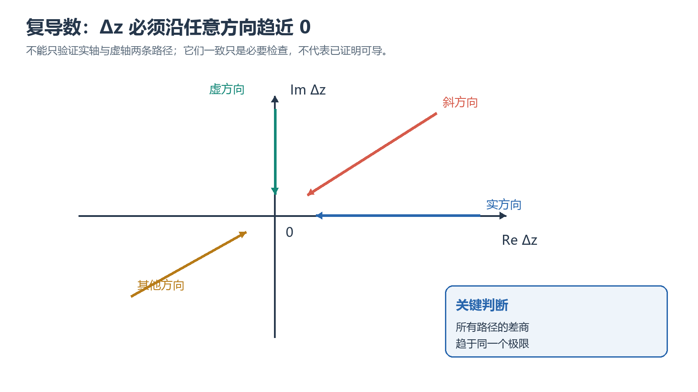

# 第二章 解析函数

## 本章要学什么

本章围绕“怎样证明一个复函数可导或解析，并利用这种强约束构造函数”展开。从差商的全方向要求，到柯西—黎曼条件，再到调和共轭与多值分支，读者应能把定义、计算和区域条件联在一起。学习目标是区分一点可导与邻域解析，完整执行CR判定，解释指数和三角函数的复值性质，选择对数与幂的解析分支，构造满足初值的解析函数，并检查局部共轭能否成为全局单值函数。

## 本章学习地图

| 学习阶段 | 要回答的问题 | 可见成果 |
| --- | --- | --- |
| 复导数 | 差商为何必须方向无关？ | 给路径反例与可导点 |
| CR条件 | 哪些附加条件使方程充分？ | 写联立方程、导数与解析域 |
| 初等函数 | 多值和主值如何区别？ | 计算全部值、固定分支 |
| 调和共轭 | 哪些实函数能组成解析函数？ | 求共轭并验证初值与全局性 |

前置为第一章的复数运算、二元极限、区域和连续性。来源为教材第2章2.1—2.5，主要理论见拆分PDF第1—5页，典型例题见第6—24页。当前笔记保留原有有效定义、推导及复导数示意图，补足题源和计算过程，修复旧稿断裂公式与重复占位题。课程的高阶导数与展开定理将在第三、四章证明，此处不把未说明的后续定理当作判定前提。

## 一、复导数与解析性

### 本章路线

先用差商定义复导数，再比较单点可导和邻域解析，最后用反例检查区别。本章要解决的问题是方向无关如何改变可导条件；本章学完应会给出可导点、导数与解析区域。

### 学习单元

#### 复导数

设函数 $w=f(z)$ 定义在区域 $D$ 上，$z_0\in D$。若极限

$$
\lim_{\Delta z\to 0}\frac{f(z_0+\Delta z)-f(z_0)}{\Delta z}
$$

存在，则称 $f$ 在 $z_0$ 处**复可导**，导数记为

$$
f'(z_0)=\lim_{\Delta z\to 0}\frac{f(z_0+\Delta z)-f(z_0)}{\Delta z}.
$$

关键点：$\Delta z\to 0$ 可以沿复平面中的任意路径。因此，复可导比一元实函数可导严格得多。

<!-- study-note-illustration:2026-10-04:complex-derivative-paths -->

**读图提示：**各色箭头代表增量沿不同方向趋近于零；复导数要求差商在所有路径上趋于同一个极限。只检验实轴和虚轴两条路径相同，仍不足以证明复可导。

来源：依据本篇笔记相邻段落自绘的教学示意；不是教材原图或实测记录。

<!-- /study-note-illustration -->

#### 可导、解析与整函数

- **在一点可导**：差商在该点的极限存在。
- **在一点解析**：函数在该点的某个邻域内处处可导。
- **在区域 $D$ 内解析**：函数在 $D$ 的每一点都可导。
- **整函数**：函数在整个复平面 $\mathbb C$ 上解析。

注意：在一点可导不等于在该点解析，因为解析要求一个邻域内都可导。

#### 典型反例

##### 例 1：$f(z)=\overline z$ 处处不可导

令 $\Delta z=\Delta x+i\Delta y$，则

$$
\frac{f(z_0+\Delta z)-f(z_0)}{\Delta z}
=\frac{\overline{\Delta z}}{\Delta z}
=\frac{\Delta x-i\Delta y}{\Delta x+i\Delta y}.
$$

- 沿 $\Delta y=0$ 趋近，极限为 $1$；
- 沿 $\Delta x=0$ 趋近，极限为 $-1$。

两条路径所得极限不同，所以 $f(z)=\overline z$ 在任何点都不可导。这也说明：实部和虚部具有连续偏导，并不能单独保证复可导。

##### 例 2：$f(z)=|z|^2$ 只在原点可导

利用 $|z|^2=z\overline z$，可得

$$
\frac{f(z_0+\Delta z)-f(z_0)}{\Delta z}
=\overline{z_0}+z_0\frac{\overline{\Delta z}}{\Delta z}+\overline{\Delta z}.
$$

- 当 $z_0=0$ 时，极限为 $0$，所以 $f'(0)=0$；
- 当 $z_0\ne 0$ 时，极限依赖趋近方向，所以不可导。

因此，该函数只在 $0$ 点可导，却在 $\mathbb C$ 上处处不解析。

#### 导数运算法则

若相关导数存在，则

$$
(f\pm g)'=f'\pm g',
$$

$$
(fg)'=f'g+fg',
$$

$$
\left(\frac{f}{g}\right)'=\frac{f'g-fg'}{g^2},\qquad g\ne 0,
$$

$$
[f(g(z))]'=f'(g(z))g'(z).
$$

若 $z=\varphi(w)$ 与 $w=f(z)$ 在相应邻域内互为反函数，且 $\varphi'(w)\ne 0$，则

$$
f'(z)=\frac{1}{\varphi'(w)},\qquad w=f(z).
$$

由此可知：多项式是整函数；有理函数 $P(z)/Q(z)$ 在 $Q(z)\ne 0$ 的区域内解析。

#### 奇点

若 $f$ 在 $z_0$ 不解析，但 $z_0$ 的每个邻域内都有 $f$ 的解析点，则称 $z_0$ 为 $f$ 的**奇点**。

易错点：$z_0$ 是奇点，只表示 $f$ 在 $z_0$ 不解析，并不能直接推出 $f$ 在 $z_0$ 不可导。

“在一点可导”“在一点解析”“在区域解析”有不同量词。前者只看一个差商极限；第二者要求存在邻域，在邻域每一点可导；第三者要求整个区域每一点可导。因此 $|z|^2$ 只在0可导、无处解析。求可导点集合后，必须再找它是否含有某个点的开放邻域，不能把非空可导集合直接当作解析域。

> 题源：教材第2章例2.1“虚部函数与模平方的可导性”改编。

##### 小练习：知识应用

**题目：** 判断 $f(z)=\operatorname{Im}z$ 和 $g(z)=|z|^4$ 的可导点与解析域。

**解析：** 前者沿实增量差商0，沿纯虚增量 $h=it$ 差商为 $t/(it)=-i$，故处处不可导。

对后者设 $z_0=x_0+iy_0$、$r_0=|z_0|$。沿实增量 $h=t$ 展开 $[(x_0+t)^2+y_0^2]^2$，差商趋 $4x_0r_0^2$；沿纯虚增量 $h=it$，差商趋 $-4iy_0r_0^2$。一个是实数，一个是纯虚数，两者相等只能同时为0，因而必须 $z_0=0$。原点差商的模为 $|h|^3\to0$，所以导数0。可导集合只有原点，不含开放邻域，故无解析点。

对商与复合函数使用导数法则，要先确保所处邻域内定义合法。例如 $(z^2-1)/(z-1)$ 原式在1无定义；当 $z\ne1$ 时约成 $z+1$，故可在1补值2，得到整函数。应区分原函数与补值后的函数，不能因为代数约分就把原先未定义的点自动算入定义域。

### 本章小结

复导数是一个复线性近似，方向无关比普通二元可微更强。单点可导不含邻域保证，解析性需要逐点覆盖开区域。反例、差商与CR各有用途，判断题应同时交代可导点、导数和解析区域。

### 本章练习与检验

> 题源：教材第2章例2.1、例2.3的可导解析比较方法改编。

设 $f(z)=x^2-y^2+2ixy+|z|^2$。求全部可导点及导数，说明它是否在任何点解析。

**参考解析：** 前半为 $z^2$ 整，后半只在0可导。由相减法则，如果总函数在非零点可导，那么减去 $z^2$ 后 $|z|^2$ 也应可导，矛盾。因此仅0可导，导数0，无处解析。这个方法比重新展开所有偏导更快，并明确使用导数运算法则的逻辑方向。

## 二、柯西—黎曼条件与判定

### 本章路线

先由两个方向推出必要条件，再加入实可微得到充要条件，最后以直角和极坐标处理参数题。本章要解决的问题是为什么只解CR不够；本章学完应会联立方程并说明充分性。

设

$$
f(z)=u(x,y)+iv(x,y),\qquad z=x+iy.
$$

### 学习单元

#### 直角坐标形式

这里 $u,v$ 分别是函数的实部和虚部，都是关于实变量 $x,y$ 的实值函数。下标 $u_x$ 表示固定 $y$ 后对 $x$ 求偏导，$u_y,v_x,v_y$ 同理。

**实可微**表示增量可以分成一个关于 $\Delta x,\Delta y$ 的线性部分和一个相对距离更小的余项。

例如 $u(x,y)=x^2+y^2$ 的增量为 $2x\Delta x+2y\Delta y+(\Delta x)^2+(\Delta y)^2$；最后两项除以距离 $\sqrt{(\Delta x)^2+(\Delta y)^2}$ 后趋0，记作 $o(|h|)$，其中 $h=\Delta x+i\Delta y$。

偏导只检查两轴方向，实可微要求这个余项估计对全部方向统一成立。

函数 $f$ 在点 $z=x+iy$ 可导，当且仅当 $u,v$ 在点 $(x,y)$ 可微，且满足 Cauchy-Riemann 方程：

$$
\frac{\partial u}{\partial x}=\frac{\partial v}{\partial y},
\qquad
\frac{\partial u}{\partial y}=-\frac{\partial v}{\partial x}.
$$

此时导数可以写成

$$
f'(z)=\frac{\partial u}{\partial x}+i\frac{\partial v}{\partial x}
=\frac{\partial v}{\partial y}-i\frac{\partial u}{\partial y}.
$$

实用判定法：若 $u,v$ 的一阶偏导在某邻域内连续，并且满足 C-R 方程，则 $f$ 在该邻域内解析。

#### 从复导数到实微分的一步

复导数要求差商对所有复增量趋于同一个数，而实可微只要求线性近似具有两个实方向系数。设 $h=\Delta x+i\Delta y$，实微分展开为

$$
f(z+h)-f(z)=(u_x+iv_x)\Delta x+(u_y+iv_y)\Delta y+o(|h|).
$$

如果满足 $u_y=-v_x$、$v_y=u_x$，第二个系数恰等于 $i(u_x+iv_x)$，所以

$$
f(z+h)-f(z)=(u_x+iv_x)(\Delta x+i\Delta y)+o(|h|),
$$

除以 $h$ 后余项模趋0，差商趋 $u_x+iv_x$。这个证明不仅得到导数，还说明为何两条方向相同仅能提供必要条件：如果缺少统一的 $o(|h|)$ 余项，就不能覆盖弯曲路径。实可微的充分常用条件是附近一阶偏导连续，但连续偏导不是复可导定义的一部分。

#### 为什么只满足 C-R 方程还不够

函数

$$
f(z)=\sqrt{|xy|},\qquad z=x+iy
$$

在原点的四个一阶偏导都为 $0$，所以形式上满足 C-R 方程。但沿 $y=kx$、$x\to 0^+$，有

$$
\frac{f(z)-f(0)}{z}=\frac{\sqrt{k}}{1+ik},
$$

这里取 $k>0$，其值随 $k$ 改变，因此 $f$ 在原点不可导。

结论：**C-R 方程加上实部、虚部可微**才构成充要条件；只有点上的偏导和 C-R 等式并不充分。

#### 极坐标形式

若 $z=re^{i\theta}$、$r>0$，则 C-R 方程为

$$
\frac{\partial u}{\partial r}=\frac{1}{r}\frac{\partial v}{\partial \theta},
\qquad
\frac{\partial v}{\partial r}=-\frac{1}{r}\frac{\partial u}{\partial \theta}.
$$

#### 常见应用

这里 $\nabla u=(u_x,u_y)$ 是梯度，指向 $u$ 增长最快的方向；$u=C_1$ 是实部取固定常数的等值线。偏导连续且梯度非零时，梯度垂直于等值线。把 $u$ 理解为势函数、把 $v$ 理解为对应流函数时，才分别称这两族曲线为等势线和流线。以下先用梯度验证它们为何正交。

##### 判断含参数函数的解析性

对

$$
f(z)=x^2+axy+by^2+i(cx^2+dxy+y^2),
$$

先计算 $u_x=2x+ay$、$u_y=ax+2by$、$v_x=2cx+dy$、$v_y=dx+2y$。区域解析要求CR作为恒等式成立：$2x+ay=dx+2y$ 给 $d=2,a=2$；$ax+2by=-2cx-dy$ 给 $a=-2c,2b=-d$。联立得到

$$
a=2,\qquad b=-1,\qquad c=-1,\qquad d=2.
$$

##### 等势线与流线正交

若 $f=u+iv$ 解析且 $f'(z)\ne 0$，则曲线族 $u(x,y)=C_1$ 与 $v(x,y)=C_2$ 相互正交。因为

$$
\nabla u\cdot\nabla v
=u_xv_x+u_yv_y
=u_x(-u_y)+u_yu_x=0.
$$

##### 导数恒为零

若区域 $D$ 上处处有 $f'(z)=0$，则由 C-R 方程可得

$$
u_x=u_y=v_x=v_y=0,
$$

故 $f$ 在连通区域 $D$ 上为常数。

##### 模恒定的解析函数

若 $f$ 在区域 $D$ 内解析，且 $|f(z)|$ 恒为常数，则 $f$ 为常数。

- 若 $|f|=0$，结论显然；
- 若 $|f|=C>0$，则 $f$ 无零点，且 $\overline f=C^2/f$ 解析；
- $f=u+iv$ 与 $\overline f=u-iv$ 同时解析，C-R 方程推出 $u,v$ 均为常数。

#### 逐点方程与区域恒等式

判定参数时要区分在一个点成立和在整个开放区域成立。如果 $u,v$ 是多项式且要在区域内解析，CR应作为关于 $x,y$ 的恒等式逐项比较，不能只代一个测试点。若只问某点可导，则解两个方程得到点集，之后再核对实可微的条件。

> 题源：教材第2章例2.3“何处可导、何处解析”改编。

##### 小练习：知识应用

**题目：** 对 $f(z)=2xy^2+ix^2y$，求可导点、导数和解析域。

**解析：** $u_x=2y^2$、$u_y=4xy$、$v_x=2xy$、$v_y=x^2$，CR为

$$
x^2=2y^2,\qquad 6xy=0.
$$

两式共同强制 $x=y=0$，一阶偏导处处连续，所以原点可导且导数0，其他点不可导。没有开放可导邻域，因此无处解析。若只解第一式，会误把两条直线当可导点集；所有CR方程必须联立。

教材的极坐标形式可以通过链式法则推导。写 $x=r\cos\theta$、$y=r\sin\theta$，$r>0$，则

$$
u_r=u_x\cos\theta+u_y\sin\theta,\qquad
u_\theta=-ru_x\sin\theta+ru_y\cos\theta,
$$

$$
v_r=v_x\cos\theta+v_y\sin\theta,\qquad
v_\theta=-rv_x\sin\theta+rv_y\cos\theta.
$$

代入直角CR得 $u_r=v_\theta/r$、$v_r=-u_\theta/r$。导数也可表示为

$$
f'(z)=e^{-i\theta}(u_r+iv_r).
$$

$r=0$ 时极坐标退化，不能用含 $1/r$ 的式子判原点；回到差商或直角坐标。

> 题源：教材第2章例2.11、例2.12的极坐标CR应用改编。

##### 小练习：知识应用

**题目：** 对 $f(z)=r^\alpha e^{im\theta}$，$r>0$，$\alpha,m$ 为实常数，判断在角度已选定的扇形上解析的条件。

**解析：** $u=r^\alpha\cos m\theta$、$v=r^\alpha\sin m\theta$，有

$$
u_r=\alpha r^{\alpha-1}\cos m\theta,\quad
v_\theta/r=mr^{\alpha-1}\cos m\theta,
$$

$$
v_r=\alpha r^{\alpha-1}\sin m\theta,\quad
-u_\theta/r=mr^{\alpha-1}\sin m\theta.
$$

区域内恒满足需 $\alpha=m$，此时函数是选支的 $z^m$。当 $m$ 非整数时，扇形上的连续角度是单值定义的必要组成，不能直接扩成整个去心平面。$m=0,\alpha=0$ 给常数1。

一个解析函数若实部恒为常数，则 $u_x=u_y=0$，CR使 $v_x=v_y=0$，区域连通便得函数常数。同理虚部恒定也迫使常数。若模恒定，需由 $u^2+v^2=C^2$ 再结合CR推出导数零，不能仅从实变量圆周约束推出。这个结论解释解析函数的像不可能在非退化曲线里移动；第六章将更系统地说明局部映射。

#### 以一个反例分开偏导、实可微与复可导

考虑 $f(0)=0$，非零点令 $f(z)=x^3/(x^2+y^2)+i\,y^3/(x^2+y^2)$。在原点沿轴求偏导，有 $u_x=1,u_y=0,v_x=0,v_y=1$，所以满足原点CR。沿实轴差商1，沿虚轴差商也1；如果只做这两个方向，会误认为导数为1。但是沿 $y=x\ne0$，

$$
f(x+ix)=\frac{x}2+i\frac{x}2=\frac{x+ix}2,
\qquad \frac{f(z)-f(0)}z=\frac12.
$$

因此原点不可复导。与此同时它连续，因为

$$
|f(z)|^2=\frac{x^6+y^6}{(x^2+y^2)^2}\le x^2+y^2=|z|^2.
$$

这个例子进一步说明两个轴上差商相同也只是必要检查。若实可微，其线性部分由偏导给出 $x+iy=z$，应有 $f(z)-z=o(|z|)$。但沿对角线，差为 $-z/2$，模除 $|z|$ 恒为 $1/2$，所以不实可微。这正是CR充要判据中被漏掉的条件。

> 题源：教材第2章例2.2与2.1.2“偏导和可导的充分性”反例方法改编，具体函数为方法变式。

##### 小练习：知识应用

**题目：** 对 $g(z)=z^2\overline z$，证明0处可导而其他点不可导，并说明是否解析。

**解析：** 原点差商 $z\bar z=|z|^2\to0$，所以 $g'(0)=0$。非零点先用 $z^2\bar z=z|z|^2$ 写成 $u=x(x^2+y^2)$、$v=y(x^2+y^2)$。计算得

$$
u_x=3x^2+y^2,\quad u_y=2xy,\quad
v_x=2xy,\quad v_y=x^2+3y^2.
$$

CR条件为 $x^2=y^2$ 与 $xy=0$，联立只得原点。偏导连续，充分性也成立，故可导点恰为0；该集合没有开放邻域，所以无解析点。

#### 在连通区域中导数为零为何推出常数

局部由CR得实部和虚部的一阶偏导均为零。对区域中任意两点，取完全位于区域中的有限折线路径，每段上应用实变量链式法则，沿段的 $u,v$ 导数为零，所以端点值相等。各段首尾连接，函数在整个区域同值。这里连通性用于把局部常数连成一个常数；若定义域是两个不相交圆盘，在每个盘分别取不同常数，导数依旧处处零，却不在整个集合为同一个值。

> 题源：教材第2章解析函数导数为零结论的证明扩展。

##### 小练习：知识应用

**题目：** 分别在 $|z-2|<1$ 取1、$|z+2|<1$ 取 $i$，说明该函数是否解析、是否全域常数。

**解析：** 每个点都有包含在一个圆盘内的小邻域，函数在那里常数，因此解析且导数零；整体定义域不连通，所以不是全域同一个常数。结论的区域条件确实承担作用。

### 本章小结

CR的两个等式必须联立，并与实可微共同使用。多项式参数要按区域恒等式比较系数，极坐标仅在 $r>0$ 使用。常实部、常虚部或常模的解析函数被强结构限制为常数。

### 本章练习与检验

> 题源：教材第2章例2.4、例2.10的参数与约束判断改编。

设 $f(z)=x^2+axy+by^2+i(cx^2+dxy+y^2)$，推导解析所需参数，并写成 $z$ 的形式。

**参考解析：** 第一CR给 $2x+ay=dx+2y$，故 $d=2,a=2$；第二给 $ax+2by=-2cx-dy$，故 $c=-1,b=-1$。此时 $f=(1-i)z^2$，因为实部 $x^2-y^2+2xy$、虚部 $2xy-x^2+y^2$。导数 $2(1-i)z$，全平面解析。

## 三、复初等函数与分支

### 本章路线

先从指数定义建立周期性，再解出对数和复幂，最后讨论三角与反三角的分支。本章要解决的问题是主值和解析分支为何不同；本章学完应会给全部值并写合法定义域。

### 学习单元

#### 指数函数

定义

$$
e^z=e^{x+iy}=e^x(\cos y+i\sin y).
$$

主要性质：

$$
|e^z|=e^x,
$$

$$
\operatorname{Arg}(e^z)=y+2k\pi,\qquad k\in\mathbb Z,
$$

$$
e^{z_1+z_2}=e^{z_1}e^{z_2},
$$

$$
e^{z+2\pi i}=e^z,
$$

$$
(e^z)'=e^z.
$$

因此 $e^z$ 是以 $2\pi i$ 为周期的整函数，并且永远不等于 $0$。

#### 对数函数

由 $e^w=z$ 解出

$$
w=\ln|z|+i\operatorname{Arg}z.
$$

##### 多值对数

$$
\operatorname{Ln}z=\ln|z|+i(\arg z+2k\pi),\qquad k\in\mathbb Z.
$$

##### 对数主值

取

$$
\arg z\in(-\pi,\pi],
$$

定义

$$
\ln z=\ln|z|+i\arg z.
$$

对数主值在割平面 $\mathbb C\setminus(-\infty,0]$ 上解析，并满足

$$
\frac{d}{dz}\ln z=\frac{1}{z}.
$$

在任何不经过原点的单连通区域内，只要连续选取辐角，就能得到一个解析的对数分支。

##### 多值运算的注意事项

作为值集合，有

$$
\operatorname{Ln}(z_1z_2)=\operatorname{Ln}z_1+\operatorname{Ln}z_2.
$$

但主值一般不满足

$$
\ln(z_1z_2)=\ln z_1+\ln z_2,
$$

两边可能相差 $2k\pi i$。同样，不能把多值等式直接当作普通单值等式使用。

常见值：

$$
\operatorname{Ln}i=i\left(\frac{\pi}{2}+2k\pi\right),
$$

$$
\operatorname{Ln}1=2k\pi i,
$$

$$
\operatorname{Ln}(-1)=i(\pi+2k\pi).
$$

#### 幂函数

对 $a\ne 0$，定义复幂

$$
a^b=e^{b\operatorname{Ln}a}.
$$

- $b\in\mathbb Z$ 时，$a^b$ 为单值；
- $b=p/q$ 为既约有理数且 $q>0$ 时，$a^b$ 有 $q$ 个不同值；
- 对课件所讨论的非有理指数，通常产生无穷多个值。

固定 $\operatorname{Ln}a$ 的一个值后，关于 $z$ 的函数

$$
a^z=e^{z\operatorname{Ln}a}
$$

为整函数，且

$$
(a^z)'=a^z\operatorname{Ln}a.
$$

在选定的对数分支上，

$$
z^b=e^{b\operatorname{Ln}z},
\qquad
(z^b)'=bz^{b-1}.
$$

典型例子：

$$
i^i=e^{i\operatorname{Ln}i}=e^{-\pi/2-2k\pi},\qquad k\in\mathbb Z.
$$

因此 $i^i$ 虽然是实数，但有无穷多个正实值。

#### 三角函数与双曲函数

复三角函数定义为

$$
\cos z=\frac{e^{iz}+e^{-iz}}{2},
\qquad
\sin z=\frac{e^{iz}-e^{-iz}}{2i}.
$$

它们都是整函数，并满足

$$
(\cos z)'=-\sin z,
\qquad
(\sin z)'=\cos z,
$$

$$
e^{iz}=\cos z+i\sin z,
$$

$$
\sin^2z+\cos^2z=1.
$$

双曲函数定义为

$$
\cosh z=\frac{e^z+e^{-z}}{2},
\qquad
\sinh z=\frac{e^z-e^{-z}}{2},
$$

$$
\tanh z=\frac{e^z-e^{-z}}{e^z+e^{-z}}.
$$

其中 $\cosh z$ 为偶函数，$\sinh z$ 为奇函数，并且

$$
(\cosh z)'=\sinh z,
\qquad
(\sinh z)'=\cosh z.
$$

当 $z=x+iy$ 时，

$$
\cos(x+iy)=\cos x\cosh y-i\sin x\sinh y.
$$

这表明复三角函数一般无界。例如 $|\sin(iy)|$ 与 $|\cos(iy)|$ 在 $y\to+\infty$ 时趋于无穷。

两类函数的联系为

$$
\cos(iy)=\cosh y,
\qquad
\sin(iy)=i\sinh y,
$$

$$
\cosh(iy)=\cos y,
\qquad
\sinh(iy)=i\sin y.
$$

#### 反三角函数

反三角函数通常通过对数函数表示，因此也是多值函数。例如，由 $z=\tan w$ 可得

$$
\operatorname{Arctan}z
=\frac{1}{2i}\operatorname{Ln}\left(\frac{1+iz}{1-iz}\right).
$$

处理反三角函数时，需要同时关注对数的分支和分母为零的点。

#### 分支、主值与多值运算的界限

主辐角给每个非零数挑一个值，却可能跨负实轴跳变，因而“处处给了值”不代表处处连续或解析。对数主值在割线两侧极限相差 $2\pi i$，这就是要去掉负实轴的原因。另一条割线同样可以产生不同的解析分支，只要域里能够连续追踪角度。在连通域上任意两个对数分支相差固定 $2k\pi i$。

> 题源：教材第2章例2.19对数值及初等函数知识改编。

##### 小练习：知识应用

**题目：** 比较主值 $\log((-1)(-1))$ 与 $\log(-1)+\log(-1)$，再求全部 $\operatorname{Ln}i$。

**解析：** 采用 $-\pi<\arg\le\pi$ 的点值主值，第一为 $\log1=0$，后者为 $2\pi i$，说明主值乘法公式失败。这里 $-1$ 的主值点值存在，但它不位于主对数的解析割平面内。全部 $\operatorname{Ln}i=i(\pi/2+2k\pi)$，每个值经指数还原都得到 $i$。要区分代数点值、值集合和解析分支这三个对象。

复幂 $z^\alpha=\exp(\alpha\operatorname{Ln}z)$ 的各值相差倍率 $e^{2\pi i k\alpha}$。若 $\alpha$ 为整数，倍率全1；若为既约有理数 $p/q$，倍率有 $q$ 种；若为实无理数，则无限不同方向；若指数有非零虚部，不同 $k$ 还会改变模。对 $i^i$，对数中 $2\pi i k$ 乘 $i$ 变成实数 $-2\pi k$，所以各值全是正实数而且模不同。把实数幂的法则未经分支检查直接用于复幂，常导致错误。

> 题源：教材第2章例2.20复幂值改编。

##### 小练习：知识应用

**题目：** 求 $(-1)^{1/2}$ 的全部值和 $1^i$ 的全部值。

**解析：** 前者为 $e^{i(\pi+2k\pi)/2}=\pm i$。后者 $\operatorname{Ln}1=2k\pi i$，所以 $1^i=e^{-2k\pi}$，有无穷个正值。若事先固定主对数，$\exp(i\log1)=1$ 只是主分支值，不代表全部多值结果。

复三角函数没有实轴上的幅度界。由指数定义推得

$$
\sin(x+iy)=\sin x\cosh y+i\cos x\sinh y,
$$

$$
\cos(x+iy)=\cos x\cosh y-i\sin x\sinh y.
$$

所以 $\sin iy=i\sinh y$ 可无界增长，$\cos iy=\cosh y\ge1$。这并不违反 $\sin^2z+\cos^2z=1$，因为这是复数平方和而非模平方和。例如 $z=iy$ 时 $-\sinh^2y+\cosh^2y=1$。若将复值平方换成模平方，则是另一个表达。

反三角函数来自解指数方程。例如 $\sin w=z$，令 $q=e^{iw}$，得到 $q^2-2izq-1=0$，于是 $q=iz\pm\sqrt{1-z^2}$，再取多值对数得

$$
w=-i\operatorname{Ln}\left(iz\pm\sqrt{1-z^2}\right).
$$

平方根与对数的支需联动，不能对每个符号随意选择后宣称形成同一解析反函数。关于局部反函数，只在原函数导数非零的点附近选支并使用反函数求导法；$\sin w$ 的临界值 $z=\pm1$ 是分支结构的关键位置。

### 本章小结

指数整且周期，对数和非整数幂通常多值。主值是选值约定，解析分支还需要连续角度与割域。三角恒等式可以延拓到复数，但实轴有界性不能延拓。反三角函数的根式和对数分支要与局部反函数对应。

### 本章练习与检验

> 题源：教材第2章例2.17—例2.24的初等函数计算方法综合改编。

计算 $\cos(\pi+2i)$，列出方程 $e^z=-2$ 的全部解，并解释为何后者不是一个单解方程。

**参考解析：** $\cos(\pi+2i)=-\cosh2$。指数方程给 $z=\log2+i(\pi+2k\pi)$。实部由模2决定、虚部由全部辐角决定；指数周期 $2\pi i$ 造成无穷解。

## 四、调和函数与场模型

### 本章路线

先验证拉普拉斯方程，再由CR构造共轭，最后检查全局单值和场的符号约定。本章要解决的问题是调和性怎样连接解析性；本章学完应会求共轭并核验初值。

### 学习单元

#### Laplace 方程与调和函数

若 $f=u+iv$ 解析，且相关二阶偏导连续，则由 C-R 方程可得

$$
\frac{\partial^2u}{\partial x^2}
+\frac{\partial^2u}{\partial y^2}=0,
$$

$$
\frac{\partial^2v}{\partial x^2}
+\frac{\partial^2v}{\partial y^2}=0.
$$

记 Laplace 算子为

$$
\Delta=\frac{\partial^2}{\partial x^2}
+\frac{\partial^2}{\partial y^2}.
$$

若实函数 $u$ 在区域 $D$ 内具有二阶连续偏导，且满足

$$
\Delta u=0,
$$

则称 $u$ 是 $D$ 内的**调和函数**。

解析函数的实部和虚部一定调和，但一个函数调和并不自动保证它在任意区域内都有全局共轭调和函数；区域的拓扑结构也很重要。

#### 共轭调和函数

若 $u$ 在区域 $D$ 内调和，并且 $u+iv$ 解析，则称 $v$ 为 $u$ 的**共轭调和函数**。

由 C-R 方程，$v$ 应满足

$$
v_x=-u_y,
\qquad
v_y=u_x.
$$

若 $v$ 是 $u$ 的共轭调和函数，则 $-u$ 是 $v$ 的共轭调和函数，因为

$$
-i(u+iv)=v-iu
$$

仍然解析。

在单连通区域内，给定调和函数 $u$，其共轭调和函数 $v$ 存在，并且只相差一个实常数。因此对应的解析函数 $f=u+iv$ 只相差一个纯虚常数。

#### 构造共轭调和函数

##### 方法一：偏积分法

1. 由 $v_x=-u_y$ 对 $x$ 积分：

   $$
   v(x,y)=\int -u_y(x,y)\,dx+\phi(y).
   $$
2. 对上式求 $v_y$，再与 $v_y=u_x$ 比较，求出 $\phi'(y)$。
3. 积分得到 $\phi(y)$，保留任意实常数。

也可以先从 $v_y=u_x$ 出发，对 $y$ 积分。

##### 方法二：线积分法

由

$$
dv=-u_y\,dx+u_x\,dy
$$

得到

$$
v(x,y)=\int_{(x_0,y_0)}^{(x,y)}(-u_y\,dx+u_x\,dy)+C.
$$

在单连通区域内，由于 $u$ 调和，该积分与路径无关。实际计算时通常选取先水平、后竖直的折线路径。

#### 典型例题

##### 例 1：由辐角构造解析函数

在右半平面 $x>0$ 上，给定

$$
u(x,y)=\arctan\frac{y}{x}.
$$

在 $x>0$ 上，$u_x=-y/(x^2+y^2)$、$u_y=x/(x^2+y^2)$；再求二阶偏导相加为0。CR要求 $v_x=-x/(x^2+y^2)$、$v_y=-y/(x^2+y^2)$。第一式对 $x$ 积分，得 $v=-\tfrac12\log(x^2+y^2)+\phi(y)$；第二式给 $\phi'(y)=0$，所以

$$
v(x,y)=-\frac{1}{2}\ln(x^2+y^2)+C.
$$

因此

$$
f(z)=u+iv
=\arg z-i\ln|z|+iC
=-i\ln z+iC,
$$

其中 $\ln z$ 表示右半平面上选定的解析对数分支。

##### 例 2：构造满足初值的解析函数

给定

$$
u(x,y)=e^x\cos y+x+y,
$$

求满足 $f(0)=1$ 的解析函数 $f=u+iv$。

先求 $u_x=e^x\cos y+1$、$u_y=-e^x\sin y+1$。由 $v_y=u_x$ 积分得 $v=e^x\sin y+y+\phi(x)$，再由 $v_x=-u_y$ 得 $\phi'(x)=-1$，因此

$$
v(x,y)=e^x\sin y-x+y+C.
$$

再由 $f(0)=1$ 得 $C=0$，于是

$$
f(z)=e^z+(1-i)z.
$$

#### 单连通条件为何重要

函数 $\ln(x^2+y^2)$ 在 $\mathbb C\setminus\{0\}$ 上调和，但在整个穿孔平面上没有单值的全局共轭调和函数。原因是绕原点一周后，辐角会增加 $2\pi$，无法全局连续选取。

若把区域限制在不包围原点的单连通子区域内，例如右半平面，就可以选取连续辐角，从而构造共轭调和函数。

#### 局部共轭与全局障碍

从CR求共轭函数时，不定积分的“常数”可以依赖未积分的变量。比如由 $v_y=u_x$ 对 $y$ 积分，必须写 $v=\int u_xdy+\phi(x)$，再用另一个CR确定 $\phi'$。直接把它当实常数，可能漏掉函数项。最后的自由常数是实数，因为 $v$ 为实函数；对应解析函数增加纯虚常数，而不是随意增加任意复常数后仍保持给定实部。

> 题源：教材第2章例2.14“由三次调和多项式求解析函数”改编。

##### 小练习：知识应用

**题目：** 已知 $u=x^3-3xy^2$，求满足 $f(0)=2i$ 的解析函数 $f=u+iv$。

**解析：** $u_x=3x^2-3y^2$、$u_y=-6xy$，拉普拉斯和为 $6x-6x=0$。由 $v_y=u_x$，

$$
v=3x^2y-y^3+\phi(x),\quad
v_x=6xy+\phi'(x)=-u_y=6xy,
$$

所以 $\phi'=0$，$v=3x^2y-y^3+C$。条件 $f(0)=2i$ 给 $C=2$，最终 $f=z^3+2i$。如果给 $f(0)=1+2i$，则与已知 $u(0)=0$ 矛盾，无解。初始条件不能自由改动已经指定的实部。

并非任意二元函数都能作为解析函数实部。给 $u=x^2+y^2$，$u_{xx}+u_{yy}=4\ne0$，故不可能在开放区域中成为解析函数实部。若在一条线或一个点上恰巧满足部分条件，也不能推出区域解。先检验调和性再积分，可以避免最后得到不相容的 $\phi'$。

在单连通区域，调和性保证微分形式 $-u_y dx+u_xdy$ 的闭性，进一步保证路径无关。去心平面则可能有非零环绕积分。取 $u=\log|z|=\tfrac12\log(x^2+y^2)$，

$$
u_x=\frac{x}{x^2+y^2},\qquad
u_y=\frac{y}{x^2+y^2},\qquad
 dv=-\frac{y}{x^2+y^2}dx+\frac{x}{x^2+y^2}dy.
$$

沿单位圆 $x=\cos t$、$y=\sin t$，$dv=dt$，一圈积分 $2\pi$。若有全局单值 $v$，全微分的闭路积分应为0，矛盾。所以每个小邻域都能找到共轭，但整个去心平面没有全局单值共轭。割去一条射线后可选 $v=\arg z$，对应解析对数。

调和函数的等值线正交结论需要在正规点使用。$u=\operatorname{Re}z^2$、$v=\operatorname{Im}z^2$ 在非零点梯度均非零，CR保证正交；在0，两个梯度都为0，等值线可能交叉，不能以一个未定义的切向量声明普通正交。物理复势模型中的停滞点、奇点也须单独讨论。

教材2.1.5与例2.25、例2.26提到平面场。设速度场两个分量为 $p(x,y),q(x,y)$。“无源”表示 $p_x+q_y=0$，即局部流入流出相抵；“无旋”表示 $q_x-p_y=0$，即局部没有旋转分量。

若该场有速度势 $\phi$，满足 $p=\phi_x$、$q=\phi_y$，势函数 $\phi$ 调和，可取共轭流函数 $\psi$，$W=\phi+i\psi$。有 $W'=p-iq$，所以复势导数中的虚部为速度第二分量的负值，不是 $p+iq$。等势线和流线在正规点正交。这里说明数学模型，并未补造任何实验数据。

例如 $W=z^2/2$，$\phi=(x^2-y^2)/2$、$\psi=xy$，速度 $p=x,q=-y$，$W'=z=x+iy=p-iq$。散度 $p_x+q_y=1-1=0$，旋度 $q_x-p_y=0$，与模型一致。若给定 $W$ 的导数，再解释速度方向时需沿用这一符号约定；不同教材可能定义不同复速度，不要只看名称。

### 本章小结

构造共轭先查调和性，再保留未积分变量的函数项，用另一个CR确定它。初值与给定实部必须相容。局部共轭存在不等于全局单值共轭，环绕积分能说明拓扑障碍。场的正交性与复速度符号仅在模型条件和正规点下使用。

### 本章练习与检验

> 题源：教材第2章例2.13—例2.16及2.1.5场模型综合改编。

设 $u=e^x\cos y+x+y$，求 $f=u+iv$ 且 $f(0)=1$。再求它的导数并检验实部。

**参考解析：** 共轭 $v=e^x\sin y-x+y+C$，条件给 $C=0$。$f=e^z+(1-i)z$，导数 $e^z+1-i$。$(1-i)(x+iy)$ 的实部 $x+y$、虚部 $y-x$，与构造相符；二阶偏导和为 $e^x\cos y-e^x\cos y=0$。

## 本章综合习题测验

> 题源：依据教材第2章2.1.1复导数、2.1.2柯西—黎曼条件、2.1.4初等函数及2.1.3调和函数自编综合题；具体函数为方法变式。

### 第1题：连续、一点可导与解析分别判断

**题目：** 对 $f(z)=z^2+|z|^2$，求全部可导点、导数和解析区域，并说明为什么连续不足以替代解析性判断。

**解析与答案：** $u=2x^2$、$v=2xy$，因此 $u_x=4x,u_y=0,v_x=2y,v_y=2x$。两条CR条件为 $4x=2x$、$0=-2y$，共同要求 $x=y=0$。偏导为多项式，连续，满足充分性，所以只在0可导且 $f'(0)=0$。

原点直接差商为 $z+|z|^2/z=z+\bar z\to0$，与CR结果相符。可导点集合只有一个点，没有任一点的开放邻域，故无解析点；函数却由连续运算构成，在全平面连续。这三个结论检验的量词不同。

### 第2题：把点上的方程变成区域恒等式

**题目：** 判断能否选择实参数 $a,b$，使 $f(z)=x^2+axy+i(bx^2+2xy-y^2)$ 在整个复平面解析。若只要求原点可导，参数是否仍被确定？

**解析与答案：** $u_x=2x+ay$、$u_y=ax$、$v_x=2bx+2y$、$v_y=2x-2y$。要求CR对所有 $x,y$ 成立，第一式给 $a=-2$；第二式 $ax=-2bx-2y$ 的左侧没有 $y$ 项，右侧系数却为 $-2$，不可能恒成立。因此不存在使其全平面解析的参数。

在原点四个偏导均为0，对任意实 $a,b$ 都满足CR，且偏导连续，所以原点总可导、导数0。不能用一个点的条件推断区域解析；这里第二条方程的不相容项正是全域判定的关键。即使第一条方程已确定 $a$，也不能省略另一条。

### 第3题：构造调和共轭并核验初值

**题目：** 给定实部 $u(x,y)=x^2-y^2+2x$，构造解析函数 $f=u+iv$，满足 $f(0)=i$。同时验证实部调和与所得函数的导数。

**解析与答案：** $u_{xx}=2,u_{yy}=-2$，和为0。CR给 $v_y=u_x=2x+2$、$v_x=-u_y=2y$。对 $y$ 积分得 $v=(2x+2)y+C(x)$，再代第二式得 $C'(x)=0$，所以 $C$ 是实常数。

故 $f=z^2+2z+iC$；初值要求 $C=1$。导数为 $2z+2$，也等于 $u_x+iv_x=(2x+2)+2iy$。两条CR、初值及调和方程相互核验；只积分一条CR而不确定 $C(x)$，不能完成共轭构造。

### 第4题：相乘时主辐角如何折回

**题目：** 采用主辐角 $-\pi<\arg z\le\pi$，令 $a=e^{3\pi i/4}$。比较 $\log(a^2)$ 与 $2\log a$，再求 $(-i)^i$ 的全部值及主值。负实轴上的点值主对数能否直接作为其邻域解析分支？

**解析与答案：** $a^2=-i$，主辐角是 $-\pi/2$，所以 $\log(a^2)=-\pi i/2$；而 $2\log a=3\pi i/2$，两者相差 $2\pi i$。$\operatorname{Ln}(-i)=i(-\pi/2+2k\pi)$，故 $(-i)^i=\exp(\pi/2-2k\pi)$，$k\in\mathbb Z$；主值为 $e^{\pi/2}$。

负实轴处主辐角上下两侧趋于 $\pi$ 和 $-\pi$，点值主对数不连续，不能在这样的邻域解析。可以另选不穿过该点的割线得到局部分支，但那是另一连续选角约定。全部多值、点值主值和区域内解析分支必须分开。

### 第5题：调和为什么还可能没有全局共轭

**题目：** 在去心平面 $D=\mathbb C\setminus\{0\}$ 上设 $u(x,y)=\log|z|$。验证它调和，写出局部共轭的微分，并判断能否在整个 $D$ 上配成单值解析函数。

**解析与答案：** $u_x=x/(x^2+y^2)$、$u_y=y/(x^2+y^2)$。二阶偏导相加为0，因为分子合为 $2(x^2+y^2)-2x^2-2y^2=0$。CR要求

$$
dv=-\frac{y}{x^2+y^2}\,dx+\frac{x}{x^2+y^2}\,dy.
$$

沿单位圆 $x=\cos t,y=\sin t$，$0\le t\le2\pi$，代入得 $dv=dt$，走一圈总增量为 $2\pi$。单值函数回到同一点必须具有同一值，故不存在全域单值共轭。局部可取连续辐角 $v=\theta+C$；切开一条射线后可形成对数解析分支。调和只保证局部可构造，区域条件决定全局是否成立。

## 阅读资料与衔接

主要依据项目教材第2章，辅助参照原笔记的课件术语。本文每道新练习注明教材例题方法或节次改编；未把PDF缺损公式当作可靠输入。保留示意图为原项目自绘教学图，并非教材原图。第三章把本章局部解析性与全局闭路积分连接，第六章使用非零导数与分支条件解释保形。

## 公式卡

- $f'(a)=\lim_{h\to0}[f(a+h)-f(a)]/h$：全部复增量方向统一；两轴相同不够。

- $u_x=v_y$，$u_y=-v_x$：与 $u,v$ 实可微合用才是点上复可导判据。

- $f'=u_x+iv_x$：先确认CR和实可微；解析还需开放邻域。

- $u_r=v_\theta/r$，$v_r=-u_\theta/r$：$r>0$；原点改用直角坐标或差商。

- $e^{x+iy}=e^x(\cos y+i\sin y)$：整函数、无零点、周期 $2\pi i$。

- $\operatorname{Ln}z=\log|z|+i(\arg z+2k\pi)$：$z\ne0$；主值不自动满足乘法等式。

- $z^b=\exp(bL(z))$，$(z^b)'=bz^{b-1}$：先固定解析对数分支 $L$，各幂沿用同一分支。

- $\Delta u=u_{xx}+u_{yy}=0$；$dv=-u_y dx+u_xdy$：二阶偏导连续；全局单值共轭需另检区域。
