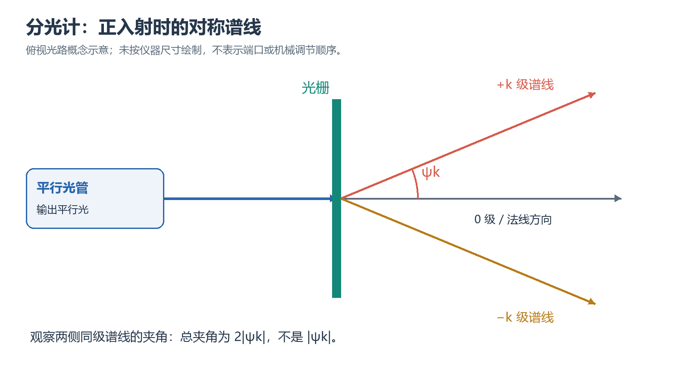

# 实验一｜分光计的调节及应用完成教程

> 适用资料：2026 年秋季《大学物理实验 B 指导书》实验一。先把分光计调到可重复读数的状态，再测光栅波长、角色散率和棱镜折射率。本文提供操作和记录方法；个人测量结果以自己的原始记录为准。

## 一、先确认要完成什么、交什么

| 类型 | 要做的事 | 做完留下什么 |
| --- | --- | --- |
| 必做 | 望远镜自准直、主轴垂直和平行光管同轴调节 | 双面镜翻转前后十字像均对准的检查记录 |
| 必做 | 测汞灯绿线、黄线 1、黄线 2 的正负一至三级谱线 | 每条谱线、每级次两侧各两个游标读数，波长和误差 |
| 必做 | 求双黄线各级角色散率 | 所用衍射角、计算式及带单位结果 |
| 必做 | 测三棱镜顶角和绿光最小偏向角，求折射率 | 反射像、直射光、折射转折点对应读数及计算 |
| 选做 | 白光衍射、双黄线折射率 | 实际观察或测量记录；未做就注明未做 |

最终把课程原始记录表、关键计算、光栅结果表、棱镜结果表、误差分析及指导书讨论题放入教师报告模板。照片若教师要求，应能看清所说明的对准或谱线现象；教学示意图不能代替个人测量证据。课程没有给定统一电子文件名时，按教师要求命名，不另造必须提交的附件。

## 二、开始前：找到旋钮、仪器和记录表

准备分光计、汞灯、绿色自准直照明、双面反射镜、300 条/mm 透射光栅及三棱镜。先在记录表写明仪器编号、光栅刻线密度、角度分度值和日期。光栅、棱镜只拿边缘，不摸光学面；光源启停遵从实验室规程，不直视强光。

对照指导书附录 1.1 认部件：9 为望远镜调焦手轮，12 为望远镜俯仰调节，7 为载物台三颗调平螺钉；2 为平行光管调焦，27 为平行光管高低调节，28 为狭缝宽度调节。上述数字只适用于该图所示型号。实物编号不同时，按部件名称定位，先请教师确认，再转动对应旋钮。

粗转望远镜或载物台前松开相应制动，锁紧后再用微调；不硬拧锁定机构。把原始读数写在现场表上，另建计算区，避免把换算后的角度覆盖原数。

### 先分清测角、调焦和俯仰

本实验真正直接测到的是方向。汞灯发出的光经过狭缝与平行光管，照到光栅后形成不同方向的谱线；望远镜负责把方向变成叉丝上的像，刻度盘和两个游标把方向差变成角度。只有这条链的前半段已校准，后半段的角度才可代入正入射光栅公式。棱镜测量仍使用同一套望远镜，却要重新识别顶角转角和折射偏向角，不能把“都读了两个游标”理解成所有角度的几何意义相同。

现场先在记录纸画出三个相互垂直或平行的目标：仪器主轴为旋转轴，望远镜光轴和平行光管光轴应在与主轴垂直的同一平面；光栅刻线应平行主轴，光栅法线应与入射光重合。载物台看上去水平只是粗调线索，真正的验收来自反射像和左右谱线的光学判据。把台面边缘与桌面比齐，不能替代双面镜翻转检查。

调节前还应分清“整个望远镜转动”“望远镜俯仰”“物镜调焦”三个动作。第一个改变方位读数，第二个改变光轴是否在水平测角平面内，第三个改变成像共轭位置。若谱线发虚，应查焦距；若同色谱线左右高度不同，应查光栅刻线；若像清晰却未压到竖线上，才是方位微调的问题。这种按现象选择自由度的习惯，可避免一个问题刚解决又破坏另一个已调好的条件。

粗转和微调也不是两套可随意叠加的控制。松开制动做大范围搜寻后，先使目标进入视场，再适度制动，用微调完成最后重合。微调走到行程尽头时先回到中间位置，再重新粗定位，不能靠加大手力延长行程。每次转动前说清“现在允许动什么、要保持什么”，能直接减少丢像和角度基准漂移。

## 三、按顺序调好分光计

### 1. 先看清叉丝，再让望远镜聚焦无穷远

先调目镜，使分划板十字叉丝清楚。打开自准直照明，在载物台按指导书位置放双面镜，使一面朝向望远镜；用望远镜调焦手轮寻找反射回来的绿十字像。调到绿十字与叉丝同时清楚，轻移眼睛时二者无相对移动，之后保持该调焦状态。

**为什么先做这一步：**叉丝清楚与被观察物清楚是两次不同调节；存在视差时，同一谱线会随眼睛位置出现不同瞄准结果。只把像调亮，不能证明已消除视差。

**完成标志与记录：**绿十字像边缘清晰、无视差；记下“自准直已检查”。找不到像时先查照明、镜面朝向和望远镜大致方向，不把所有螺钉同时转一遍。

**在本步理解自准直，而不是用远处物体代替它。**分划板上的照明十字经物镜出射，若分划板位于物镜焦平面，出射光便近似平行；平面镜把光反射回来，物镜又把它成像到原焦平面。此时返回十字与观察用叉丝共面，眼睛换位置不会改变二者的相对位置。镜子离物镜不远并不意味着望远镜对近物调焦；这套往返光路正是在建立“聚焦无穷远”的条件。

实际检查可分成三个小动作：先只看分划板，转目镜到线条最清楚；再固定目镜，转物镜调焦使返回十字边缘清楚；最后保持仪器不动，眼睛在出瞳允许的小范围内左右移动。如果两条线像浮在不同深度，移动眼睛时会相互滑动，还需细调物镜。反复挤眼或依靠眼睛自身调焦可能让两个像轮流清楚，却不能消除视差。应放松注视，比较边缘位置是否稳定。

返回像完全不见时，先让镜面在水平和俯仰上大致朝向望远镜，确认照明十字真的亮着，再缓慢扫过可能方向；若一个镜面能看到而翻面后看不到，先回到粗调。看见像后再讨论它是否在上基准线附近。课程的上基准线来自这台望远镜内部照明孔与反射成像的几何布置，不应把绿十字硬调到下方发光孔的位置。调焦完成后，后续谱线调节主要通过平行光管完成，不再随手改动这一步建立的焦距。

### 2. 翻转双面镜，用各半法校正俯仰

按指导书图 1-15 至图 1-20 的镜面摆放和 A、B 螺钉关系操作。先确认两面反射像都能进入视场，再对第一面用下述各半法把绿十字像水平线调到上基准线；载物台转 180° 后观察另一面。若另一面不重合，把偏差的一半用望远镜俯仰螺钉消除，另一半用此时靠近望远镜的载物台调平螺钉消除，再翻回检查。反复逼近，直至两面都符合。

各半法把望远镜倾斜与载物台倾斜分别消掉。只让一个反射面重合，仍可能留下共同倾斜，不能宣布主轴垂直调节结束。图中的 A、B 随观察方向辨认，不按桌面的固定左右猜位置。

**完成标志：**双面镜交替转 180°，两面绿十字像都与上基准线对齐。此时保存调节检查记录；后续换光栅时不再随意动望远镜俯仰螺钉。

**各半指像的偏差各消一半，不是两个旋钮各拧半圈。**若反射十字高于上基准线四个目视间隔，先用望远镜俯仰让它只剩两个间隔，再用当前靠近望远镜的载物台螺钉使其归零。螺距、杠杆臂和成像倍率不同，两个旋钮相同圈数并不产生相同像移。靠近基准线时应减小单次动作，避免用反向大调抵消过调。

翻面能区分两类倾斜。为说明这一点，设望远镜相对理想测角平面的微小俯仰为 $t$，镜面法线随台面翻转而改变符号的倾斜分量为 $s$。在一种统一正负约定下，两面返回光与望远镜光轴的角差可写成

$$
\varepsilon_+=2(s-t),\qquad \varepsilon_-=2(-s-t).
$$

因反射使角度偏差加倍，式中出现因子 2；两式相加主要揭示望远镜俯仰，两式相减揭示镜面倾斜。具体视场中“上、下”的符号还受成像方向影响，操作时按实际像移判断，不能把这组符号当成固定的旋钮转向说明。只让一面为零，仅给出 $s=t$，两者可能一起偏离理想平面；两面都为零才同时约束 $s$ 和 $t$。这也是指导书要求翻转的物理原因。

做完一次各半调节，转游标盘使另一面返回。此时原来远离望远镜的螺钉可能成为靠近的一颗，所以 A、B 的含义由图中相对位置确定。保持第三颗螺钉不动有助于限制调节自由度；三颗同时转会改变整体高度，使本来可追踪的俯仰误差变成混合误差。回到第一面后允许存在更小的残差，继续按同样规则逐次逼近，不要求一轮结束。

记录应具体到“翻转前在上基准线、翻转后也在上基准线，轻微转回可重复”，而不是只写“已调平”。若两面总是一面高一面低且不收敛，先查双面镜是否按刻线摆正、是否翻到同一个反射位置、是否误动了不该动的调焦或其他螺钉。若翻转时镜座滑动，先恢复稳定放置再做一轮；滑动前后的两次像不能作为同一次翻转验证。

### 3. 把狭缝像调清楚、调到中央

移开双面镜，使望远镜直对平行光管。先适当开宽狭缝，调平行光管焦距，直到狭缝像清晰。把狭缝转成水平，用平行光管高低调节让像与中央水平基准线重合；再把狭缝转回竖直，转望远镜使像与中央竖线重合。最后适当收窄狭缝，以能分开双黄线、仍能清楚瞄准为准。

**完成标志：**竖直狭缝像清晰且通过中央交点，眼睛轻移没有视差。不要用重新调整望远镜俯仰来补偿平行光管高度。

**这一步同时建立平行光和测角平面，两个条件要分别检查。**望远镜已经对无穷远聚焦，此时只有把狭缝置于平行光管物镜焦面，出射光才会在望远镜中清晰成像。如果为了看清狭缝而重新调望远镜，就把“待调光管”与“观察基准”同时改了，狭缝可能清楚，却不能证明平行光管出射平行光。因此固定望远镜焦距，利用平行光管调焦完成清晰度检查。

将狭缝临时转成水平，是把高度误差变成容易比较的两条水平线：像与中央水平基准线平行却整体高或低，就调光管高低；两线斜交则先确认狭缝旋转状态。高度完成后转回竖直，使它适合谱线中心瞄准。水平狭缝是调节中间状态，正式光谱读数要恢复竖直，否则窄谱线的定位方向会改变。

狭缝宽度有明确取舍。较宽时光通量高，容易搜到高阶谱线；但像的几何宽度也增大，双黄线可能合成一条宽带，叉丝压在哪一边都会改变中心读数。较窄时两线分离更清楚，却可能太暗，导致眼睛疲劳和瞄准抖动。应从便于搜寻的宽度逐渐收窄，选到两条黄线可独立定位且亮度仍足够的状态。图 1-21 的约 1 mm 是该图的调节提示，不宜把它当成所有仪器、所有级次都最优的最终缝宽。

完成后先记中央直射像的方向和两个游标原数，供之后检查左右对称和基准漂移；这项辅助记录不能代替同级左右谱线的正式四读数。若测量中途改变缝宽，至少复查像中心与竖线的关系，说明变更发生在哪一组之前。这样发现某级波长突变时，可以区分光栅问题与瞄准条件改变。

## 四、测光栅谱线并当场保留四个读数

### 4. 调好光栅的面和刻线方向

按图 1-23 放光栅，使光栅面与载物台指定刻线 C 对齐。先调 A 或 B，让光栅面反射回来的绿十字像与上交叉点重合；这里只调一面，不再翻转 180°，也不动望远镜俯仰。再左右寻找同一级谱线，若两侧不等高，只调 C 螺钉，直到两侧谱线等高，复查中央狭缝像。

**完成标志：**中央像清楚，同级左右谱线等高，正入射调节已按指导书检查。锁定不需要转动的机构；若左右衍射角明显不对称，先回查正入射与谱线辨认。

本步不能漏掉光栅法线与入射方向重合的条件。先让望远镜仍指向已调好的平行光管直射像，再在这一方位转载物台搜寻光栅面的自准直反射。返回十字压到上交叉点，意味着该面法线与此时望远镜方向一致；由于此时望远镜沿入射光方向观察，才同时建立正入射。若望远镜已经随意转到侧面，再把反射像调到上交叉点，只能说明光栅朝向侧面的望远镜，不能据此使用正入射公式。

图 1-24 中用 A 或 B 螺钉修正法线的俯仰，图 1-25 再用 C 修正刻线相对主轴的方向。第一项让光栅法线处在测角平面内；第二项让光栅的色散方向也留在该平面内。若刻线歪斜，左右同级谱线会一高一低，即使某一侧勉强对准，另一侧也可能偏离最佳成像区域。用望远镜俯仰去追随某条谱线，会掩盖光栅安装误差，所以应在此步调光栅，而不是破坏此前调好的望远镜。

同色同级左右等高只是刻线方向的判据，不独立证明水平面内已正入射。还要保留中央像、光栅自准直位置和左右角度对称的复查。锁紧游标盘后轻查目标是否仍处在原位置；若锁紧带动载物台，重新对准再锁紧。开始一整组读数后，载物台与光栅保持不动，主要转望远镜寻找不同级次，否则不同颜色、不同级次会失去同一入射条件。

若三级完全不见，先查光栅是否被夹具挡住、望远镜是否扫到正确侧与正确角度范围，再考虑亮度和狭缝。不要为找弱线而重新倾斜光栅；可以在记录中留下实际可见范围，并由教师决定缺测处理。理论上允许某级出现与现场足够亮、足够清晰可读是两回事。

### 5. 按颜色、级次、左右侧逐项读数

以中央零级像为起点，分别找到绿线、黄线 1、黄线 2 的正负一至三级。每到一条谱线，用微调使其中心与竖叉丝重合，连续读出两个相隔约 180° 的游标；换另一侧同色同级谱线，再读两个游标。两个黄线容易混淆，在同一级中更靠近绿线的是波长较短的黄光 1。

| 颜色与级次 | 左侧游标 1 | 左侧游标 2 | 右侧游标 1 | 右侧游标 2 | 现象或缺测原因 |
| --- | --- | --- | --- | --- | --- |
| 绿线，一级 |  |  |  |  |  |
| 黄光 1，一级 |  |  |  |  |  |
| 黄光 2，一级 |  |  |  |  |  |
| 绿线，二级 |  |  |  |  |  |
| 黄光 1，二级 |  |  |  |  |  |
| 黄光 2，二级 |  |  |  |  |  |
| 绿线，三级 |  |  |  |  |  |
| 黄光 1，三级 |  |  |  |  |  |
| 黄光 2，三级 |  |  |  |  |  |

角度保留度和分，记录原数；三级太暗或受视场限制时，现场注明并请教师确认，不用理论值补齐。

主盘每格 30′、游标最小 1′ 是本课程型号的读数规则，仍应核对实物。先读游标零线之前的主尺，再加对应重合线的分钟数。跨过 0° 时先统一展开，如 359°50′ 到 0°10′ 的小转角是 20′。

图源：原文保留的自绘教学示意，仅说明左右角度关系，不是个人光谱或读数证据。

**先辨认谱线，再读盘。**同一级中，正入射光栅满足波长越长、衍射角绝对值越大，因此两侧都是从零级向外依次找绿线、黄光 1、黄光 2。左右观察时视觉上的左、右顺序互换，但距零级远近的判据不变。零级像不分色，不能把它当成一级绿线。先沿同一侧完整看过一级到三级，再正式记录，可以建立颜色与级次的对应，防止把一级黄光与相邻级次的其他谱线混记。

瞄准时取明谱线中心与竖基准线重合，所有谱线使用同一种中心判据。若线宽明显大于叉丝，可从两个边缘估计中心，但不应一侧压内缘、另一侧压外缘。灯亮度变化使线条边缘变宽时，先稳定观察条件，再补读；切勿只挑较接近参考波长的一次瞄准结果。每次锁紧后都要在视场再看一眼，确认读游标时没有推动镜筒。

读盘时先看游标零线前的主盘刻度，再找重合线。例如主盘已过 22°30′，第 9 条游标线重合，则为 22°39′，不能写成 22.39°。后者是十进制度，换算后只有 22°23.4′，两种写法相差显著。电子计算表可把原数存为“度”和“分”两列，计算列再用“度＋分/60”合并，原数列保留现场写法。

两个游标相隔约 180°，同一位置的两个原读数可相差接近半周。它们不是两次独立瞄准，而是同一次瞄准的两个刻度位置。应让游标 1 的左读数与它自己的右读数相减，游标 2 也同样处理，然后平均方向差；不能先直接平均例如 359°与179°，再与另一侧平均值相减。跨零展开由实际扫过的方向决定，同时检查差值是否与观察到的夹角相符。

若两个游标的方向差相差一两分，可先检查是否在最小读数范围内及有无偏心残差；若相差几十度，优先查度数、跨零与列错位。两个游标平均可减小刻度盘偏心的一阶影响，但无法消除把两条黄线认反、级次填错、光栅未正入射等共同错误。现场保留四读数，正是为了离线还能独立审计这些错误。

### 6. 先求衍射角，再求波长和角色散率

设两个游标算出的同色同级左右转角分别为 $\beta_1$、$\beta_2$，都已处理跨零和方向；衍射角为 $\theta_k$，级次大小为正整数 $k$，光栅常数为 $d$：

$$
\theta_k=\frac{\beta_1+\beta_2}{4},\qquad d=\frac{1}{300}\,\mathrm{mm},\qquad \lambda_k=\frac{d\sin\theta_k}{k}.
$$

分母 4 来自“先平均两个游标，再把左右总夹角折半”。示例只说明算法：若两个转角均为 20°，衍射角就是 10°，不是 20°。计算器三角函数模式与角度单位必须一致。

先对每种颜色的三个级次求波长平均值，再将平均值及各级结果与指导书参考值比较：绿光 546.1 nm、黄光 1 为 577.0 nm、黄光 2 为 579.1 nm。相对误差取测量值与参考值之差的绝对值除以参考值。参考值只用于比较。

角色散率 $D_k$ 表示角度对波长的变化率：

$$
D_k=\frac{\mathrm d\theta}{\mathrm d\lambda}=\frac{k}{d\cos\theta_k}.
$$

若要给 rad/nm，先把光栅常数换成 nm，再代入；不要把计算器的角度制输出直接当作弧度导数。分别列双黄线各级结果，解释随级次变化的趋势。角色散大表示谱线角分离增大，实际能否分辨还取决于缝宽、像质等条件。

#### 从四个原始方向完整算一次波长

下面各表均为**构造算例，非实测**，仅演示处理链；它们不代表当前仪器读数，也不得转抄进个人原始表。假定光栅为 300 条/mm，在左右一级绿线位置取得：

| 位置 | 游标 1 原读数 | 游标 2 原读数 |
| --- | --- | --- |
| 左侧一级绿线 | 350°34′ | 170°35′ |
| 右侧一级绿线 | 9°26′ | 189°27′ |

游标 1 跨零，右读数展开成 369°26′；游标 2 不跨零。分别得到

$$
\beta_1=369^\circ26'-350^\circ34'=18^\circ52',\qquad
\beta_2=189^\circ27'-170^\circ35'=18^\circ52'.
$$

因此左右总夹角为 18°52′，衍射角为 9°26′，即 9.433333°。光栅常数必须先换为 $d=3333.333\,\mathrm{nm}$，再算

$$
\lambda_1=\frac{3333.333\sin(9.433333^\circ)}{1}\,\mathrm{nm}
\approx546.333\,\mathrm{nm}.
$$

保留中间计算位是为避免舍入积累，最终有效数字仍由实际角度分辨率、不确定度和教师要求决定。这里若把总夹角当衍射角，会算出约两倍量级的波长；若使用弧度模式却输入 9.433333，则不会得到同一结果。每次计算前写明三角函数模式，比在结果异常后盲目更改公式更可靠。

再构造二、三级的两个游标夹角均分别为 38°14′和58°52′，对应衍射角19°07′和29°26′。三个结果为：

| 级次 | 衍射角 | 算得波长/nm |
| --- | --- | --- |
| 1 | 9°26′ | 546.333 |
| 2 | 19°07′ | 545.821 |
| 3 | 29°26′ | 546.012 |

简单平均为 $\bar\lambda=546.055\,\mathrm{nm}$。与课程绿线参考值 546.1 nm 比较，构造算例的相对偏差为

$$
E_r=\frac{|546.055-546.1|}{546.1}\times100\%\approx0.0082\%.
$$

这个很小的偏差不证明仪器精度达到这一水平；构造数据接近参考值也不构成校准。真实报告应分别给每级结果和平均，检查是否随级次单调漂移，再讨论平均的意义。不能为接近标准值而改写原始分钟数或任意删去最不接近的一项。

#### 把角色散率算成带单位的量

对固定级次的光栅方程求导，$d\cos\theta\,\mathrm d\theta=k\,\mathrm d\lambda$，才得到前式。这里的微分角必须以弧度计。用上述光栅常数和课程双黄线参考波长作**理论估算，非实测色散**，可得：

| 级次 | 黄光 1 的理论角色散率/(rad/nm) | 黄光 2 的理论角色散率/(rad/nm) |
| --- | --- | --- |
| 1 | 0.00030460 | 0.00030463 |
| 2 | 0.00063955 | 0.00063987 |
| 3 | 0.00105313 | 0.00105455 |

实际报告要求用测得的对应角度求色散时，应替换为个人的黄线角度，不把本表直接当测量结果。两黄线相差 2.1 nm，一级角分离近似为 $0.0003046\times2.1=0.000640\,\mathrm{rad}$，约2.20′；以双黄线中点色散估计，三级约7.61′。这解释高阶通常更利于分开双黄线，但不意味着一级一定看不见、三级一定测得好。衍射包络影响亮度，缝宽影响像宽，实际分辨还要看两线间是否形成可稳定定位的间隔。

#### 在波长结果旁分析敏感性与方法取舍

对 $\lambda=d\sin\theta/k$ 作一阶微分，固定正确级次时有

$$
\frac{\mathrm d\lambda}{\lambda}=\frac{\mathrm d d}{d}+\cot\theta\,\mathrm d\theta.
$$

式中的 $\mathrm d d$ 指光栅常数的变化，角度变化用弧度。若光栅常数与衍射角的标准不确定度分别为 $u(d)$ 和 $u(\theta)$，且独立，则

$$
\left[\frac{u(\lambda)}{\lambda}\right]^2=
\left[\frac{u(d)}{d}\right]^2+\cot^2\theta\,u^2(\theta).
$$

这说明相同角度定位误差在低级小角度处产生更大的相对波长误差。以构造的一级角为例，衍射角偏大1′约使波长偏大0.96 nm；这是假设角度偏差的灵敏度计算，不等于本台仪器标准不确定度为1′。若四个方向原读数各自独立、标准不确定度同为 $u_0$，由四读数组成的衍射角有 $u(\theta)=u_0/2$。实际还存在共同瞄准和基准误差，不能未经判断就按四次独立读数来降低全部误差。

光栅常数偏大，会按同一比例使各级波长偏大；相同方向的瞄准偏差则通过余切因子呈现不同级次影响。若三个级次同一比例偏离，先查光栅密度和单位；若一级偏离明显、较高级趋稳，查角度定位、跨零与线宽；若左右不对称，先查正入射。以上是候选诊断，必须回到自准直与原读数核对，不能凭趋势直接宣布某个故障已经发生。

两侧法的优点是利用对称谱线把衍射角变为较大的总夹角，并减少对单个零级方向的依赖；代价是每项需要左右各读两个游标。只测某侧相对零级也能定义角度，却把零级瞄准误差带进每项，不能在本课程四读数表缺测时悄悄换法。较高级可改善角色散与角度灵敏度，但更暗、更靠外，测量难度随之上升。本课程仍要求逐级完成，不应只留下最接近标准值的级次。

## 五、换三棱镜，测顶角和最小偏向角

### 7. 用两个反射面求棱镜顶角

保持已调好的望远镜与平行光管状态，按图 1-28 放三棱镜，磨砂 BC 面不作入射或出射面。先开绿光照明，转游标盘带动载物台，交替观察 AC、AB 两面的自准直反射像，只调载物台三螺钉，使两个反射像水平线都与上基准线对齐，之后不再随意动棱镜。

测顶角时固定望远镜与刻度盘，转游标盘带动载物台，使 AC 面正对望远镜，绿十字竖线与竖基准线重合，读两游标；再转游标盘使 AB 面满足同一条件，读两游标。按图 1-29 约定，载物台此次转角为顶角的补角，不能改成只转望远镜的另一测法。

设两个游标经过方向和跨零处理后的法线夹角为 $\beta_1$、$\beta_2$，棱镜顶角为 $A$：

$$
A=180^\circ-\frac{\beta_1+\beta_2}{2}.
$$

这是该指导书的自准直反射法。若教师改用“双反射光夹角等于顶角两倍”的另一种摆法，应使用相应几何式，不能把两种方法的读数混入一式。保存两面各两个原始角度及本次摆法说明。

**先调两个工作面，再测它们的法线夹角。**棱镜换上后，AB、AC 两面的俯仰需分别通过自准直检查。一个面反射像高度正确，并不保证另一个面也正确；只转载物台切换观察面，逐颗轻调台下螺钉，交替检查两面直到都符合。磨砂面 BC 用于辨认摆放，不能当成透明工作面来找折射光。完成后避免用手推棱镜本体来找像，后续改变方位用游标盘完成。

顶角测量读的是两工作面依次正对同一固定望远镜时的载物台转角。外法线之间所选转角与棱镜内部顶角互为补角，因此本课程出现 $180^\circ$ 减转角。所谓“固定刻度盘”，是保持用于比较的刻度基准；转动游标盘时读到的是它相对刻度盘的改变。若望远镜或刻度盘在两次瞄准之间一起移动，表上仍可能出现看似合理的两个数，却已不再是公式要求的同一基准转角。

以下仍为**构造算例，非实测**。AC 面正对时两个游标为10°00′、190°01′；AB 面正对时为130°00′、310°01′。两游标各自的差均为120°00′，所以

$$
\Phi=\frac{120^\circ00'+120^\circ00'}{2}=120^\circ00',\qquad A=180^\circ-\Phi=60^\circ00'.
$$

这一步没有左右反射光夹角折半，也没有转望远镜去追两个反射方向。若有人把120°再除以2，此例恰巧也得到60°，会造成“公式混用却碰巧正确”的危险。应检查测量动作和几何含义，而不是仅凭等边棱镜的数值是否接近60°判断方法正确。离开此步骤前，在原表旁写明“望远镜、刻度盘固定；转游标盘”，这是后续审计能辨认方法的关键证据。

### 8. 找到绿光谱线的真正转折点

松开对应制动，让光从 AB 面入、AC 面出，用望远镜找到绿光折射像。轻转游标盘带动棱镜，并用望远镜跟踪，使谱线朝偏向角减小方向移动，到转折处开始反向时固定载物台，棱镜不再移动。仔细转望远镜、配合微调，让绿线对准竖基准线，读两个游标。

接着取下棱镜，转望远镜直对平行光管，让直射狭缝像对竖基准线，再读两个游标。每次解除和锁定制动都确认对象，不硬拧；不能只选“看起来角度很小”的位置当最小偏向角。

以 $\theta$、$\theta'$ 表示直射和转折点方向，按两个游标各自求得的小偏向角取平均，得到最小偏向角 $\delta_{\min}$。空气近似折射率为 1 时，材料折射率 $n$ 为

$$
n=\frac{\sin[(A+\delta_{\min})/2]}{\sin(A/2)}.
$$

**完成标志与证据：**有明确反向现象、双游标原始角度、偏向角计算及折射率代入过程。找不到转折时先核对是否取到正确透射谱线、棱镜两透光面是否在光路中，以及是否跟踪了足够的角度范围。

#### 用转折两侧的运动确认最小值

找转折时需要同时完成“转棱镜改变入射角”和“转望远镜跟踪像”，但最终读数前必须停住棱镜。先小幅转游标盘，观察绿线在视场中的移动，再判断这一动作使偏向角增大还是减小。向减小方向继续扫，接近转折后线的移动会变慢，越过转折后改向。取使偏向角最小的位置固定，最后只微调望远镜把线中心压到竖线。锁定后若棱镜跟着转动，须重新找转折，不能靠望远镜补回视场就视为完成。

最小值处变化慢，有利于重复定位，却也容易把“几乎不动”误认为已到转折。至少要在允许范围内看到转折前后两个相反运动方向，再缩小寻找区间。只转望远镜会改变观察方向，不改变棱镜对光线的偏向角；能找到一条清楚的折射线只证明有光通过，不证明处在最小偏向角。若转棱镜时只沿偏向角增大的方向扫，谱线可能始终单向移动，甚至离开视场，应回到可见位置，改向并连续跟踪。

在几何上，设入射角、出射角分别为 $i$、$e$，棱镜内折射角为 $r_1$、$r_2$。两工作面确定 $r_1+r_2=A$，偏向角为 $\delta=i+e-A$；空气到棱镜、棱镜到空气分别满足 $\sin i=n\sin r_1$、$\sin e=n\sin r_2$。在通常透明工作区的最小偏向状态，光路对称，$i=e$、$r_1=r_2=A/2$，于是

$$
i=e=\frac{A+\delta_{\min}}{2},\qquad
n=\frac{\sin i}{\sin(A/2)}.
$$

这就得到前述折射率公式。它要求使用同一条单色谱线的最小偏向角；把黄光的转折方位与绿光的计算式混用，会得到无清晰波长归属的结果。材料折射率与波长有关，选做双黄线时每一条都要独立重新定位转折。

#### 完整处理一组棱镜方向读数

以刚才构造的 $A=60^\circ00'$ 为例，再构造绿线转折方向为350°10′、170°11′，取下棱镜后的直射方向为30°10′、210°11′。第一游标跨零，展开后两位置差为40°00′；第二游标同样为40°00′，故

$$
\delta_{\min}=\frac{40^\circ00'+40^\circ00'}2=40^\circ00',\qquad
n=\frac{\sin50^\circ}{\sin30^\circ}=1.53209.
$$

以上四个方向也是**构造数据，非实测**。取下棱镜后只改变了是否折射，入射光管和刻度基准保持原状，所以直射方向能充当偏向角的零参考。若取下时碰动光管或刻度盘，应重新建立整组参考，不能沿用受扰前的转折方向与受扰后的直射方向。检查折射率时可先确认结果大于空气折射率、无单位，并能对应绿光；这些只是合理性筛查，不能代替对原读数的回算。

#### 判断顶角与偏向角误差如何传到折射率

令 $q=(A+\delta_{\min})/2$，角度微分均用弧度。由折射率公式直接求偏导得到

$$
\frac{\partial n}{\partial\delta_{\min}}=\frac{\cos q}{2\sin(A/2)},\qquad
\frac{\partial n}{\partial A}=\frac{\cos q}{2\sin(A/2)}-\frac{n}{2}\cot(A/2).
$$

在此构造例中，两灵敏系数分别约为0.64279和−0.68404。故偏向角偏大1′会使 $n$ 约增大0.000187；顶角偏大1′却使 $n$ 约减小0.000199。报告中泛写“读数偏大，所以折射率偏大”是不充分的，必须说清哪个角偏大。若两角测量独立，标准不确定度可按偏导平方加权合成；若共用某个会漂移的方向基准，需考虑相关性，不能只套独立求和。

没有真正到最小位置时，所测偏向角通常比同一光线的最小值大，因此在顶角不变时算得折射率偏大。这条有方向的误差链，应与“未观察到反向运动”的现场证据配合讨论。用重复找转折降低随机定位波动，不会自动修复棱镜松动、刻度基准改变或工作面认错。复测前先确认方法条件，复测后保留全部有效结果与重测原因。

## 六、整理报告、讨论题与收尾

报告依次写：调节判据；各色各级光栅读数与波长；双黄线角色散率；棱镜顶角、最小偏向角和折射率；缺测说明；误差与课程讨论题。误差须指出机制，例如左右光谱不对称提示正入射可能未调好，双黄线误认会把波长带入错误行；不能只列“人为误差”。

讨论题保留指导书的两个问题：为什么必须把双面反射镜转 180° 检查两面；为什么棱镜转动时可能看不到谱线反向。前者用各半法的两个倾斜误差解释，后者结合实际光路与跟踪范围排查，不把候选原因写成已经发生的故障。

检查报告与原始记录一一对应后保存电子副本，按教师要求提交并核对接收状态。结束时停止照明，收回光栅、棱镜和双面镜，恢复仪器，不强行锁紧微调机构。

报告中的两个课程讨论可直接从测量过程展开。第一题解释双面镜翻转，应写明“一面重合只约束望远镜光轴垂直于该镜面，望远镜与镜面仍可能共同倾斜；翻转后镜面倾斜分量反号，双面均重合才进一步约束主轴垂直关系”，并可据前述两个小角式画示意。不要把理由简化为“多测一次能减小偶然误差”，因为这里主要在排除几何调节的不唯一性。

第二题讨论清晰折射光却没有反向，先提出最直接的可能：在所扫区间内没有越过最小偏向位置，可能旋向错误，也可能跟踪不足导致谱线先出视场。说明回到清晰位置、辨认 AB 入 AC 出的同一绿线、小幅改变棱镜方位并持续跟踪、确认朝偏向减小方向继续、越过转折后回到最小位置的恢复流程。若这样仍不出现，才检查是否实际转动了游标盘和棱镜、夹紧是否打滑、有无把反射像当折射像。现有现象不足以断定唯一器件故障。

整理结果时，光栅部分按颜色分别列三个级次、平均波长和相对偏差，再列双黄线各级角色散率；棱镜部分列两个面的原角、顶角、转折与直射原角、最小偏向角和绿光折射率。每张派生表注明单位及所用原始表行号。重复瞄准所得离散程度、仪器分辨率和参考值偏差各有不同含义，不能把“相对误差”那一列直接当成标准不确定度。没有个人读数时，报告结果栏目应写待测，本文的构造表仅用于检查自己的计算方法。

## 七、常见问题与最终核对

| 现象 | 优先检查 | 修正后判据 |
| --- | --- | --- |
| 叉丝清楚而谱线模糊 | 物镜调焦、狭缝宽度、光管焦距 | 谱线与叉丝同时清楚、无视差 |
| 两侧谱线不等高 | 光栅 C 调节及安装方向 | 同级同色谱线在同一高度 |
| 波长相差约两倍 | 左右夹角是否折半、级次是否填错 | 回到四个原始角度重新计算 |
| 两游标角差不一致 | 偏心、读错分钟、跨零处理 | 分别复读，保留复测原因 |
| 棱镜没有转折 | 面向、透射光识别和跟踪范围 | 谱线确实由一方向改向另一方向 |

- [ ] 三种颜色、三个级次的要求已逐项检查，缺测有说明。
- [ ] 各角度均能追溯到两个游标；衍射角、顶角和偏向角未混用。
- [ ] 波长、角色散率、折射率有单位、代入和参考基准。
- [ ] 光学件已收好，原始记录、报告和提交回执已保存。

## 八、资料定位

依据《2026 年秋季大学物理实验 B 指导书》实验一，拆分 PDF 第 8—18 页为主要调节与测量步骤，第 19—20 页为注意、报告及讨论，第 21 页为部件图。另可对照本目录《分光镜实验指导书》和教师报告模板。原始数据、已填写报告属于个人证据，使用时核对实际版本，不随教程公开分发。

| 正文核对位置 | 指导书拆分 PDF 页 | 对应依据 |
| --- | --- | --- |
| 游标、光栅方程、棱镜折射率 | 2—6 | 正入射条件、双游标平均、最小偏向角几何 |
| 自准直与各半法 | 6—11 | 图1-8至图1-20，双面都重合的判据 |
| 光管与光栅调整 | 12—13 | 图1-21至图1-25，各螺钉分工与单面调整 |
| 汞线结果与色散 | 14—15、19 | 三色参考值、逐级结果及报告任务 |
| 顶角与绿光转折 | 15—18 | 图1-28至图1-32，固定望远镜/刻度盘转游标盘 |
| 讨论与部件名称 | 20—21 | 两道课程讨论、附录1.1编号 |

波长、色散、顶角与折射率的数值算例均由本文构造或由课程参考参数作理论估算；两面小角解释与不确定度灵敏系数由上述反射几何和测量公式推导，不属于已取得的实验结果。现场仍需核实实物型号、分度值及光栅标牌，并以当次教师对选做项目的安排为准。
