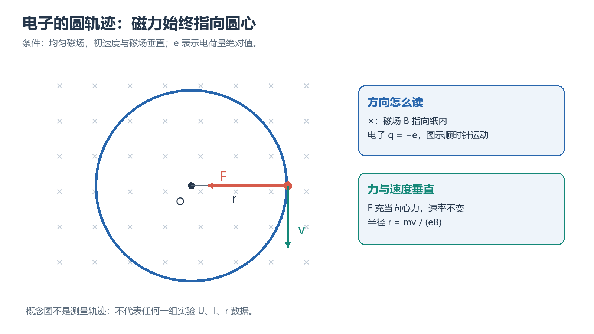

# 电子荷质比的测定实验报告指南

## 本篇要学什么

用电子在电场中的加速和磁场中的圆周运动测出 $e/m$，并能判断半径、磁场和拟合误差如何传递到结果。

完成本篇后，应能：

- 说清实验对象、输入量、输出量和成立条件；
- 在上电或正式测量前完成接线、量程、方向、零点和安全状态检查；
- 用原始数据完成带单位的计算、作图、拟合或比较，并标记无法从现有材料确认的项目；
- 按“目标—原理—操作—数据—处理—误差—结论”的顺序写出可复核报告。

## 本篇学习地图

**贯穿问题：** 用电子在电场中的加速和磁场中的圆周运动测出 $e/m$，并能判断半径、磁场和拟合误差如何传递到结果。

**路线：** 公式法、作图法、反射镜法的测量链；原始数据审计；拟合与不确定度；报告结论边界。

| 阶段 | 读者要完成的任务 | 输出证据 |
|---|---|---|
| 理解 | 找出模型、变量和适用条件 | 一段自己的原理解释 |
| 操作 | 复位、接线/调节、检查判据 | 接线或调节记录 |
| 测量 | 记录原始读数和实验条件 | 完整数据表 |
| 处理 | 展开公式、单位、作图或拟合 | 可复算结果 |
| 报告 | 解释现象、误差和局限 | 有边界的结论 |

## 一、实验问题、原理与准备

### 本章路线

先明确实验要回答的物理或电路问题，再把关键量、适用条件和判据连成一条测量链。用电子在电场中的加速和磁场中的圆周运动测出 $e/m$，并能判断半径、磁场和拟合误差如何传递到结果。

**本章要解决的问题：** 如何把本章的实验目标、关键变量和判据连成一条可执行、可复核的测量链。

**本章学完应会：** 能说明原理和适用条件，按顺序完成操作与记录，并用数据、单位和误差机制支持报告结论。

### 学习单元

#### 一、实验目标

本实验要测定电子的荷质比 $e/m$，并验证带电粒子在均匀磁场中做圆周运动的模型。学习时先明确“测什么、由什么量计算、哪些量必须控制”，再进入仪器操作和数据处理。

#### 二 预习问题

以下按报告模板的三道预习题逐题作答。公式中的 $e$ 表示电子电荷量的绝对值，$m$ 为电子质量。

##### 1. 洛伦兹力的产生条件及带电粒子在均匀磁场中作圆周运动的物理图像是什么？

**答：** 带电粒子以速度 $\boldsymbol{v}$ 进入磁感应强度为 $\boldsymbol{B}$ 的磁场时，受到洛伦兹力

$$
\boldsymbol{F}=q\boldsymbol{v}\times\boldsymbol{B}
$$

其产生条件是粒子带电且处在磁场中；当速度与磁场不平行时，才有非零磁力。对电子，$q=-e$，力的方向按左手定则确定；力的大小为

$$
F=evB\sin\theta
$$

其中 $\theta$ 是 $\boldsymbol{v}$ 与 $\boldsymbol{B}$ 的夹角。当 $\theta=90^\circ$ 且磁场均匀时，磁力始终垂直于速度，只改变速度方向、不改变速率，并充当向心力：

$$
evB=\frac{mv^2}{r}
$$

因此粒子作速率不变的匀速圆周运动，轨迹半径为 $r=mv/(eB)$。若 $\thetae90^\circ$，速度的垂直分量使粒子绕磁力线转动，平行分量使其沿磁场方向前进，合运动为螺旋线；实验中应调节电子束方向，使轨迹闭合、清晰且无重影。

<!-- study-note-illustration:2026-10-04:electron-lorentz-circle -->

**读图提示：**图中叉号表示磁场指向纸内，电子沿图示方向运动；切向速度与指向圆心的磁力垂直。只在速度与均匀磁场垂直的条件下画圆轨迹，不代表任何一组实测半径或电压。

来源：依据本篇笔记相邻段落自绘的教学示意；不是教材原图或实测记录。

<!-- /study-note-illustration -->

##### 小练习：1. 洛伦兹力的产生条件及带电粒子在均匀磁场中作圆周运动的物理图像是什么？

**题目：** 由实验数据求 e/m

**解析：** 取加速电压 $U=200\,\mathrm{V}$、轨道半径 $r=0.050\,\mathrm{m}$、磁感应强度 $B=1.0\times10^{-3}\,\mathrm{T}$，由 $e/m=2U/(r^2B^2)$ 得 $e/m=1.60\times10^{14}\,\mathrm{C\,kg^{-1}}$。实际报告还应说明读数不确定度和磁场标定条件。

##### 2. 电子在电场中加速时电场力做功与电子动能之间的关系是什么？

**答：** 忽略电子初动能和能量损失时，电子通过加速电压 $U$，电场力所做的功转化为电子动能：

$$
eU=\frac{1}{2}mv^2
$$

所以

$$
v=\sqrt{\frac{2eU}{m}}
$$

在其他条件相同的情况下，$U$ 越大，电子速率越高。该关系是用加速电压替换电子速度、推导 $e/m$ 计算式的依据。

##### 3. 亥姆霍兹线圈产生均匀磁场的原理是什么？其磁场强度与励磁电流有何种关系？

**答：** 两个相同的同轴圆线圈，间距等于线圈半径，并通入方向相同、大小相等的电流时，两个线圈的磁场在中部叠加，使线圈中心附近形成近似均匀磁场。中心处磁感应强度可写为 $B=KI$，其中 $N$ 是单个线圈匝数，$R$ 是线圈半径，$\mu_0$ 是真空磁导率。对本实验线圈，指导书给出 $N=132$、$R=158$ mm，因此

$$
K=\mu_0\left(\frac{4}{5}\right)^{3/2}\frac{N}{R}
$$

并得到 $K\approx7.51\times10^{-4}$ T/A。故磁场强度与励磁电流 $I$ 成正比：

$$
B=KI
$$

增大 $I$ 会增大 $B$，但励磁电流不得超过指导书规定的 3.5 A 短时上限。

##### 小练习：3. 亥姆霍兹线圈产生均匀磁场的原理是什么？其磁场强度与励磁电流有何种关系？

**题目：** 由实验数据求 e/m

**解析：** 取加速电压 $U=200\,\mathrm{V}$、轨道半径 $r=0.050\,\mathrm{m}$、磁感应强度 $B=1.0\times10^{-3}\,\mathrm{T}$，由 $e/m=2U/(r^2B^2)$ 得 $e/m=1.60\times10^{14}\,\mathrm{C\,kg^{-1}}$。实际报告还应说明读数不确定度和磁场标定条件。

#### 三 实验原理

由洛伦兹力提供向心力，有

$$
\frac{e}{m}=\frac{v}{rB}
$$

再利用电子经电压 $U$ 加速后的动能关系消去速度 $v$，得到

$$
\frac{e}{m}=\frac{2U}{r^2B^2}
$$

代入 $B=KI$，得到实验使用的计算式：

$$
\frac{e}{m}=\frac{2U}{K^2I^2r^2}
$$

其中 $U$ 的单位为 V，$I$ 的单位为 A，$r$ 的单位为 m，计算结果的单位为 C/kg。

##### 公式法

保持加速电压 $U$ 不变，使电子束依次击中直径为 $d_0$、$d_0+10$ mm、$d_0+20$ mm、$d_0+30$ mm 的标点，并记录相应励磁电流。由于固定电压下 $Ir$ 为常量，对第 $n$ 个增量点有

$$
I_0d_0=I_n(d_0+n\Delta d)
$$

其中 $\Delta d=10$ mm。可由每一组数据估计初始直径：

$$
d_0=\frac{n\Delta d I_n}{I_0-I_n}
$$

对所得 $d_0$ 取平均，再由 $r_n=(d_0+n\Delta d)/2$ 和实用计算式求各次 $e/m$，最后取平均值。

##### 作图法

保持轨道半径 $r$ 不变，改变 $U$ 和 $I$。由基本公式可得

$$
U=\frac{1}{2}\frac{e}{m}r^2K^2I^2
$$

因此 $U$ 与 $I^2$ 应呈线性关系。若对 $U-I^2$ 数据进行线性拟合，斜率为 $C$，则

$$
\frac{e}{m}=\frac{2C}{r^2K^2}
$$

拟合时应同时检查截距是否接近零、数据点是否存在明显偏离，以及线性范围是否合理。

##### 反射镜法测量半径

调节反射镜使刻度尺成像清晰，再移动滑动标尺，使黑白分界的中心刻度线与电子枪口及镜中像三点一线。若圆轨迹两端读数为 $S_0$ 和 $S_1$，则

$$
r=\frac{1}{2}(S_1-S_0)
$$

三点一线用于减小视差。读数时应始终以黑白分界的中心线作为基准。

##### 小练习：反射镜法测量半径

**题目：** 由实验数据求 e/m

**解析：** 取加速电压 $U=200\,\mathrm{V}$、轨道半径 $r=0.050\,\mathrm{m}$、磁感应强度 $B=1.0\times10^{-3}\,\mathrm{T}$，由 $e/m=2U/(r^2B^2)$ 得 $e/m=1.60\times10^{14}\,\mathrm{C\,kg^{-1}}$。实际报告还应说明读数不确定度和磁场标定条件。

#### 四 仪器与主要参数

- 电子荷质比测定仪，包括亥姆霍兹线圈、威尔尼氏管、反射镜、滑动标尺和电源。
- 直流稳压电源、电压表、电流表。
- 米尺、游标卡尺等辅助测量工具。

| 项目 | 参数 |
| --- | --- |
| 威尔尼氏管真空度 | 约 10-1 Pa |
| 灯丝电压 | 6.3 V |
| 最大加速电压 | 250 V |
| 线圈内径 | 300 mm |
| 线圈外径 | 332 mm |
| 线圈有效半径 R | 158 mm |
| 单线圈匝数 N | 132 |
| 励磁电流 | 最大 3.5 A，仅允许短时间使用 |
| 加速电压范围 | 0-250 V，连续可调 |
| 聚焦电压范围 | 0-20 V |
| 照明电压 | 2.5 V |
| 磁电转换系数 K | 约 7.51×10-4 T/A |

#### 十二 当前资料状态

- 已知：实验目的、基本公式、线圈参数、操作流程、三种测量方案、数据处理要求和思考题。
- 缺失：实际实验日期、仪器编号、所有原始读数、拟合结果、实验现象记录及教师要求的具体不确定度计算格式。
- 待完成：现场填写原始数据，保留单位和有效数字；完成线性拟合；计算平均值、相对误差和不确定度；再据此撰写实验结论。
- 接线待确认：端子全名、线缆类型、励磁线圈的实际串接方向和测量表头接法必须按当次仪器面板、指导书接线图或教师要求核对后填写，本文不以接口位置推断。

<!-- study-notes-integrated:2026-10-06 -->

### 本章小结

实验对象、模型、变量、仪器和安全边界已经能够用自己的话说明；正式操作前应先做条件检查。

### 本章练习与检验

不看原文，写出一个输入量、一个输出量和一个关键适用条件，并说明若条件不满足会出现什么现象。

## 二、实验操作、数据与处理

### 本章路线

按“复位与检查—接线/调节—正式测量—原始记录—现场复核”的顺序执行；所有现场读数、缺测和异常都保留在原始记录中，不用理论值替代。

**本章要解决的问题：** 如何把本章的实验目标、关键变量和判据连成一条可执行、可复核的测量链。

**本章学完应会：** 能说明原理和适用条件，按顺序完成操作与记录，并用数据、单位和误差机制支持报告结论。

### 学习单元

#### 五 实验流程

##### 1 连线与启动

指导书中的接线图是本实验的接线依据。由于当前资料未提供可逐字核对的面板端子名称，下面对无法确认的端子保留“待按实物面板或教师要求确认”，不得根据接口位置猜测。接线前所有电源关闭，电压、电流旋钮逆时针调至最小。

| 线缆/回路 | 起点 | 终点 | 信号或能量方向 | 作用与现场核对 |
| --- | --- | --- | --- | --- |
| 灯丝回路 | 测定仪灯丝输出端（端子全名待确认） | 威尔尼氏管灯丝端（端子全名待确认） | 灯丝供电 | 核对极性、额定值和接线柱标识；不得接入加速端 |
| 加速回路 | 测定仪加速电压正端（端子全名待确认） | 威尔尼氏管加速电极正端（端子全名待确认） | 加速电压 | 按指导书图确认正负端和公共端，不能仅凭颜色接线 |
| 聚焦回路 | 测定仪聚焦电压端（端子全名待确认） | 威尔尼氏管聚焦电极端（端子全名待确认） | 聚焦电压 | 核对 0–20 V 范围及回路公共端 |
| 励磁回路 | 测定仪励磁输出正、负端（端子全名待确认） | 亥姆霍兹线圈对应正、负端（端子全名待确认） | 线圈电流 | 两线圈须按图同向串接/接入；通电前请教师确认方向 |
| 电压/电流测量 | 仪表输入端（端子全名待确认） | 指导书规定的测定仪测量端 | 仪表读数 | 核对量程、共地和表头接法，避免把电流表并联 |

按以下顺序操作：

1. 逐线对照上表和指导书接线图，检查端子全名、极性、线缆类型和公共端；不确定处标为“待确认”，请教师复核后再上电。
2. 确认加速、聚焦、励磁输出均未使能且旋钮最小，再接通总电源。预热约 5 min，将灯丝电压调至约 6.3 V。
3. 先将加速电压预置到约 130 V 以激发电子束；电子束稳定后，可按指导书要求降至约 90–100 V。聚焦电压从低值缓慢调节，励磁电流保持 0。
4. 成功判据：能看到稳定、连续的电子束直线轨迹；电压、电流示值稳定，线圈无异常发热或异味。确认后才开始磁偏转测量。

**故障排查：** 无电子束时，先检查灯丝电压、加速回路、总电源和接线公共端；有灯丝但无束流时停止升压并请教师检查。轨迹不闭合或出现重影时，优先检查电子束与磁场是否垂直、聚焦设置和线圈电流方向。读数漂移或线圈发热时，立即减小励磁电流，检查接线和仪表量程，冷却后再测。

##### 2 正式测量流程

1. **观察磁偏转。** 先把励磁电流调至 0，观察电子束的直线轨迹；缓慢增大励磁电流，调整电子束方向与磁场方向垂直，使轨迹成为清晰、无重影的闭合圆。
2. **公式法测量。** 固定 $U$，依次调节电子束击中指定直径标点，记录相应的励磁电流和稳定时间。
3. **作图法测量。** 固定圆轨迹半径，改变 $U$ 和 $I$，记录多组配对数据；每次改变一个量后等待示值稳定。
4. **反射镜法测量。** 调清刻度尺像，完成三点一线校准，读取轨迹两端位置并计算半径；同时记录对应的 $U$ 和 $I$。
5. **结束实验。** 先将励磁电流、聚焦电压和加速电压旋钮调到最小，再关闭电源；记录异常、未完成点和仪器编号。

#### 六 原始数据记录

原始读数应直接填写，不应把计算结果反写成原始数据。每组数据还应注明共同的加速电压或固定半径。

##### 表 1 公式法数据

固定加速电压：U = ______ V

| n | 电子圆直径/mm | 励磁电流 I/A | 稳定性/异常备注 |
| ---: | ---: | ---: | --- |
| 0 | d0 |  |  |
| 1 | d0 + 10 |  |  |
| 2 | d0 + 20 |  |  |
| 3 | d0 + 30 |  |  |

##### 表 2 作图法数据

固定圆轨迹半径：r = ______ mm

| 序号 | U/V | I/A | I2/A2 |
| ---: | ---: | ---: | ---: |
| 1 |  |  |  |
| 2 |  |  |  |
| 3 |  |  |  |
| 4 |  |  |  |
| 5 |  |  |  |
| 6 |  |  |  |
| 7 |  |  |  |
| 8 |  |  |  |

##### 表 3 反射镜法数据

固定加速电压：U = ______ V

| 序号 | S0/mm | S1/mm | r/mm | I/A | 稳定性/异常备注 |
| ---: | ---: | ---: | ---: | ---: | --- |
| 1 |  |  |  |  |  |
| 2 |  |  |  |  |  |
| 3 |  |  |  |  |  |
| 4 |  |  |  |  |  |
| 5 |  |  |  |  |  |
| 6 |  |  |  |  |  |
| 7 |  |  |  |  |  |
| 8 |  |  |  |  |  |

#### 七 数据处理

##### 0 数据审计与清洗记录

计算前逐项核对：原始读数来源、数据组对应的固定 $U$ 或固定 $r$、单位、点数、顺序、重复记录、量程变化和缺测。原始记录只读保存，计算值写入派生表。任何剔除、重测或异常点处理均填写理由，不用插值替代实测值。

建议在数据表旁记录：数据文件或纸质记录编号、仪器编号、实际灯丝/加速/聚焦设置、读数分辨率、测量时间、异常现象及教师确认事项。

##### 1 单次结果与平均值

将半径统一换算为 m，再对每组数据计算

$$
x_i=\left(\frac{e}{m}\right)_i=\frac{2U_i}{K^2I_i^2r_i^2}
$$

若共有 $n$ 次有效测量，则平均值为

$$
\bar{x}=\frac{1}{n}\sum_{i=1}^{n}x_i
$$

##### 2 作图法拟合

1. 计算每组 $I^2$。
2. 以 $I^2$ 为横轴、$U$ 为纵轴作图。
3. 进行线性拟合 $U=CI^2+b$，记录斜率 $C$、截距 $b$ 和拟合优度。
4. 用 $e/m=2C/(r^2K^2)$ 计算荷质比。

除非课程明确要求强制过原点，否则建议先保留截距，用其判断零点偏移或系统误差。

##### 小练习：2 作图法拟合

**题目：** 由实验数据求 e/m

**解析：** 取加速电压 $U=200\,\mathrm{V}$、轨道半径 $r=0.050\,\mathrm{m}$、磁感应强度 $B=1.0\times10^{-3}\,\mathrm{T}$，由 $e/m=2U/(r^2B^2)$ 得 $e/m=1.60\times10^{14}\,\mathrm{C\,kg^{-1}}$。实际报告还应说明读数不确定度和磁场标定条件。

##### 3 与公认值比较

指导书给出的公认值为

$$
x_0=1.759\times10^{11}
$$

其中 $x_0$ 表示公认的电子荷质比，单位为 C/kg。

相对误差为

$$
E_r=\frac{\left|\bar{x}-1.759\times10^{11}\right|}{1.759\times10^{11}}\times100\%
$$

##### 4 不确定度分析

由 $e/m\propto UI^{-2}r^{-2}K^{-2}$ 可知，若各量的不确定度相互独立，合成相对标准不确定度可写为

$$
\frac{u_x}{x}=\sqrt{\left(\frac{u_U}{U}\right)^2+\left(2\frac{u_I}{I}\right)^2+\left(2\frac{u_r}{r}\right)^2+\left(2\frac{u_K}{K}\right)^2}
$$

若课程只要求估计最大相对误差，可使用线性叠加：

$$
\frac{\Delta x}{x}\approx\frac{\Delta U}{U}+2\frac{\Delta I}{I}+2\frac{\Delta r}{r}+2\frac{\Delta K}{K}
$$

这表明 $I$、$r$ 和 $K$ 的相对误差都会以两倍权重传递到结果中，其中圆半径的边界判断、视差和非圆轨迹通常是重要误差来源。

##### 小练习：4 不确定度分析

**题目：** 由实验数据求 e/m

**解析：** 取加速电压 $U=200\,\mathrm{V}$、轨道半径 $r=0.050\,\mathrm{m}$、磁感应强度 $B=1.0\times10^{-3}\,\mathrm{T}$，由 $e/m=2U/(r^2B^2)$ 得 $e/m=1.60\times10^{14}\,\mathrm{C\,kg^{-1}}$。实际报告还应说明读数不确定度和磁场标定条件。

### 本章小结

每条数据都要同时记录条件、单位和读数位置；计算展示中间量，图表标注坐标、单位和实验条件。

### 本章练习与检验

任选一组真实或待补数据，写出从原始读数到最终结果的计算链，检查量纲、有效数字和异常值处理。

## 三、误差、报告与复习

### 本章路线

把观察、计算、理论比较和误差机制分开写，结论只回答实验目标；报告中的每个数字都应能回到原始记录、公式和单位。

**本章要解决的问题：** 如何把本章的实验目标、关键变量和判据连成一条可执行、可复核的测量链。

**本章学完应会：** 能说明原理和适用条件，按顺序完成操作与记录，并用数据、单位和误差机制支持报告结论。

### 学习单元

#### 八 误差来源与改进

| 误差机制 | 对结果的影响路径 | 改进方法 |
| --- | --- | --- |
| 电子束与磁场不垂直 | 轨迹变为螺旋线，圆半径只对应速度的垂直分量；按理想公式计算时结果通常偏大 | 调整电子束，使轨迹闭合、清晰且无重影 |
| 圆轨迹较粗或发散 | 内外边界不同，半径判断产生随机偏差 | 适当降低加速电压并调节聚焦，使光迹细而清晰 |
| 反射镜未满足三点一线 | 产生视差，使 S0、S1 读数系统性偏移 | 每次读数前重新校准三点一线，视线保持稳定 |
| 磁场并非完全均匀 | 实际磁感应强度偏离 KI，轨迹也可能不是理想圆 | 使轨迹位于线圈中心附近，不使用过大的圆轨迹 |
| 电流过大导致线圈升温 | 线圈参数和电流可能漂移，磁场稳定性下降 | 大电流只短时使用，分组测量间留出冷却时间 |
| 电压或电流示值波动 | 直接传入 e/m，电流误差还具有二倍权重 | 等示值稳定后读数，多次测量并取平均 |
| 拟合区间或异常点处理不当 | 改变 U-I2 斜率，造成作图法结果偏移 | 保留原始点，报告剔除依据，并检查残差和截距 |

#### 九 思考题参考分析

##### 1 还可以怎样确定圆轨迹半径

- **标尺直接读直径：** 操作简单、速度快，但视差和轨迹边界判断误差较明显。
- **反射镜法：** 通过三点一线减小视差，精度通常优于直接读数，但调节过程较慢，仍依赖人工判断光迹边缘。
- **拍照后进行圆拟合：** 可使用多个轨迹点进行最小二乘圆拟合，减少单点读数的偶然性，并保留可复核图像；缺点是必须进行像素尺寸标定，还要控制透视畸变和镜头畸变。
- **三点定圆或多点坐标法：** 几何关系明确，多点拟合时抗随机误差较好；但坐标测量和装置标定较繁琐。

##### 2 电子束与磁场不完全垂直的影响

电子轨迹为螺旋线。若速度与磁场夹角为 $\theta$，轨道半径由 $v\sin\theta$ 决定，而加速电压对应电子的总动能。设按垂直入射公式得到的测量值为 $x$、真实值为 $x_0$，则

$$
x=\frac{x_0}{\sin^2\theta}
$$

因此在理想模型下，$\thetae90^\circ$ 时测量值偏大；同时螺旋投影和重影还会增大半径读数的不确定度。

##### 小练习：2 电子束与磁场不完全垂直的影响

**题目：** 由实验数据求 e/m

**解析：** 取加速电压 $U=200\,\mathrm{V}$、轨道半径 $r=0.050\,\mathrm{m}$、磁感应强度 $B=1.0\times10^{-3}\,\mathrm{T}$，由 $e/m=2U/(r^2B^2)$ 得 $e/m=1.60\times10^{14}\,\mathrm{C\,kg^{-1}}$。实际报告还应说明读数不确定度和磁场标定条件。

##### 3 各测量量误差的影响

由 $e/m=2U/(K^2I^2r^2)$ 可知：

- $U$ 偏大 1%，计算结果约偏大 1%。
- $I$ 偏大 1%，计算结果约偏小 2%。
- $r$ 偏大 1%，计算结果约偏小 2%。
- 因此在仪表精度相近时，应重点控制励磁电流和半径的测量误差。

##### 小练习：3 各测量量误差的影响

**题目：** 由实验数据求 e/m

**解析：** 取加速电压 $U=200\,\mathrm{V}$、轨道半径 $r=0.050\,\mathrm{m}$、磁感应强度 $B=1.0\times10^{-3}\,\mathrm{T}$，由 $e/m=2U/(r^2B^2)$ 得 $e/m=1.60\times10^{14}\,\mathrm{C\,kg^{-1}}$。实际报告还应说明读数不确定度和磁场标定条件。

#### 十 注意事项

1. 励磁电流必须从 0 开始缓慢增大，最大 3.5 A 只能短时使用，防止线圈过热。
2. 加速电压不宜过高，否则电子束容易发散；电子束出现后应按需要降低电压。
3. 调整轨迹时先保证电子束与磁场垂直，再进行半径测量。
4. 反射镜法读数必须仔细完成三点一线，以减小系统误差。
5. 指导书注明本实验仪器无偏转功能，面板上的偏转开关及插座无效。
6. 实验结束时先把电压、电流旋钮调到最小，再关闭电源。

#### 十一 报告结论写作框架

取得实测数据后，结论应依次说明：采用了哪种测量方法；所得 $e/m$ 及其不确定度；相对公认值的误差；作图关系是否支持 $U\propto I^2$；影响结果可信度的主要误差机制。没有实测数据时不能填写数值结论。

#### 综合题与解析

##### 小练习：1

**题目：** 电子荷质比

**解析：** 加速电压 U=200 V、电子轨道半径 r=0.05 m、磁感应强度 B=1.0×10⁻³ T，按 e/m=2U/(r²B²) 计算。

##### 小练习：2

**题目：** 分光计

**解析：** 光栅常数 d=1/300 mm，一级衍射角 ψ=10°，用 λ=d sinψ/k 求波长。

##### 小练习：3

**题目：** 单管放大

**解析：** 输入 Ui=20 mV，输出有效值 Uo=1.0 V，求电压增益；若输出顶部削平，优先检查什么？

#### 六、练习提示与常见问题

- 先写对象、已知条件和求解目标，再选择公式、规则或操作。
- 任何结论都要检查适用条件；资料缺页、版本变化、现场读数或官方规则不明确时标记“待核实”。
- 不要把一次计算、一次波形或一个网页提示直接当作充分证据。

#### 七、隔日复习与自测

##### 换一组条件再判断（20分钟）

改变本篇核心题目的一个关键条件，重新判断方法、结果和边界，并记录哪些结论依赖模型条件。

##### 闭卷解释关键问题（20分钟）

1. 本篇的核心对象、输入和输出分别是什么？
2. 哪个条件一旦改变，原方法最先失效？
3. 如何用独立计算、图表、实验记录或官方资料检查结果？

##### 周末/阶段复盘（15分钟）

闭卷画出本篇学习地图，重做下面两道题，只看题源不看解析；最后列出一个仍需查阅的问题。

#### 八、学习安排与阅读资料

##### 阅读资料

- 实验指导书和实验整理。
- 当前项目原始 PDF、课程讲义、实验指导书或官方资料。

##### 细节查阅

争议内容优先回到题源原文核对条件、符号、版本和题图，不用记忆补齐缺失信息。

#### 九、自测参考答案

##### 题目一

比较系统误差、随机误差和操作失误的影响路径，每个原因对应可执行验证动作。

#### 深度题源检验

> 题源：实验指导书和实验整理（按项目原始资料和课程题意整理）

**题目一：** 围绕“用磁场运动模型反推电子荷质比并审查误差”设计完整核验任务：写出输入条件、控制变量、步骤、成功判据和异常分支。

**解析：** 从原理或反馈模型确定变量，再把操作连接到读数或波形；无现场数据时标记待测。

**题目二：** undefined

**解析：** undefined

<!-- study-notes-v2-rebuilt:2026-10-07 -->

### 本章小结

结论区分观察、测量结果、理论比较与误差机制；缺少原始证据的地方写“待补/待确认”，不填猜测。

### 本章练习与检验

给出一个具体异常现象，按“现象—优先检查项—修正动作—重新判据”写出排查记录，并说明它是否足以改变结论。

## 四、练习提示与常见问题

- 先回答“测什么、凭什么、怎么判定成功”，再填写公式和步骤。
- 原始数据、处理数据和理论参考值分栏保存；不要把处理结果覆盖原始记录。
- 报告中的“误差”要写出影响路径，例如读数偏大如何传递到最终量，而不是只列“人为误差、仪器误差”。
- 涉及高压、大电流、强光、加热或极性风险时，按实验室规程执行并在教师检查后启动。

## 五、隔日复习与自测

### 换一组条件再判断（20 分钟）

改变一个控制量，预测曲线、波形、峰谷或读数如何变化，并写出预测依据。

### 闭卷解释关键问题（20 分钟）

不用看稿，依次说明实验目标、核心公式、成功判据、一个异常和一个误差传递路径。

### 周末复盘（15 分钟）

对照原始数据检查：是否有单位、条件、有效数字、缺测说明、图表标题、结论证据和待确认项。

## 六、学习安排与阅读资料

1. 先读“实验问题、原理与准备”，能口头解释后再看操作。
2. 实验台上只依据经核对的指导书和教师规程设置危险参数。
3. 细节查阅优先回到本实验的指导书、原始数据页和仪器面板；本指南不代填现场读数。

## 七、自测参考答案

- 实验主线的答案必须包含对象、变量、条件和判据，不能只写结论。
- 数据题的答案必须能由原始读数、公式、单位和有效数字复算。
- 异常题的答案必须说明现象与修正动作之间的因果关系；若缺少现场证据，应保留为待确认。

## 八、报告提交前核对

- [ ] 实验目的与结论一一对应。
- [ ] 原理公式的符号、单位和适用条件已解释。
- [ ] 接线、量程、方向、零点或调节状态已记录。
- [ ] 原始数据未被覆盖，图表有标题、坐标、单位和条件。
- [ ] 计算展示关键中间量，结果使用合理有效数字。
- [ ] 误差写出具体机制和影响路径，未把猜测写成实测事实。
- [ ] 缺测、异常和待教师确认项目已明确标注。

