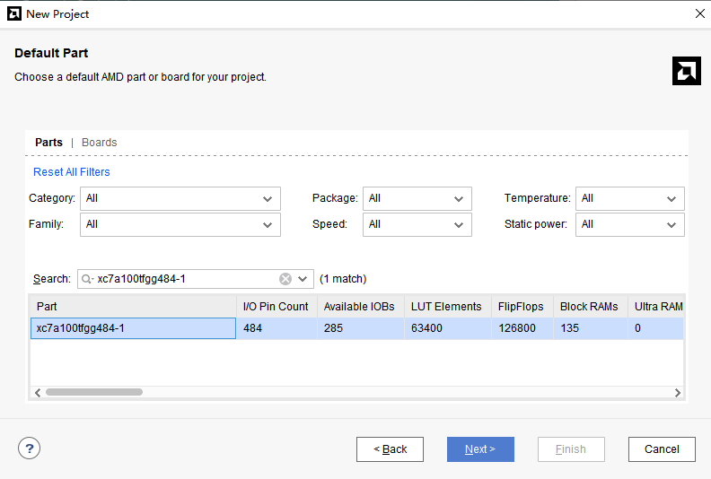
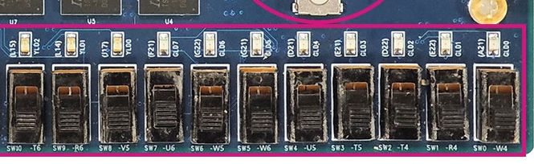
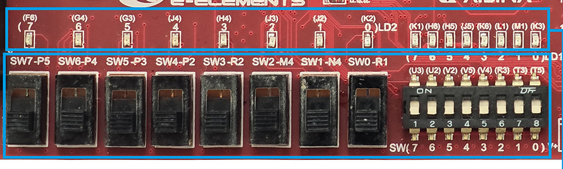
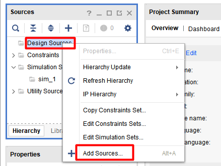
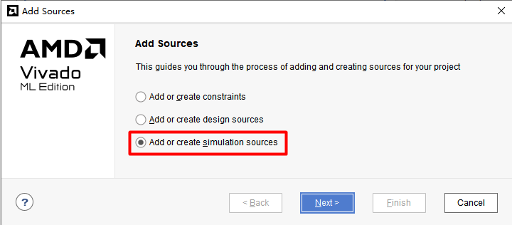
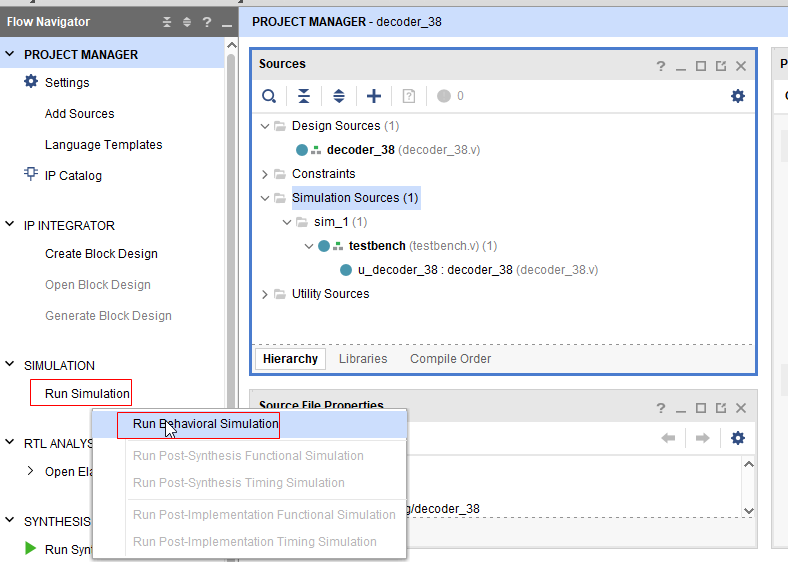
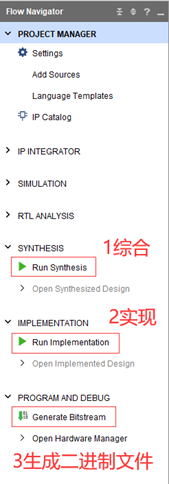
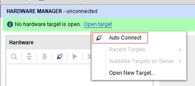
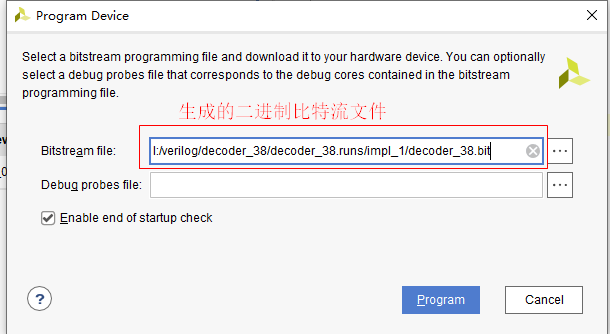

# 实验一完成教程｜Vivado 使用与组合电路

这份教程按实际操作顺序写。**你要先用 3—8 译码器走通一次开发流程，再单独完成 `mux` 加减选择电路，最后提交 `mux.v`、`pin.xdc` 和个人实验报告 PDF。** 从下面的任务清单开始，按顺序做；每一步都有完成标志。

> 依据：实验文件夹《lab1-Vivado使用与组合电路.pdf》及其指向的课程指导书，核对日期 2026-10-12。文中代码、预期值和图片帮助你操作；教程图不是你的实验结果。本任务未实际运行 Vivado 或上板，报告图片需在你自己的工程和开发板上取得。

## 0. 先弄清楚：实验到底要你干什么

| 任务                     | 你要做的事                                                                  | 做完的标志                                               |
| ------------------------ | --------------------------------------------------------------------------- | -------------------------------------------------------- |
| A：3—8 译码器，练熟流程 | 建工程→添加设计和仿真代码→仿真→加引脚约束→生成 bit→下载到板子          | 改变 SW 开关后，正确的一只 LED 熄灭；使能关闭时八灯全亮  |
| B：mux，报告与提交重点   | 新建 mux 工程，实现“禁用输出全 1；有效时选择 a+b 或 a−b”，完成仿真和上板 | 三种情况都正确，保存上板照片、仿真图、RTL 图、综合电路图 |
| C：整理并提交            | 写个人报告，导出 PDF，与自编代码和约束打包                                  | ZIP 中只有当前要求的三份文件，PDF 中图片和说明清楚       |

最终提交包按当前课程实验页要求整理：

```text
lab1_submit.zip
├── mux.v
├── pin.xdc
└── 学号_姓名.pdf
```

**报告至少需要收齐这些东西：**

- [ ] mux 未使能时的上板照片及输入、输出说明。
- [ ] mux 做加法时的上板照片及输入、输出说明。
- [ ] mux 做减法时的上板照片及输入、输出说明。
- [ ] 自己运行得到的 mux 仿真波形，带完整信号名和分析。
- [ ] mux 的 RTL Analysis 电路图。
- [ ] mux 的 Synthesis schematic 电路图，注意不是 Device 图。

当前实验一无课上检查，但仍要求自己上板验证。译码器用于练习流程；当前提交清单没有要求把译码器工程一并打包。截止时间到提交平台查看，不在本文猜一个日期。

## 1. 开始前准备：确认板子、保存位置和开关

### 1.1 你需要准备什么

**先认清对象：**FPGA（现场可编程门阵列）是开发板上能按配置改变内部数字逻辑与连接的芯片。本实验用 Vivado 把写出的电路变成配置，再让这块芯片驱动 LED；Minisys、EGO1 是开发板型号，建工程时仍要选择板上实际的 FPGA 型号。

1. 实验室开发板一块，确认是蓝色 Minisys 还是红色 EGO1。
2. 与该版本板卡匹配、可以传输数据的连接线；旧版本的电源连接先问教师。
3. Vivado，课程操作示例使用 2023.2，实际版本以实验室安装为准。
4. 自己的学生卡，用于课程要求的上板拍照。
5. 一个不会被实验室电脑重启还原的保存位置，以及备份位置。

工程路径用英文、短路径、不带空格。例如教师确认 E 盘可以保存时，可用 `E:/diglogic/lab1/`。课程说明部分实验室 C、D 盘重启会清除新文件，**不要没确认就把唯一一份工程放在这些盘**。本文的中文文件夹只是阅读位置，不要求你在其中建 Vivado 工程。

### 1.2 建工程时选哪个芯片

| 你的板卡     | Default Part 中搜索并选中的完整型号 |
| ------------ | ----------------------------------- |
| 蓝色 Minisys | xc7a100tfgg484-1                    |
| 红色 EGO1    | xc7a35tcsg324-1                     |

下图只是器件选择界面的示例。**EGO1 用户要输入自己那一行型号，不要照着截图选 Minisys。**



*图源：课程“建立工程”页，操作示意图。*

### 1.3 板子怎么摆，开关怎么读

把板子正面朝上、电源接口一侧朝上、主拨码开关一侧朝下，按丝印辨认编号。主拨码向上为 1、向下为 0；本实验使用的 LED 高电平亮、低电平灭。按编号读位，不凭灯在照片里的左右位置判断。

**Minisys：**主拨码 SW0 位于图的最右侧。下面的课程照片局部保留了开关名、引脚名和 LED 名，写约束时用它核对。



**EGO1：**下面的大开关是 SW7—SW0，旁边还有一组八位小 DIP。DIP 下方器件编号从左到右是 7—0，而外壳数字从左到右是 1—8：**DIP0 是最右侧的外壳 8，DIP1 是它左边的外壳 7。** 不要把外壳数字 1 当成 DIP1。



*以上两图裁自课程“FPGA 开发板”原图，只用于识别实物。DIP 的 0/1 方向按课程说明与实际丝印核对，后面用使能测试确认。若你的引脚丝印与本教程不同，停止套用对应约束，先让教师确认版本。*

**本步完成标志：**知道自己的芯片型号、可靠保存位置，能找到 SW0—SW7；EGO1 用户还要能准确指出 DIP0、DIP1。

## 2. 任务 A：先完成 3—8 译码器

### A1. 新建 decoder_38 工程

**为什么选 RTL Project：**RTL（Register Transfer Level，寄存器传输级）是用 Verilog 等语言描述数字电路的一种设计层次，说明数据怎样被处理、怎样连接，暂不指定芯片内部每条连线的位置。本实验的组合电路也从这一层开始，不要求必须有寄存器；选这个入口，是为了让 Vivado 根据随后添加的设计代码建立工程。

1. 打开 Vivado，等待界面出现。
2. 点击 `Create Project → Next`。
3. `Project name` 填 `decoder_38`，路径使用前面确认的位置。
4. `Project Type` 选 `RTL Project`。如果有 `Do not specify sources at this time`，勾选，文件稍后添加；否则先跳过空的文件添加页。
5. 到 `Default Part`，按 1.2 选自己的完整芯片型号。
6. 点击 `Finish`。

**本步完成标志：**工程名是 decoder_38，Project Summary 中器件型号与自己的板卡一致。

### A2. 创建 decoder_38.v，写入功能代码

1. 在中间 `Sources` 窗口右击 `Design Sources → Add Sources`。
2. 选择 `Add or create design sources → Next`。
3. 点击 `Create File`，类型选 `Verilog`，文件名填 `decoder_38`，点击 `OK → Finish`。
4. `Define Module` 弹窗直接 `OK`，如询问是否继续再选 `Yes`。
5. 双击新文件，先读下面的接口与组合逻辑说明，再删除工具生成的模块骨架，写入后面的完整译码器示例并保存。文件里只保留一个 `module decoder_38`。



*图源：课程“添加设计文件”页。后面添加 mux.v 使用同一入口。*

#### 写入前先读懂：模块、端口与位的编号

Verilog 在这里描述的是一组输入怎样决定一组输出。`module` 开始定义一个电路模块，`endmodule` 结束这个定义；`decoder_38` 是模块名。模块名后面圆括号里的信号叫**端口（port）**，是模块与外部交换信号的逻辑接口。`input` 表示信号流入这个模块，`output` 表示信号由这个模块给出。此时先定义功能接口，等 A5 写约束时才把它们对应到板上的实际引脚；端口名本身不是引脚编号。

下面这份代码的接口可以先读成三句话：`en` 是三位控制输入，`data_in` 是三位待译码输入，`data_out` 是八位输出。三位数据有 0 到 7 共八种正常取值，八位输出恰好分别对应八个被选位置。端口方向始终以当前模块为参照，不能因为测试台会给 `en` 赋值，就把设计模块里的 `en` 改成输出。

**位宽与向量索引：**方括号中的 `[2:0]` 声明从第 2 位到第 0 位，共 2−0+1=3 位；`[7:0]` 同理是八位。这样的一组位叫向量，也常在波形中作为总线显示。声明时的 `[7:0]` 表示整组范围，使用时的 `data_out[0]` 表示只取其中一位。二进制字符串最左边对应最高位、最右边对应最低位，因此 `11111110` 只有第 0 位为 0，绝不是第 7 位为 0。后面约束文件中的位号也沿用这个约定。

**`wire` 与 `reg`：**`wire` 声明用来承接连接或驱动的信号，本例的输入信号从模块外部接进来。`reg` 是传统 Verilog 中可在过程语句里赋值的变量类型，因此下面在组合过程里赋值的 `data_out` 声明为 `reg`。**`reg` 不会自动推断物理寄存器。** 是否需要保存历史值，取决于赋值条件与是否使用时钟边沿等描述；本例没有时钟，而且每条组合路径都会给出输出，目标仍是组合电路。不要看到名字里有 reg，就额外添加时钟、复位或一拍延迟。

| 接口写法 | 在本模块里的意思 | 读位时的约定 |
| --- | --- | --- |
| `input wire [2:0] en` | 三位使能输入，由模块外部提供 | 从高到低是 `en[2]`、`en[1]`、`en[0]` |
| `input wire [2:0] data_in` | 三位待译码数据，由模块外部提供 | `data_in[0]` 是最低位，权重为 1 |
| `output reg [7:0] data_out` | 八位译码输出，由下面的过程语句赋值 | `data_out[7]` 是最高位，`data_out[0]` 是最低位 |

**数值怎样写：**本例常量采用“位数 + 单引号 + 进制字母 + 数字”。进制字母 `b` 表示二进制，`d` 表示十进制，`h` 表示十六进制；位数说明这个常量占几位。`3'b100` 是三位二进制 100，即十进制 4；`3'd4` 表示同一个三位值。不能把二进制 100 读成十进制的一百，也不要漏掉进制前的单引号。

| 本例常量 | 展开后怎样读 | 在当前代码中的作用 |
| --- | --- | --- |
| `3'b100` | 三位，依次为 1、0、0 | 仅这一种使能组合有效 |
| `3'd0` 到 `3'd7` | 用十进制书写三位数据的八个取值 | 选择要拉低的输出位 |
| `8'hFF` | 八位二进制 `11111111` | 默认八位全为 1 |
| `8'hFE` | 八位二进制 `11111110` | 只把第 0 位变成 0 |
| `8'h7F` | 八位二进制 `01111111` | 只把第 7 位变成 0 |

十六进制一位代表四个二进制位，A、B、C、D、E、F 分别表示十进制 10—15。例如 F 是 1111，E 是 1110，所以 FE 正好是 1111 与 1110 连起来的八位。译码器输出用两位十六进制显示；后面的四位 mux 输出只需一位，例如 F。它们的位宽不同，不能把四位端口改成八位去追求显示字母数量相同。

#### 再读控制流程：每次输入变化都重新给出完整输出

`always @*` 表示一个组合过程：当它读取的相关输入变化时，重新执行其中的语句。`begin` 与 `end` 把多条语句包成一个块。这里没有等待语句，也没有时钟边沿；它说明输入与输出的逻辑关系，不表示电路每隔固定时间计算一次。过程中的 `=` 是阻塞赋值，同一次执行里按语句先后更新变量；`==` 才是判断两边是否相等。语句末尾的分号不可省，端口列表各项之间用逗号，列表末尾的右圆括号后再用分号。

按这个顺序读即将输入的代码：先执行 `data_out = 8'hFF`，给本次计算设定八位全 1 的**组合默认值**；随后 `if (en == 3'b100)` 判断是否允许译码。条件满足时，`case (data_in)` 按数据值选择一个分支，冒号后给出该分支的输出。`endcase` 结束分支选择。条件不满足时不进入 case，输出就保留为本次刚赋的 FF。这个“保留”是保留本次默认值，不是保留上一次输入的输出。

每一个正常的三位数据都有明确分支。`default` 是普通 `case` 中没有任何标签匹配时的后备分支，不是“第九个合法输入”；本例让它也输出 FF。前面的整体默认值负责覆盖使能无效等路径，case 内的 default 则把后备行为写清楚，两者位置和作用要分别读懂。仿真里还可能出现 `X`（未知值）与 `Z`（高阻态）；它们不是普通的 0 或 1，普通 case 找不到精确匹配时会走 default。输出碰巧为 FF 也不能证明含 X/Z 的输入正常，后续仍应查初始化与连接。

为什么先给默认值？组合电路应由当前输入唯一决定输出。若某条路径没有赋值，代码就可能要求保留以前的值，从而推断出锁存器。锁存器是会保存状态的硬件，不是本任务要求的纯组合逻辑。本例先给 FF，再按有效条件覆盖，覆盖了所有路径；默认赋值必须放在选择之前，若移到最后，就会把刚选出的 FE、FD 等结果重新盖成 FF。读完这段再输入完整代码，能把“禁用全亮、有效选中灯灭”与每条赋值对应起来。

```verilog
module decoder_38 (
    input  wire [2:0] en,
    input  wire [2:0] data_in,
    output reg  [7:0] data_out
);
    always @* begin
        data_out = 8'hFF;
        if (en == 3'b100) begin
            case (data_in)
                3'd0: data_out = 8'hFE;
                3'd1: data_out = 8'hFD;
                3'd2: data_out = 8'hFB;
                3'd3: data_out = 8'hF7;
                3'd4: data_out = 8'hEF;
                3'd5: data_out = 8'hDF;
                3'd6: data_out = 8'hBF;
                3'd7: data_out = 8'h7F;
                default: data_out = 8'hFF;
            endcase
        end
    end
endmodule
```

这一步只需抓住规则：`en=100` 有效；数据为几，就把输出的第几位变成 0。LED 高电平亮，所以选中位会灭，其余七灯亮。使能无效时输出 FF，八灯全亮。

**本步完成标志：**Design Sources 中有 decoder_38；如不是设计顶层，右击它选择 `Set as Top`。代码编辑器没有明显语法报错。

### A3. 添加译码器仿真文件

**这次仿真要查什么：**行为仿真（Behavioral Simulation）是在电脑中按设计代码和测试输入计算输出，先检查功能是否符合要求。这里用它核对译码结果和输入时间轴；此时尚未安排芯片内部的实际位置与连线，因此波形中的测试间隔不能当作上板后的真实传播延迟。

仿真文件负责替你产生输入，不下载到开发板。

1. 右击 `Simulation Sources → Add Sources`。
2. 选择 `Add or create simulation sources → Next → Create File`。
3. 类型 Verilog，文件名填 `decoder_38_sim`，完成创建。
4. 删除生成的空骨架；先读下方的连接、时间语句和输入时间轴，再写入完整教学测试代码并保存。
5. 在 Simulation Sources 中把 `decoder_38_sim` 设为仿真顶层。



*图源：课程“添加仿真文件、运行仿真”页。设计文件和仿真文件要用不同选项添加。*

#### 写测试台前，先把连接和仿真时间读懂

测试台也叫 testbench，是在电脑里向设计施加输入、观察输出的模块。它的顶层 `decoder_38_sim` 不需要板外端口：测试输入在模块内部产生。被测试的设计叫 **DUT（Device Under Test，待测设计）**。下面的 `decoder_38 dut (...)` 表示创建一个 `decoder_38` 实例，并给这个实例取名 `dut`；前者必须与设计模块名一致，后者只是这个实例的名字。测试台中要主动赋值的 `en`、`data_in` 用 reg，承接 DUT 输出的 `data_out` 用 wire。方向没有反过来：测试台驱动 DUT 的输入，DUT 驱动测试台观察的输出。

**具名端口映射怎样看：**`.en(en)` 中，点号后、圆括号外的 `en` 是 DUT 声明的端口名，括号里面的 `en` 是本测试台的信号名。左右碰巧同名，仍分别属于两个模块。`.data_out(data_out)` 同理把 DUT 输出接到测试台的观察信号。采用具名连接时依靠名字匹配，不依靠书写顺序；若设计把端口叫 `data_in`，这里就不能擅自写成 `.data(...)`。这是模块之间的逻辑连接，板上哪个开关接哪位仍由 A5 的 XDC 另行规定。

| 接下来会用到的语句 | 应当怎样读 |
| --- | --- |
| `` `timescale 1ns/1ps `` | 这是编译指令，开头是反引号，不是数值里的单引号；时间单位为 1 ns，时间精度为 1 ps |
| `initial begin ... end` | 仿真从 0 时刻启动一次，按先后顺序执行这个语句块；它负责安排激励 |
| `#5;` | 当前这条激励流程等待 5 个时间单位，此处是 5 ns，然后执行下一条语句；等待期间已设的输入保持不变 |
| `integer n;` | 声明循环用的整数变量，帮助依次生成 0—7，不是开发板上的新输入端口 |
| `for (n = 0; n < 8; n = n + 1)` | 先令 n=0，每轮先查 n 是否小于 8；执行循环体后加 1，再查下一轮 |
| `$finish;` | 结束本次电脑仿真；它不对应板上的开关动作或断电命令 |

`timescale` 不会自动产生时钟；1 ps 说明仿真时间的分辨精度，不是电路有 1 ps 延迟。`#5` 是相对当前仿真时刻向后等待 5 ns，不是每次都跳到绝对时刻 5 ns。这里用延时把不同输入分隔开，便于看波形；这些延时属于仿真安排，不能把它们加进 A2 的组合电路。

循环体先执行 `data_in = n`，再等待 5 ns。因此第一轮在 5 ns 赋 0，第二轮在 10 ns 赋 1，直到第八轮在 40 ns 赋 7；不是等到第一个循环体末尾才改变输入。整数 n 比三位数据宽，但本循环只把 0—7 赋进去，三位足以表示，没有丢失本实验需要的数值。n 增至 8 时循环条件已经不成立，所以不会向三位数据端口施加“第九个测试值 8”。

先把输入安排写成时间轴，再读代码；此表只说明测试台什么时候改变输入，输出将在 A4 按译码规则推导。区间左端是新值施加时刻，右端到来时再执行下一次修改。

| 仿真区间 | 本段输入 en | 本段 data_in，十进制 | 为什么从这里开始 |
| --- | --- | --- | --- |
| 0—5 ns | 000 | 0 | initial 先初始化，再等待一次 5 ns |
| 5—10 ns | 100 | 0 | 打开使能，循环第 1 轮 n=0 |
| 10—15 ns | 100 | 1 | 第 2 轮 n=1 |
| 15—20 ns | 100 | 2 | 第 3 轮 n=2 |
| 20—25 ns | 100 | 3 | 第 4 轮 n=3 |
| 25—30 ns | 100 | 4 | 第 5 轮 n=4 |
| 30—35 ns | 100 | 5 | 第 6 轮 n=5 |
| 35—40 ns | 100 | 6 | 第 7 轮 n=6 |
| 40—45 ns | 100 | 7 | 第 8 轮 n=7，仍要等满本轮 5 ns |
| 45—55 ns | 101 | 0 | 退出循环，改成无效使能，最后等待 10 ns |

总时长是首次等待 5 ns，加八轮各 5 ns，再加最后 10 ns，即 55 ns；到 55 ns 执行 `$finish`。测试台在 0 时刻的第一组赋值会初始化输入，但输出还需由组合过程在同一仿真时刻响应；看每段输入更新后的稳定值，不把启动瞬间或事件边界的显示误读成实测传播延迟。

```verilog
`timescale 1ns/1ps
module decoder_38_sim;
    reg  [2:0] en;
    reg  [2:0] data_in;
    wire [7:0] data_out;
    integer n;

    decoder_38 dut (
        .en(en), .data_in(data_in), .data_out(data_out)
    );

    initial begin
        en = 3'b000;
        data_in = 3'd0;
        #5;
        en = 3'b100;
        for (n = 0; n < 8; n = n + 1) begin
            data_in = n;
            #5;
        end
        en = 3'b101;
        data_in = 3'd0;
        #10;
        $finish;
    end
endmodule
```

**本步完成标志：**Simulation Sources 中的顶层是 decoder_38_sim，它下面实例化了 decoder_38；不是把 decoder_38 当成没有激励的仿真顶层。

### A4. 运行仿真，核对十个时间点

1. 左侧点击 `Run Simulation → Run Behavioral Simulation`。
2. 等待波形窗口，保留 `en`、`data_in`、`data_out` 三个信号。
3. 点击 `Zoom Fit` 看完整波形。必要时右击总线，把数值显示改为 `Hexadecimal`。
4. 按下面表格核对。每行表示该时刻施加新输入后稳定的预期值，不是实测传播延迟。



*图源：课程仿真教程。mux 工程也从这里启动行为仿真。*

**从输入推出预期输出：**先查 en 是否恰为三位 100，再看数据位号。例如 5 ns 施加 en=100、data_in=0，只有输出第 0 位为 0，得到 `11111110`，也就是 FE；10 ns 的数据为 1，只有第 1 位为 0，得到 `11111101`，也就是 FD。45 ns 虽然又令数据为 0，但 en=101 不等于 100，应回到 FF，不能继续按数据 0 预期 FE。表中其余行用同一规则核对，显示进制变化不会改变信号本身。

| 起始时刻 | en 二进制 | data_in | data_out 十六进制 |
| -------- | --------- | ------- | ----------------- |
| 0 ns     | 000       | 0       | FF                |
| 5 ns     | 100       | 0       | FE                |
| 10 ns    | 100       | 1       | FD                |
| 15 ns    | 100       | 2       | FB                |
| 20 ns    | 100       | 3       | F7                |
| 25 ns    | 100       | 4       | EF                |
| 30 ns    | 100       | 5       | DF                |
| 35 ns    | 100       | 6       | BF                |
| 40 ns    | 100       | 7       | 7F                |
| 45 ns    | 101       | 0       | FF                |

55 ns 时测试结束。若波形出现 X 或 Z，先检查仿真顶层、代码是否保存、端口是否连齐和输入是否初始化，再重新 `Relaunch Simulation`。若有编译错误，先看 Messages 或控制台第一条实质错误，不继续上板。

**本步完成标志：**十行与自己的波形一致，稳定区间没有未知值；可以解释为何 5 ns 输出 FE、45 ns 输出 FF。

### A5. 添加 pin.xdc，只选自己的板卡版本

1. 右击 `Constraints → Add Sources`。
2. 选 `Add or create constraints → Next → Create File`。
3. 创建 `pin.xdc`；先读下方约束语句说明，再写入与你板卡对应的一套代码。
4. **两套不要同时加入同一个工程。** 原来的示例约束若同时约束同一端口，应先停用，确保本工程只使用当前这一套。

#### 先分清 XDC 里写的是端口名还是物理引脚名

XDC 是 Vivado 的约束文件，这里用它把 A2 的逻辑端口绑定到 FPGA 封装上的具体引脚。它采用 Tcl 命令，语法与 Verilog 不同。先看 Minisys 的第一行：`set_property` 表示设置属性，`-dict` 后的大括号中成对列出属性名和值；`PACKAGE_PIN W6` 指定封装引脚 W6，`IOSTANDARD LVCMOS33` 指定相应的 3.3 V LVCMOS 输入输出标准。这个标准是引脚电气配置，不是让你额外接一条 3.3 V 电源线。

行末的 `[get_ports {en[0]}]` 是“在设计顶层找到 en 的第 0 位端口”。外层方括号在 Tcl 中表示先执行其中的查询命令；大括号把 `en[0]` 作为完整名字保留，里面的 `[0]` 才是端口名中的位索引。不要把这两层方括号当成同一种用途，也不要把 get_ports 中的名字换成测试台实例名 `dut`。只有与设计顶层端口逐字一致的名字，才能约束到想要的信号。

沿着一行追踪的顺序是“设计信号某一位→PACKAGE_PIN 指定的封装引脚→开发板已经接好的开关或 LED”。因此写 XDC 不需要外加跳线。译码器的三位 en、三位 data_in、八位 data_out 共 14 个端口位都要有对应项；位数齐全之外，还要确认没有两个端口误占同一个引脚。具体哪一行属于哪种板卡由下面两套已核对约束规定，不能根据引脚名看起来相近就交换，也不能把两套混进一个工程。

**蓝色 Minisys 的译码器 pin.xdc：**

```tcl
set_property -dict {PACKAGE_PIN W6  IOSTANDARD LVCMOS33} [get_ports {en[0]}]
set_property -dict {PACKAGE_PIN W5  IOSTANDARD LVCMOS33} [get_ports {en[1]}]
set_property -dict {PACKAGE_PIN U6  IOSTANDARD LVCMOS33} [get_ports {en[2]}]
set_property -dict {PACKAGE_PIN W4  IOSTANDARD LVCMOS33} [get_ports {data_in[0]}]
set_property -dict {PACKAGE_PIN R4  IOSTANDARD LVCMOS33} [get_ports {data_in[1]}]
set_property -dict {PACKAGE_PIN T4  IOSTANDARD LVCMOS33} [get_ports {data_in[2]}]
set_property -dict {PACKAGE_PIN A21 IOSTANDARD LVCMOS33} [get_ports {data_out[0]}]
set_property -dict {PACKAGE_PIN E22 IOSTANDARD LVCMOS33} [get_ports {data_out[1]}]
set_property -dict {PACKAGE_PIN D22 IOSTANDARD LVCMOS33} [get_ports {data_out[2]}]
set_property -dict {PACKAGE_PIN E21 IOSTANDARD LVCMOS33} [get_ports {data_out[3]}]
set_property -dict {PACKAGE_PIN D21 IOSTANDARD LVCMOS33} [get_ports {data_out[4]}]
set_property -dict {PACKAGE_PIN G21 IOSTANDARD LVCMOS33} [get_ports {data_out[5]}]
set_property -dict {PACKAGE_PIN G22 IOSTANDARD LVCMOS33} [get_ports {data_out[6]}]
set_property -dict {PACKAGE_PIN F21 IOSTANDARD LVCMOS33} [get_ports {data_out[7]}]
```

**红色 EGO1 的译码器 pin.xdc：**

```tcl
set_property -dict {PACKAGE_PIN P3 IOSTANDARD LVCMOS33} [get_ports {en[0]}]
set_property -dict {PACKAGE_PIN P4 IOSTANDARD LVCMOS33} [get_ports {en[1]}]
set_property -dict {PACKAGE_PIN P5 IOSTANDARD LVCMOS33} [get_ports {en[2]}]
set_property -dict {PACKAGE_PIN R1 IOSTANDARD LVCMOS33} [get_ports {data_in[0]}]
set_property -dict {PACKAGE_PIN N4 IOSTANDARD LVCMOS33} [get_ports {data_in[1]}]
set_property -dict {PACKAGE_PIN M4 IOSTANDARD LVCMOS33} [get_ports {data_in[2]}]
set_property -dict {PACKAGE_PIN K2 IOSTANDARD LVCMOS33} [get_ports {data_out[0]}]
set_property -dict {PACKAGE_PIN J2 IOSTANDARD LVCMOS33} [get_ports {data_out[1]}]
set_property -dict {PACKAGE_PIN J3 IOSTANDARD LVCMOS33} [get_ports {data_out[2]}]
set_property -dict {PACKAGE_PIN H4 IOSTANDARD LVCMOS33} [get_ports {data_out[3]}]
set_property -dict {PACKAGE_PIN J4 IOSTANDARD LVCMOS33} [get_ports {data_out[4]}]
set_property -dict {PACKAGE_PIN G3 IOSTANDARD LVCMOS33} [get_ports {data_out[5]}]
set_property -dict {PACKAGE_PIN G4 IOSTANDARD LVCMOS33} [get_ports {data_out[6]}]
set_property -dict {PACKAGE_PIN F6 IOSTANDARD LVCMOS33} [get_ports {data_out[7]}]
```

两种板此任务都用 SW7、SW6、SW5 对应 en 的高、中、低位，用 SW2、SW1、SW0 对应数据。输出连接指定编号的八只绿色 LED。引脚依据课程文字约束与对应板照片；先与实物丝印核对，再使用。

**本步完成标志：**Constraints 中有 pin.xdc，只有适配当前板卡的一套约束，没有漏端口或同脚重复分配。

### A6. 综合、实现、生成比特流

先分清三个按钮各做什么，再按下面的原顺序操作：

- **综合（Synthesis）**：把 Verilog 描述转换、优化成可由目标 FPGA 资源构成的逻辑及其连接，形成网表，也就是“有哪些逻辑单元、彼此怎样相连”的清单。它把功能描述向实际电路推进一步。
- **实现（Implementation）**：接着在选定芯片内安排这些逻辑单元的位置，并连接所需线路，即布局与布线；同时按工程约束处理引脚等要求，使逻辑有实际的安放与连接方案。
- **生成比特流（Generate Bitstream）**：把实现结果写成 FPGA 可加载的配置文件。本实验称它为 bit 文件，是因为文件扩展名为 `.bit`；下载这份文件后，芯片才按本次设计工作。

按左侧 Flow Navigator 顺序做：

1. `Run Synthesis`，弹窗确认启动。完成后可选 Cancel 留在工程。
2. `Run Implementation`，确认启动，等待完成。
3. `Generate Bitstream`，确认启动，等待完成。



*图源：课程综合实现教程，图中数字标出顺序。*

若工具显示 Error，先修正，不继续下载。引脚错误优先检查器件型号与 XDC；端口不存在优先检查设计顶层和拼写。**不要靠删除约束或降低检查级别来硬生成 bit。**

**本步完成标志：**比特流生成完成，能找到当前工程的 `.bit`。常见位置是 `decoder_38.runs/impl_1/decoder_38.bit`，实际名称以工具生成结果为准。

### A7. 连接开发板并下载

**JTAG 在这一步做什么：**JTAG 是用于芯片测试、配置和调试的一种通信接口。本实验通过板上已有的数据/JTAG 通道，让 Vivado 识别 FPGA，再把上一节生成的 bit 文件送入芯片；因此下面要接对板卡的数据接口，并确认当前要下载的文件。

1. 先关闭板卡电源。
2. 常见 Type-C 版本：电脑 USB 数据口→配套数据线→板卡标明数据/JTAG 功能的 Type-C 接口，然后上电。
3. 若是教师确认的 T2615 V1 旧版：按规定另接 5 V 电源，数据线接 `USB_JTAG (J22)`，不要误插同板另一个 microUSB。接口与极性未确认时先请教师检查。
4. 确認电源指示正常，打开 Vivado 的 `Open Hardware Manager`。
5. 点击 `Open Target → Auto Connect`。
6. 在识别到的 FPGA 上右击 `Program Device`。
7. 检查 `Bitstream file` 指向当前 decoder_38 工程的 bit，再点击 `Program`。





*图源：课程上板教程。截图演示的是译码器工程；做 mux 时应换成自己生成的 mux.bit。*

**本步完成标志：**识别到与工程一致的器件，当前 bit 配置完成。不能只看到板上灯已经亮，就认为自己的程序已下载：上电时可能运行 Flash 中的旧程序。

### A8. 拨开关，确认译码器真的工作

不用加外部跳线，开关与 LED 已经在开发板内连接。

| 操作                                | 对应输入         | 你应该看到什么             |
| ----------------------------------- | ---------------- | -------------------------- |
| SW7、SW6、SW5 全向下                | en=000           | 八只对应 LED 全亮          |
| 只把 SW7 向上；SW2、SW1、SW0 都向下 | en=100，data=000 | 第 0 只 LED 灭，其余七只亮 |
| 保持使能，把 SW0 向上               | en=100，data=001 | 第 1 只 LED 灭，其余七只亮 |
| SW0、SW1 向下，SW2 向上             | en=100，data=100 | 第 4 只 LED 灭，其余七只亮 |
| 把 SW7 再拨回下方                   | en=000           | 恢复八灯全亮               |

每组拨完等状态稳定，再看编号正确的灯。若只有一只灯亮而七只灭，优先检查输出是否被写成高有效或被多取反了一次。

**任务 A 完成标志：**仿真和这些上板操作符合规则。此时保存工程；下一节新建 mux 工程，不把译码器的控制引脚照搬过去。

## 3. 任务 B：完成真正需要整理报告的 mux

### B1. 新建 mux 工程

按 A1 再创建一个独立工程，**工程名必须为 `mux`**，器件仍选自己的板卡。不要继续在 decoder_38 工程里把模块名随意改来改去。

这个工程里要有三类文件：

| 文件      | 加到哪里           | 用途                           |
| --------- | ------------------ | ------------------------------ |
| mux.v     | Design Sources     | 实现要下载到 FPGA 的功能       |
| mux_sim.v | Simulation Sources | 在电脑里产生仿真输入           |
| pin.xdc   | Constraints        | 把输入输出绑定到本板开关与 LED |

**本步完成标志：**工程名是 mux；你知道三个文件各放在哪个文件组。

### B2. 创建 mux.v，完成加减选择功能

按 A2 的入口创建 `mux.v`，模块名为 `mux`。对照下面的功能要求编写；给出的实现示例可用于核对各分支，使用前须理解并在自己的工程验证。

- en=0：输出 `1111`，不看其他输入。
- en=1、mux_sel=0：输出 a+b 的低四位。
- en=1、mux_sel=1：输出 a−b 的低四位。

#### 把 A2 的读法应用到四位运算，先认出新增符号

这里的 en 与 mux_sel 没有向量范围，都是一位；`input_a`、`input_b`、`output_c` 的 `[3:0]` 各表示四位。正文表格把它们简称为 a、b、c，把 mux_sel 简称为 sel；这些简称只为便于计算，模块端口与约束文件仍使用完整名字。两个输入没有声明 signed，本例按无符号的 0—15 来读四位值。

`!` 是逻辑非：对本例的一位正常输入，0 取反为 1，1 取反为 0。因此 `if (!en)` 表示“使能为 0 时”；它先于后面的选择判断。`else if (!mux_sel)` 表示“前面的禁用条件不成立，而且选择为 0 时”。最后的 `else` 覆盖有效且选择为 1 的情况。不要为了让 if 看起来是正条件而只删掉感叹号，那会把禁用条件或加减分支反过来。

这一写法用完整的 if / else if / else 覆盖所有正常控制组合，不需要另加一个独立默认赋值：禁用给 1111，有效加法给和，有效减法给差，每条路径都赋给 output_c。它与 A2“先默认、再覆盖”的共同要求是**所有路径都有赋值**，并不是所有组合电路都必须照抄同一套 if 形状。output_c 使用 reg 仍只说明它在过程里赋值，不代表新增物理寄存器。

`+` 和 `-` 分别执行加法与减法，结果赋给四位 output_c 后只留下低四位。先用完整整数算，再取除以 16 的非负余数，就能得到本实验的四位预期：15+1=16，对应二进制 10000，低四位是 0000；0−1 按模 16 为 15，四位是 1111。后一种情况的波形若按无符号显示是 F 或 15，不应据此给接口增加负号或符号位。

普通测试输入也同样处理：8+4=12，四位为 1100，即 C；8−4=4，四位为 0100。后续上板操作固定 8 和 4，正是为了在只切换 mux_sel 时能看到 C 与 4 的区别。低四位规则不会改变 en=0 的优先级：即使 a、b 怎样变化，禁用分支仍直接输出四位 1111。

```verilog
module mux (
    input  wire       en,
    input  wire       mux_sel,
    input  wire [3:0] input_a,
    input  wire [3:0] input_b,
    output reg  [3:0] output_c
);
    always @* begin
        if (!en)
            output_c = 4'b1111;
        else if (!mux_sel)
            output_c = input_a + input_b;
        else
            output_c = input_a - input_b;
    end
endmodule
```

只需记住两点：本实验虽然叫多路复用器，选择的是**加法还是减法**，不是直接输出 a 或 b；输出只有四位，所以 15+1 得 `0000`，0−1 得 `1111`，无需增加符号显示或进位端口。

**本步完成标志：**Design Sources 顶层是 mux，四位输入输出、一位控制与要求一致，所有控制分支都有输出赋值。

### B3. 创建 mux_sim.v，准备课程测试序列

按 A3 的入口创建仿真文件 `mux_sim.v`，模块名设为 `mux_sim`。当前在线实验页使用这个名称；课件中的 `testbench.v` 是通用叫法，不要因此重复添加两个相同测试模块。

下面是按课程十组输入序列重新组织的教学测试代码。它只用于仿真，不加入设计文件组。也可以使用指导书提供的原始 mux_sim.v；两者择一。

#### 先理解 apply、拼接顺序和这一份输入时间轴

A3 已说明测试台的 reg / wire、具名端口连接和 initial 的作用。这里仍由 mux_sim 产生输入，`mux dut (...)` 创建待测 mux；五个具名连接逐个对应 B2 的五个端口。新增的 `task apply` 是在测试台内封装的一段可重复调用流程，`endtask` 结束定义。把十组相同格式的“设置输入、等待”写成一个任务，可以避免手工复制时漏掉某次等待；它没有新建一个电路模块，也没有增加板上端口。

任务声明里的 `input [9:0] value` 表示每次调用传入一个十位参数 value。这是任务参数，与 mux 模块的真实端口要分清。调用 `apply(...)` 时，圆括号中的十位常量送给 value；任务中的 `begin` / `end` 把本次执行的两条语句组织在一起。

赋值左侧 `{en, mux_sel, input_a, input_b}` 叫拼接：把几组位按从左到右的顺序看成一个整体，左边的组占高位。总位宽是 1+1+4+4=10，恰好等于 value 的十位；赋值时再按各组宽度把值拆回去。由此 en 对应 value 的第 9 位，mux_sel 对应第 8 位，input_a 对应第 7—4 位，input_b 对应第 3—0 位。不能因为板上数据开关编号先后不同，就擅自交换这里的字段顺序。

例如 `10'b1_0_1000_0100` 是十位二进制数，数字里的下划线只帮助分组，不增加位数，也不是减号。照上述顺序拆开就是 en=1、sel=0、a=1000、b=0100，也就是 a=8、b=4。若把开头两个单独的位与后面的四位数据读混，仿真即使能启动，测试的也会是另一组输入。

每次调用 apply 先同时设置这一组输入，再在任务内部执行 `#5`，等满 5 ns 后才返回 initial 的下一行。它不是在同一时刻连续改完十组值，也不是在 5 ns 后才施加本组输入。第一次调用在 0 ns 初始化所有输入；第十次从 45 ns 开始，50 ns 返回，initial 又等待一次 5 ns，到 55 ns 执行 `$finish`。最后一组会从 45 ns 一直保持到结束，不存在一个额外的新输入组。

| 仿真区间 | en | sel | a，二进制 | b，二进制 | 对应调用 |
| --- | --- | --- | --- | --- | --- |
| 0—5 ns | 0 | 1 | 0010 | 0001 | 第 1 次 apply |
| 5—10 ns | 0 | 0 | 0010 | 0001 | 第 2 次 apply |
| 10—15 ns | 1 | 0 | 0001 | 0000 | 第 3 次 apply |
| 15—20 ns | 1 | 0 | 0001 | 0001 | 第 4 次 apply |
| 20—25 ns | 1 | 0 | 1000 | 0100 | 第 5 次 apply |
| 25—30 ns | 1 | 0 | 0100 | 0001 | 第 6 次 apply |
| 30—35 ns | 1 | 1 | 0001 | 0000 | 第 7 次 apply |
| 35—40 ns | 1 | 1 | 0001 | 0001 | 第 8 次 apply |
| 40—45 ns | 1 | 1 | 1000 | 0100 | 第 9 次 apply |
| 45—55 ns | 1 | 1 | 0100 | 0001 | 第 10 次 apply 后再多保持 5 ns |

先按此表读输入与时间，不急着从代码中猜输出。B4 将在保持这个字段顺序与时刻的前提下，先查使能，再按选择做运算。这里沿用 `` `timescale 1ns/1ps ``，所以所有 `#5` 仍表示 5 ns；若自行改变时间单位，必须重新换算时间轴，不能继续原样抄表。

```verilog
`timescale 1ns/1ps
module mux_sim;
    reg en, mux_sel;
    reg [3:0] input_a, input_b;
    wire [3:0] output_c;

    mux dut (
        .en(en), .mux_sel(mux_sel),
        .input_a(input_a), .input_b(input_b),
        .output_c(output_c)
    );

    task apply;
        input [9:0] value;
        begin
            {en, mux_sel, input_a, input_b} = value;
            #5;
        end
    endtask

    initial begin
        apply(10'b0_1_0010_0001);
        apply(10'b0_0_0010_0001);
        apply(10'b1_0_0001_0000);
        apply(10'b1_0_0001_0001);
        apply(10'b1_0_1000_0100);
        apply(10'b1_0_0100_0001);
        apply(10'b1_1_0001_0000);
        apply(10'b1_1_0001_0001);
        apply(10'b1_1_1000_0100);
        apply(10'b1_1_0100_0001);
        #5;
        $finish;
    end
endmodule
```

输入时间轴应与十次 apply 调用逐组对应。这里只定义激励，没有自动判断对错的断言；仿真运行到结束本身不能替代 B4 的逐行波形核对。保持 mux.v 为组合功能描述，把输入安排与延时留在 mux_sim.v。

**本步完成标志：**Simulation Sources 顶层是 mux_sim，下方能找到被测试的 mux。

### B4. 运行仿真，马上保存报告要用的波形

1. 保存两个代码文件。
2. `Run Simulation → Run Behavioral Simulation`。
3. 波形中保留完整的 `en`、`mux_sel`、`input_a`、`input_b`、`output_c`。
4. 使用 `Zoom Fit`；总线改为十六进制或二进制，确保数值清楚。
5. 逐行对照下表。结果正确后，截图保存到自己的报告素材目录，建议叫 `mux_wave.png`。

**再按功能计算输出：**0—10 ns 的 en 都为 0，虽然 sel 从 1 变为 0，输出都应是 F。10—30 ns 使能有效、sel=0，依次计算 1+0、1+1、8+4、4+1，得到 1、2、C、5。30 ns 起 sel=1，依次计算 1−0、1−1、8−4、4−1，得到 1、0、4、3。最后一个 3 应保持到 55 ns 结束，50 ns 只是最后一次调用返回的时刻，不会自动清空输出。

核对选择功能时，20 ns 的 C 与 40 ns 的 4 比单看 10 ns 和 30 ns 更有辨别力：后两段都用 a=1、b=0，加减恰好同为 1，即使选择端接错也可能表面相同。因此要保留整段课程波形，再用输入 8、4 的两段验证选择是否按预期改变了运算。

| 起始时刻 | en | sel | a | b | 输出 c，十六进制 | 验证什么               |
| -------- | -- | --- | - | - | ---------------- | ---------------------- |
| 0 ns     | 0  | 1   | 2 | 1 | F                | 关闭使能               |
| 5 ns     | 0  | 0   | 2 | 1 | F                | 关闭使能时选择变化无效 |
| 10 ns    | 1  | 0   | 1 | 0 | 1                | 加法                   |
| 15 ns    | 1  | 0   | 1 | 1 | 2                | 加法                   |
| 20 ns    | 1  | 0   | 8 | 4 | C                | 加法，8+4=12           |
| 25 ns    | 1  | 0   | 4 | 1 | 5                | 加法                   |
| 30 ns    | 1  | 1   | 1 | 0 | 1                | 减法                   |
| 35 ns    | 1  | 1   | 1 | 1 | 0                | 相等输入的减法         |
| 40 ns    | 1  | 1   | 8 | 4 | 4                | 减法                   |
| 45 ns    | 1  | 1   | 4 | 1 | 3                | 减法                   |

截图要包含信号名、时间轴和关键变化；不要只截 output_c，也不要全屏截图把波形缩得很小。一次放不清楚，可分为加法和减法两张图。

报告分析按自己的截图写三段：①禁用时输出 F；②有效选择 0 时选两组算出和；③有效选择 1 时选两组算出差。例如截图确实显示 20 ns 的对应值后，说明“en=1、sel=0、a=8、b=4，输出 C 即 12，与加法一致”。时刻与数值必须来自你的图。

**本步完成标志：**十组输入的输出正确，保存了可清晰阅读且带信号名的个人波形截图。

### B5. 编写 mux 的 pin.xdc，固定本教程的开关分配

此任务八个数据开关已占满 SW7—SW0。因此使能和选择必须使用**另外两个独立开关**。本教程选下面这套分配，你按自己的板卡只用其中一列。

| 功能          | 蓝色 Minisys | 红色 EGO1            |
| ------------- | ------------ | -------------------- |
| input_a[3:0]  | SW3—SW0     | 主拨码 SW3—SW0      |
| input_b[3:0]  | SW7—SW4     | 主拨码 SW7—SW4      |
| en            | SW8，V5      | DIP0，T5，外壳数字 8 |
| mux_sel       | SW9，R6      | DIP1，T3，外壳数字 7 |
| output_c[3:0] | GLD3—GLD0   | LD2_3—LD2_0         |

写法沿用 A5 已解释的 set_property 与 get_ports，查询对象现在换成 mux 顶层的完整端口名。这里一位 en、一位 mux_sel、两组各四位数据和四位输出，仍共 14 个端口位；不能直接拿译码器的 14 行只改文件名。尤其 data_in / data_out 与 input_a / input_b / output_c 是不同接口，要逐字对应 B2。

检查每组四位时，从编号低位追起：input_a[0] 对应 SW0，input_a[3] 对应 SW3；input_b[0] 对应 SW4，input_b[3] 对应 SW7。控制位继续使用上表已确定的独立开关：Minisys 为 SW8、SW9；EGO1 为 DIP0、DIP1。不要把小 DIP 外壳的 8、7 当成主拨码的 SW8、SW7，也不要把本任务的一位 en 换回译码器的三位使能。下面完整保留两种板卡各自的约束，只选择与实物对应的一套。

**蓝色 Minisys 的 mux pin.xdc：**

```tcl
set_property -dict {PACKAGE_PIN V5  IOSTANDARD LVCMOS33} [get_ports {en}]
set_property -dict {PACKAGE_PIN R6  IOSTANDARD LVCMOS33} [get_ports {mux_sel}]
set_property -dict {PACKAGE_PIN W4  IOSTANDARD LVCMOS33} [get_ports {input_a[0]}]
set_property -dict {PACKAGE_PIN R4  IOSTANDARD LVCMOS33} [get_ports {input_a[1]}]
set_property -dict {PACKAGE_PIN T4  IOSTANDARD LVCMOS33} [get_ports {input_a[2]}]
set_property -dict {PACKAGE_PIN T5  IOSTANDARD LVCMOS33} [get_ports {input_a[3]}]
set_property -dict {PACKAGE_PIN U5  IOSTANDARD LVCMOS33} [get_ports {input_b[0]}]
set_property -dict {PACKAGE_PIN W6  IOSTANDARD LVCMOS33} [get_ports {input_b[1]}]
set_property -dict {PACKAGE_PIN W5  IOSTANDARD LVCMOS33} [get_ports {input_b[2]}]
set_property -dict {PACKAGE_PIN U6  IOSTANDARD LVCMOS33} [get_ports {input_b[3]}]
set_property -dict {PACKAGE_PIN A21 IOSTANDARD LVCMOS33} [get_ports {output_c[0]}]
set_property -dict {PACKAGE_PIN E22 IOSTANDARD LVCMOS33} [get_ports {output_c[1]}]
set_property -dict {PACKAGE_PIN D22 IOSTANDARD LVCMOS33} [get_ports {output_c[2]}]
set_property -dict {PACKAGE_PIN E21 IOSTANDARD LVCMOS33} [get_ports {output_c[3]}]
```

**红色 EGO1 的 mux pin.xdc：**

```tcl
set_property -dict {PACKAGE_PIN T5 IOSTANDARD LVCMOS33} [get_ports {en}]
set_property -dict {PACKAGE_PIN T3 IOSTANDARD LVCMOS33} [get_ports {mux_sel}]
set_property -dict {PACKAGE_PIN R1 IOSTANDARD LVCMOS33} [get_ports {input_a[0]}]
set_property -dict {PACKAGE_PIN N4 IOSTANDARD LVCMOS33} [get_ports {input_a[1]}]
set_property -dict {PACKAGE_PIN M4 IOSTANDARD LVCMOS33} [get_ports {input_a[2]}]
set_property -dict {PACKAGE_PIN R2 IOSTANDARD LVCMOS33} [get_ports {input_a[3]}]
set_property -dict {PACKAGE_PIN P2 IOSTANDARD LVCMOS33} [get_ports {input_b[0]}]
set_property -dict {PACKAGE_PIN P3 IOSTANDARD LVCMOS33} [get_ports {input_b[1]}]
set_property -dict {PACKAGE_PIN P4 IOSTANDARD LVCMOS33} [get_ports {input_b[2]}]
set_property -dict {PACKAGE_PIN P5 IOSTANDARD LVCMOS33} [get_ports {input_b[3]}]
set_property -dict {PACKAGE_PIN K2 IOSTANDARD LVCMOS33} [get_ports {output_c[0]}]
set_property -dict {PACKAGE_PIN J2 IOSTANDARD LVCMOS33} [get_ports {output_c[1]}]
set_property -dict {PACKAGE_PIN J3 IOSTANDARD LVCMOS33} [get_ports {output_c[2]}]
set_property -dict {PACKAGE_PIN H4 IOSTANDARD LVCMOS33} [get_ports {output_c[3]}]
```

这次共有 14 个端口位要约束。两套都已依据课程文字 XDC 和板卡原图逐位整理，但只适用于与原图丝印相匹配的板。**使用前对照 1.3 的图与手头板卡，尤其核对 SW3、SW4 和两个控制位。** 不能把译码器 en 的 SW5—SW7 继续当作 mux 使能。

**本步完成标志：**选中的 pin.xdc 与板卡匹配；en、选择与数据位没有占用同一开关或同一引脚。

### B6. 获取报告的第一张电路图：RTL Analysis

**这次为什么打开图：**Schematic 是逻辑电路连接图，用方框、端口和连线显示“输入经过哪些逻辑到达输出”。这里的 `RTL Analysis → Open Elaborated Design` 先展开并解释 B2 的代码，再用 Schematic 查看 RTL 层的结构，便于检查两组数据和控制信号怎样连接；B7 综合后的同名图则查看转换、优化后的电路连接。Device 视图侧重芯片资源与物理位置，所以仍按原要求保存两张 Schematic 图。

1. 保存 mux.v 和 pin.xdc。
2. 左侧 `RTL Analysis → Open Elaborated Design`。
3. 完成后打开 `Schematic`。某些版本自动打开，若没有就到该设计的视图中选择 Schematic。
4. 调整缩放，让输入、输出和主要逻辑连接清楚。
5. 保存截图，建议叫 `mux_rtl.png`。

如果刚修改过代码，旧图提示 Reload，应重新载入。**截图里应是自己的 mux，不是 decoder_38，也不是教程的示意图。**

**本步完成标志：**保存了自己的 mux RTL 电路图，能辨认两组数据、使能、选择和输出的连接。

### B7. 获取第二张电路图，并生成 mux.bit

1. 点击 `Run Synthesis`，等待完成。
2. 选择 `Open Synthesized Design`。
3. 打开 `Schematic`，适当展开和缩放电路，保存 `mux_synth.png`。
4. **不要用 Device 视图截图代替这张图。**
5. 点击 `Run Implementation`，完成后再点 `Generate Bitstream`。
6. 检查 Messages 中的实质错误和与端口、引脚有关的警告；错误未修复不继续上板。

课程报告要两类电路图，是因为 RTL 图展示描述层结构，综合图展示综合后连接。图中具体块名可能因写法或版本不同，不要求与你想象的框图完全相同。

**本步完成标志：**mux_rtl.png、mux_synth.png 都已保存，当前工程成功生成 mux.bit。代码若又改过，要重跑受影响步骤，不能继续使用旧图和旧 bit。

### B8. 下载 mux.bit

开发板连接仍按 A7 操作，断电插线、确认接口版本、上电识别。然后：

1. `Open Hardware Manager → Open Target → Auto Connect`。
2. 在自己的 FPGA 上选择 `Program Device`。
3. 把 `Bitstream file` 指向**本次 mux 工程**生成的 bit，常见路径为 `mux.runs/impl_1/mux.bit`。
4. 点击 `Program`，等待完成。

**本步完成标志：**当前下载的是 mux.bit，而不是刚才的 decoder_38.bit，识别器件与工程一致。

### B9. 三组上板测试，边做边拍报告照片

下面固定同一组数据 **a=8、b=4**，这样更容易看到使能和选择的作用。四位数据分别写成 `a=1000`、`b=0100`：

- a 对应 SW3—SW0：**SW3 向上，SW2、SW1、SW0 向下**。
- b 对应 SW7—SW4：**SW6 向上，SW7、SW5、SW4 向下**。
- 其他无关数据开关不用参与判断。

**第一组：关闭使能。**

1. Minisys：SW8 向下；EGO1：DIP0 置 0。选择端先置 0。
2. 保持上述 a、b；应看到 output_c=1111，四只指定 LED 全亮。
3. 可以再改变几只数据开关，确认使能关闭时仍全亮。
4. 拍照保存为 `mux_disabled`，记录真实输入和实际输出。

**第二组：打开使能，做加法。**

1. 把数据重新恢复成 a=8、b=4。
2. Minisys：SW8 置 1、SW9 置 0；EGO1：DIP0 置 1、DIP1 置 0。
3. 应得 8+4=12，即 `1100`：**LED3、LED2 亮，LED1、LED0 灭**。
4. 拍照保存为 `mux_add`，写清使能、选择、两组输入和输出。

**第三组：保持输入，切换为减法。**

1. 保持使能为 1、a=8、b=4。
2. 仅把选择变成 1：Minisys 是 SW9，EGO1 是 DIP1。
3. 应得 8−4=4，即 `0100`：**只 LED2 亮，其余三只灭**。
4. 拍照保存为 `mux_sub`，记录同样四项条件。

课程要求把学生卡与板子放在一起拍照，姓名、学号和实验现象能辨认；照片只用于自己的课程报告，不放入这份教学文档。拍之前先拨完、核对、等稳定，再拍。

| 自己填的记录 | en | sel | a | b | 理论值  | 我的实测值 | 照片 |
| ------------ | -- | --- | - | - | ------- | ---------- | ---- |
| 未使能       | 0  | 0   | 8 | 4 | F／1111 | 待填       | 待填 |
| 加法         | 1  | 0   | 8 | 4 | C／1100 | 待填       | 待填 |
| 减法         | 1  | 1   | 8 | 4 | 4／0100 | 待填       | 待填 |

可再补 15+1→0、0−1→F，检查四位输出边界，但不能因此漏掉上面三种必需照片。

**任务 B 完成标志：**三种状态在自己的板上验证正确，三张个人照片、波形截图和两类电路图都已保存。

## 4. 任务 C：把实验结果写成报告，再提交

### C1. 按三个栏目写报告

打开 Word 或你熟悉的写作工具，先写实验标题、姓名、学号、班级，再按下列结构填写。**以下是栏目提示，结果必须替换成自己实际取得的证据和说明。**

```text
实验一：Vivado使用与组合电路
姓名：……  学号：……  班级：……

一、多路复用器实验结果图
1. 未使能：插入个人照片；写en、sel、a、b、实际c。
2. 加法：插入个人照片；写输入、计算与实际LED状态。
3. 减法：插入个人照片；写输入、计算与实际LED状态。

二、多路复用器仿真波形截图和波形分析
插入个人波形截图，完整显示五个信号名。
分别解释禁用、加法、减法的关键时间区间。

三、多路复用器电路图
1. 插入自己的RTL Analysis schematic。
2. 插入自己的Synthesis schematic。
```

不要只写“结果正确”，应让读者能从图中核对你的输入与输出。没有运行成功的环节如实写清状态，不用教程图或理论表冒充自己的实验结果。

### C2. 导出 PDF，检查后打包

1. 导出 `学号_姓名.pdf`，再打开 PDF 逐页确认图片、代码和文字没有缺字或截断。
2. 从自己的工程复制出自编 `mux.v` 和 `pin.xdc` 到单独的提交文件夹。
3. 把这两份文件与报告 PDF 打包成 ZIP。
4. 打开 ZIP，确认只有当前课程要求的三份文件。
5. 登录课程提交平台，核对准确截止时间并上传；确认平台显示提交成功。

**不要提交整个 Vivado 工程，也不要把缓存、bit、教程、测试文件都塞进 ZIP。** 当前清单未列 mux_sim.v；若教师随后更改要求，以新的明确清单为准。

**任务 C 完成标志：**PDF 清楚且内容与真实结果一致，ZIP 文件范围正确，课程平台已确认你的提交。

## 5. 做到哪一步卡住，就查这一行

| 你卡住的地方              | 先检查什么                                              | 接着怎么做                                               |
| ------------------------- | ------------------------------------------------------- | -------------------------------------------------------- |
| 代码编译失败              | Messages 第一条错误、module 名、端口名和括号            | 修正并保存，再重新启动仿真                               |
| 仿真一直 X/Z              | 是否选 mux_sim 为顶层、设计是否被实例化、输入是否初始化 | 对照 B2、B3 的层级与连接，重新仿真                       |
| 仿真仍是修改前结果        | 文件是否保存、仿真是否重新载入                          | Relaunch；必要时关闭并 Reset Behavioral Simulation       |
| 综合或生成 bit 报引脚错误 | 芯片型号、板卡版本、XDC 端口与引脚是否重复              | 对照 A5 或 B5，修复后重跑，不删除必要约束                |
| Hardware Manager 找不到板 | 正确供电、数据线、JTAG 接口、驱动识别                   | 断电后核对连接，旧板按课程接口要求处理；仍失败请教师检查 |
| 四灯永远全亮              | 当前 bit 是否为 mux、使能开关是否选对                   | 先测试 B9 加法，检查 en 的 SW8 或 DIP0 和 XDC            |
| 加法、减法正好反过来      | 选择开关方向、mux_sel 接口、代码分支                    | 固定8和4，只改选择，沿B2、B5、B9核对                     |
| 灯亮位置与二进制对不上    | LED 位号、a/b 位序、是否读错开关组                      | 按丝印编号，分别读SW3—0和SW7—4，不凭左右数灯           |
| EGO1 的使能无法独立调节   | 是否误用了主拨码SW7或把DIP外壳数字当位号                | 控制用DIP0/1，即外壳8/7，数据仍用主拨码SW7—0            |

收尾时先关闭板卡电源，再拔线，按实验室规定装回防静电保护并收纳。不要带走开发板。

## 6. 最后核对：做完这些，实验一就收齐了

- [ ] 译码器仿真与上板操作已完成，开发流程会走。
- [ ] mux 工程名、接口和功能符合要求。
- [ ] mux 设计顶层为 mux，仿真顶层为 mux_sim。
- [ ] 使用与实物匹配的 pin.xdc，控制开关与数据开关独立。
- [ ] 波形、RTL 图、综合图都是自己的当前工程结果。
- [ ] 已下载本次 mux.bit，并取得三种真实上板照片。
- [ ] 报告写清输入、输出、计算和波形变化。
- [ ] PDF 重新打开检查过，ZIP 只含规定三文件。
- [ ] 提交平台确认成功，工程与素材已备份，板卡已断电收纳。

## 7. 资料入口与示意图来源

遇到实物版本差异或菜单差异时再回查下列来源，不需要先读完所有理论资料才能开始。

| 来源                                                                       | 什么时候用                                     |
| -------------------------------------------------------------------------- | ---------------------------------------------- |
| 实验文件夹《lab1-Vivado使用与组合电路.pdf》                                | 确认两项任务和课堂要求；重点看第5—9、15—18页 |
| [实验一要求](https://diglogic.p.cs-lab.top/lab1/lab-content/)               | 核对功能、仿真序列、照片要求和提交清单        |
| [创建工程](https://diglogic.p.cs-lab.top/vivado/s1-create-project/)         | A1、B1不熟悉时，核对器件选择                   |
| [添加设计文件](https://diglogic.p.cs-lab.top/vivado/s2-add-rtl/)            | A2、B2找不到文件添加入口时                     |
| [添加仿真文件](https://diglogic.p.cs-lab.top/vivado/s3-add-testbench/)      | A3—A4、B3—B4核对仿真操作                     |
| [板卡说明与原图](https://diglogic.p.cs-lab.top/vivado/minisys/)             | 识别型号、DIP编号、实际引脚与供电接口          |
| [约束教程](https://diglogic.p.cs-lab.top/vivado/s4-add-constraints/)        | 对照已提供译码器文字约束和外设映射             |
| [综合、实现与下载](https://diglogic.p.cs-lab.top/vivado/s5-synth-impl-bit/) | A6—A7、B6—B8核对工具入口                     |
| [板卡连接失败](https://diglogic.p.cs-lab.top/vivado/unconnected/)           | 无设备或遇到T2615 V1版本时                     |
| [通用提交要求](https://diglogic.p.cs-lab.top/)                              | 提交前确认格式、保存与迟交等课程规则           |

正文共九张配图来自上述课程原图或截图，两个板卡图做了局部裁剪；它们用于本地课程学习，不能替代个人实验图片。课程首页限制资料使用范围，因此本教程及这些课程图片保留本地，不公开上传。
