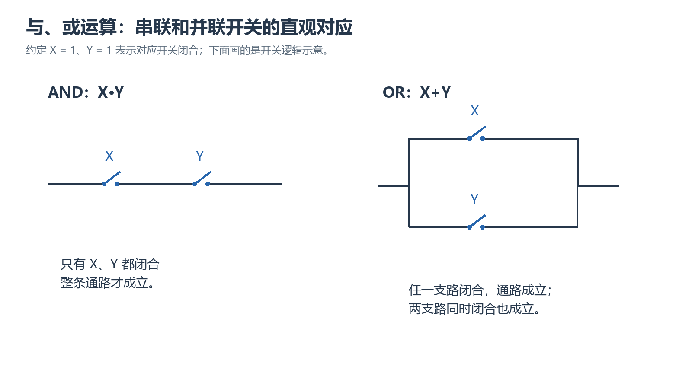

# 第2章｜布尔代数

## 本章要学什么

第一章用0和1表示数值或编号；本章把0和1用来记录条件是否成立。例如A表示“按钮A按下”，A为1就是按下，A为0就是没有按下。要回答的问题是：怎样从这些条件推知输出，再把不同写法比较和化简？

本章只以与、或、非三种运算为起点。每种运算先用具体条件说明，再写符号与表格。随后学习表达式和全部输入的记录方法，最后用已证明的定律变形、展开和求补。本章的学习和作答都从已经介绍的三种运算与表格出发。

主资料为《03_第2章布尔代数.pdf》2.1—2.8节。本文将求补集中在基本变形之后，先确保会读括号和判断等价；第三章才讲的蕴含定理不作为本章化简前提。以下例题与练习若没有写原书题号，均为依据相应教材知识自编的变式。

## 本章学习地图

| 阶段 | 当前问题 | 学完能做什么 |
| --- | --- | --- |
| 状态与运算 | 哪些输入条件使输出成立？ | 解释与、或、非及其符号 |
| 表达式与表 | 怎样完整记录一种功能？ | 逐行计算，不遗漏任何输入 |
| 基本规律 | 哪些重复和相反条件可直接处理？ | 用定律说明每步变形 |
| 结构改变 | 怎样改变分组、展开或提取共同部分？ | 比较两种等价写法 |
| 化简与形式 | 怎样减少重复而保持结果？ | 写积之和、和之积并检查 |
| 整体取反 | 怎样让每种输入下的输出都相反？ | 保留取反范围，逐层求补 |

## 一、从条件认识与、或、非（教材2.1—2.2）

### 本章路线

先定义变量与输出，再从一个条件取反、两个条件同时成立、至少一个成立三个问题建立运算，最后才把它们连接成式子。

> 本章要解决的问题：逻辑中的1加1为什么仍是1？
>
> 本章学完应会：先说明0和1代表什么，再解释三种运算及开关连接的意义。

### 学习单元

#### 变量、常量与逻辑函数

**布尔变量**是只取0或1的变量。字母A可以表示一个输入条件，取1时条件成立，取0时条件不成立。使用新变量时要明确它记录什么；A表示按钮按下与A表示按钮松开，虽然字母相同，实际功能会不同。

**常量**0和1在运算中不随输入变化，分别代表恒不成立和恒成立。变量A有时0、有时1；常量1则一直为1。式子中A和1不能因为某次输入恰为1便随意替换，除非当前只计算那一次输入的结果。

根据输入条件产生的输出可记为F。**逻辑函数**是这条确定的对应规则：每一种允许输入组合都有一个确定输出0或1。本章讨论输出只看当前输入的组合功能，承接第一章的分类，不要求电路保存过去的输入。

#### 非：把一个条件的结果反过来

**非运算**，英文NOT，输入0得到1，输入1得到0。写作$A'$，读“非A”或“A的补”。撇号是运算符，不是导数，也不是第一章负数的反码名称。若A表示按钮按下，A'就表示按钮没有按下。

| A | 非A的结果A' |
| --- | --- |
| 0 | 1 |
| 1 | 0 |

实现这项功能的基本电路叫**反相器**。这里的“相反”是逻辑0和1交换，不是把电压变成负值。输入输出仍然都是已经约定的两个逻辑状态。

对A连续做两次非，0先变1再变0，1先变0再变1，因此$(A')'=A$。括号说明第二个撇号作用于整个A'。有的资料在字母上画横线表示非，含义相同；本文主要统一使用撇号，避免同一步推导的取反范围难以辨认。

#### 与：两个条件必须同时成立

**与运算**，英文AND，只有所有输入都是1才输出1。写成$A\cdot B$，点常省略为$AB$。这个乘法外形借自代数，但这里定义的是条件同时成立；并不先假设普通代数的所有规则也能使用。

| A | B | 与的结果AB |
| --- | --- | --- |
| 0 | 0 | 0 |
| 0 | 1 | 0 |
| 1 | 0 | 0 |
| 1 | 1 | 1 |

假设A和B分别表示两个开关闭合，输出1表示电路导通。两个开关**串联**，即沿同一条支路前后连接，电流要依次经过二者，必须二者都闭合才有通路。因此串联通路的条件是AB。没有任何一只开关闭合时，也不会因“两个0”合成一个1。

完成与运算的基本电路叫**与门**。**逻辑门**是按特定规则把输入逻辑值变成输出逻辑值的基本功能部件。门的名字表示它的规则，不是说开关本身具有门的形状；本文用功能和符号说明，暂不讨论其内部电子器件。

#### 或：至少一个条件成立

**或运算**，英文OR，至少一个输入是1就输出1，只有全部输入0才输出0。写作$A+B$。注意这里的加号已经被定义为逻辑或，不是累加数量；两输入都为1时，“至少一个成立”仍然成立，所以$1+1=1$。

| A | B | 或的结果A+B |
| --- | --- | --- |
| 0 | 0 | 0 |
| 0 | 1 | 1 |
| 1 | 0 | 1 |
| 1 | 1 | 1 |

两个开关**并联**，即形成两条可供选择的支路，只要其中一条闭合就能导通。因此输出通路条件是A+B。这里的“或”包括两者同时成立，并不是日常有时所说的“只能选一个”。第三章会另外定义“恰好不同”的运算，本章先不混用。

实现或的功能部件叫**或门**。把与门、或门和反相器连接起来，就可以描述更复杂的条件。要始终先明确输入代表“条件成立”为1，输出代表“通路存在”为1，才可把串并联与运算符号对应。

图示来源：项目原有教学示意。串联图需两开关同时闭合，并联图只需至少一条支路闭合；它用于解释已经定义的与和或。

##### 小练习：读懂“或”是否包含同时成立

> 题源：依教材2.2基本运算与开关关系自编比较题。

**题目：** 要求“甲同意或乙同意就通过，二者都同意也通过”。令A、B分别表示甲、乙同意，写输出；若有人在A=B=1时填0，错在何处？

**解析：** 输出F=A+B，四种输入的输出按00、01、10、11顺序为0、1、1、1。错解把“或”理解为只能一个条件成立，改变了题目允许同时成立的要求。不能只说“加法算错”，因为错误发生在运算含义的选取。

#### 括号与运算顺序

优先计算括号里面；没有括号时，先做非，再做与，最后做或。所以$A+B'C$应读为A与“B先取反后同C相与”的结果相或，而不是先计算A+B。撇号紧跟谁，就对谁取反；要反转整体，必须写括号，如$(A+B)'$。

取A=1、B=1、C=0，$A+B'C=1+0\cdot0=1$，而$(A+B')C=(1+0)\cdot0=0$。括号改变了先完成哪个运算，不能只看式中出现同样三个字母就认为功能相同。

**中间结果**可以另命名字母，帮助读结构。例如设P=B'，T=PC，F=A+T。P、T是由输入计算出的信号，不能把它们又当成任意独立输入；取B=1时P已经确定为0，不允许另外指定P=1。

### 本章小结

与是全部成立，或是至少一个成立，非是把成立与不成立交换。串联、并联和反相器可分别说明这些功能；变量含义和输出约定先于符号。读表达式时保留括号，不能把普通算术的加法含义带入逻辑或。

### 本章练习与检验

> 题源：依教材2.2基本运算自编连接比较题。

**题目：** A与B串联的支路，再同C并联；另一个电路是A串联在B、C并联部分前。写两输出并给出使它们不同的一组输入。

**解析：** 第一输出F=AB+C，第二输出G=A(B+C)。取A=0、B=0、C=1，第一条还有C支路，F=1；第二条必须经过A，G=0。括号反映支路连接，而不是书写装饰。两式有一组输入不同，已经证明功能不同。

## 二、表达式与完整真值表（教材2.3）

### 本章路线

先认识文字、表达式和函数的区别，再把每个运算拆成中间列，按固定顺序列出全部输入，最后比较两种表达式。

> 本章要解决的问题：验算几组结果相同，能否就说两个式子等价？
>
> 本章学完应会：列完整真值表、给出反例，并说清楚两种证据的不同作用。

### 学习单元

#### 文字和表达式不等于输入个数

由变量、常量、与或非和括号组成的式子叫**布尔表达式**。一个变量或其补的一次出现叫一个**文字**。例如$AB'+A'C$共有A、B、C三个不同输入变量，却有四个文字出现：A、B'、A'、C。文字数可以因为同一变量重复出现而多于变量数。

输出名F只是把结果命名。$F=AB'+A'C$意味着给定三个输入后，按右边规则得到F，不能把F同时当作第四个任意输入。如果列输入组合时连F也自由填，就把函数关系破坏了。

同一逻辑函数可以有不同表达式。表达式说明怎样组合运算，函数说明每种输入最终对应什么输出；两个结构不同的式子，只要所有输入下结果相同，就叫**等价**。符号等式在这里要求所有合法输入都成立，称为**恒等式**，并不是只求某一组使等号成立的输入。

#### 为什么有n个输入就有二的n次方行

**真值表**列出每种输入组合及对应输出。n代表可以独立选择的二值输入个数，每个输入各有两种选择，所以有$2^n$行。三个输入A、B、C按000、001、010、011、100、101、110、111排列，便能系统地不漏不重。

从最右列每行0、1交替；往左一列每两行换一次；再左每四行换一次。这样的排序借用第一章的二进制数顺序，不是用二进制算术计算输出。输入组合只是排列编号，输出仍按已定义的逻辑与、或、非求值。

#### 完整例子：逐列计算而不靠猜

设$F=A'B+AC$。先加中间列A'B与AC，最后对两列做或。每行把当前A、B、C代入，不把上一行的结果带到下一行。

| A | B | C | A'B | AC | F |
| --- | --- | --- | --- | --- | --- |
| 0 | 0 | 0 | 0 | 0 | 0 |
| 0 | 0 | 1 | 0 | 0 | 0 |
| 0 | 1 | 0 | 1 | 0 | 1 |
| 0 | 1 | 1 | 1 | 0 | 1 |
| 1 | 0 | 0 | 0 | 0 | 0 |
| 1 | 0 | 1 | 0 | 1 | 1 |
| 1 | 1 | 0 | 0 | 0 | 0 |
| 1 | 1 | 1 | 0 | 1 | 1 |

以010这一行为例，A'=1，B=1，故左项1；A=0使右项0，F=1。以101这一行为例，左项因A'=0为0，右项因A=C=1为1，F也为1。这两行输出相同，不代表内部两项也相同；中间列帮助定位错误来自哪一步。

每一行只回答稳态输入下的逻辑结果。本章不在表里推断输入变化需要多长时间，也不把相邻两行看成必须经过的实际时间过程；门延迟将在第8章专门讲授。

#### 一个反例与全部证明

要推翻“两式对所有输入都相同”，找一行不同就足够；这行输入叫**反例**。例如比较$A+B'C$与$(A+B')C$，前节的100已经给出1与0，因此不等价。即便另外七行都相同，这一行仍足以否定恒等。

要用真值表证明恒等，必须全部行对应相同。比较$A(B+C)$与$AB+AC$，可列下面的完整结果；这里暂把规律当作待检验结论，不提前使用后面的分配律。

| A | B | C | B+C | A(B+C) | AB | AC | AB+AC |
| --- | --- | --- | --- | --- | --- | --- | --- |
| 0 | 0 | 0 | 0 | 0 | 0 | 0 | 0 |
| 0 | 0 | 1 | 1 | 0 | 0 | 0 | 0 |
| 0 | 1 | 0 | 1 | 0 | 0 | 0 | 0 |
| 0 | 1 | 1 | 1 | 0 | 0 | 0 | 0 |
| 1 | 0 | 0 | 0 | 0 | 0 | 0 | 0 |
| 1 | 0 | 1 | 1 | 1 | 0 | 1 | 1 |
| 1 | 1 | 0 | 1 | 1 | 1 | 0 | 1 |
| 1 | 1 | 1 | 1 | 1 | 1 | 1 | 1 |

两输出列逐行相同，因此恒等。这不是把每个式子的“1的总数”比较一下；即使两列各有四个1，若落在不同输入行，函数仍然不同。

##### 小练习：相同个数不代表相同功能

> 题源：依教材2.3真值表与等价判定自编比较题。

**题目：** 对两个输入A、B，F=A，G=B。列四行输出，判断“两个函数都在两行输出1，所以等价”。

**解析：** 按00、01、10、11顺序，F为0、0、1、1，G为0、1、0、1。01一行已得到不同结果。相同的1的个数只反映一种计数，未说明输出发生在哪些输入；等价必须逐行对应。

### 本章小结

变量数决定输入行数，文字数记录式中的出现次数。真值表完整描述当前输入对应的输出；一行不同可否定恒等，证明恒等则要逐行完整比较，或者使用接下来学到的合法定律。

### 本章练习与检验

> 题源：依教材2.3表达式、真值表自编错误审查。

**题目：** 有人认为$F=A'B+AC$与$G=(A'+B)(A+C)$只是“把加和乘换个位置”，应当相等。先找反例，再解释两个式子的最外层操作。

**解析：** 取A=0、B=0、C=1，F=0，G=(1+0)(0+1)=1。F先产生两个与的结果再做或；G先产生两个或的结果再做与。运算层次不同，不能凭字母与补号相似判断等价。即使找不到反例，也应完成全部行而不是停在外观比较。

## 三、从运算表得到基本定律（教材2.4）

### 本章路线

先用0、1两个取值说明单变量定律，再把同一规律代入一个整体表达式，最后介绍成对记忆定律的对偶方法。

> 本章要解决的问题：定律里的X只能是一个输入字母，还是可以代表一整个子式？
>
> 本章学完应会：解释每条基本关系，并在不改变运算范围的条件下替换整体。

### 学习单元

#### 0和1分别怎样影响与和或

$X+0=X$，因为X为0时0或0仍为0，X为1时1或0仍为1；$X+1=1$，因为至少有常量1这个成立条件。与的对应关系为$X\cdot1=X$与$X\cdot0=0$，前者始终保留X，后者无论X是什么都不能让所有输入为1。

这些常称为**0-1律**。名称不是新的计算操作，只是给四个已经由运算表得到的关系起一个方便引用的名字。比如$A(B+C')+1$，不必先知道A、B、C的值，就能把整个$A(B+C')$看成X，由X+1=1直接得结果1。

这种把X换成整体的做法叫**代入**。只要该整体最终仍取0或1，定律对它也成立。但必须保留整体范围：若X=A+B，则X乘0是$(A+B)0$，不能去掉括号写A+B0，再宣布结果0；后者只把B与0相与，A仍会影响输出。

#### 重叠律：重复条件不改变真假

$X+X=X$和$XX=X$叫**重叠律**，也称幂等律。X为0时两式都0，X为1时两式都1。逻辑或不计次数，所以“A成立或A成立”与“A成立”没有区别；逻辑与中重复同一个必须条件也没有增加新的要求。

普通代数中的X+X通常是2X，但那是在计数量。本章的加号定义为或，两个1或在一起仍为1，因此不能把2X当作本章的标准简化结果。类似地，XX可直接写X，而不必留下一个平方来表示复杂程度。

重复可以是整个子式。例如$(A+B')(A+B')=A+B'$，先识别两因子完全一样，再用XX=X。若是$(A+B')(A'+B')$，就不是同一个X，不能仅因外观相近就用重叠律；必须让代入对象逐字符或逐功能一致。

#### 互补律与双重否定

$X+X'=1$及$XX'=0$叫**互补律**。X与X'总有一个为1，却不可能同时为1，所以相或恒1、相与恒0。$(X')'=X$叫**还原律**或双重否定律，连续翻转两次还原原值。

这些关系也适用于整体子式。令P=A+B，则$(A+B)(A+B)'=PP'=0$。但$A+B$与$A'+B'$通常不是互补的两个整体：例如A=0、B=1时二者都1。看到每个字母都改了补号，不代表整个表达式已经被取反；后面会正式推导整体求补的方法。

这一点也说明不能只凭名称套公式。要使用XX'=0，必须确认两部分确实是一部分与该部分整体的补。括号是识别范围的证据，不是可有可无的书写习惯。

#### 对偶：交换运算，不反转每个变量

教材用**对偶**把定律配成对：在式中同时将与和或交换、0和1交换，变量及其补号保持原样，并保留原来的分组关系。比如$X+0=X$的对偶是$X\cdot1=X$；$X+X'=1$的对偶是$XX'=0$。

对于含多层运算的式子，需要把运算关系整体翻译，而不只是替换字形后照旧按原优先级读。$X+YZ$的结构是“X与YZ相或”；对偶结构是“X与Y+Z相与”，应写$X(Y+Z)$。若写成XY+Z，就把括号层次丢失了。

对偶不是求补，也不是把所有变量换成补变量。以X+0=X为例，对偶仍保留X，没有变成X'。本章只把对偶作为理解和核对成对定律的方法；具体变形是否成立，仍可用定义、已证定律或真值表确认。

##### 小练习：整体代入与取反范围

> 题源：依教材2.4基本定理和对偶自编错误审查。

**题目：** 化简$(A+B')(A+B')+0$，写X+X'=1的对偶；再审查把$(A+B)(A'+B')$直接当成XX'。

**解析：** 第一式令X=A+B'，用XX=X和X+0=X得到A+B'。对偶为XX'=0。第三式不满足互补结构，A=0、B=1时两个括号均为1，乘积1，不可能恒等于0；反例说明不能把各个字母反相当成整体反相。

### 本章小结

基本律由0、1运算表得到，对任何二值子式整体代入仍成立。对偶同时交换与或及0、1，保留变量和分组；求整体的补则是另一个问题。先确认子式是不是同一个整体，再引用定律。

### 本章练习与检验

> 题源：依教材2.4基本定理自编综合题。

**题目：** 不列全部输入，化简$[(A+B)(A+B)']+C0+DD$，逐步说明依据；如果把第一个括号中的第二因子改成A'+B'，原第一步是否仍成立？

**解析：** 原式第一部分是互补相与，为0；C0为0；DD=D，故全式为0+0+D=D。改成A'+B'后不再是已确认的整体补，不能用XX'=0。取A=0、B=1、C=D=0，修改后的式子为1，而原式为0，能直接看到这一改动改变函数。

## 四、交换、结合与两种分配（教材2.5）

### 本章路线

先改变同一种运算的顺序与分组，再讨论两种运算混合时的展开。用0和1分别讨论，解释布尔代数多出的一种分配关系。

> 本章要解决的问题：为什么X+YZ也能分解成两个括号，而普通代数一般不能？
>
> 本章学完应会：识别允许交换和结合的范围，用两种分配关系作双向变形。

### 学习单元

#### 交换律与结合律各改变什么

**交换律**改变运算对象的次序：$X+Y=Y+X$，$XY=YX$。它们分别来自“至少一个为1”和“两个都为1”的对称性。交换输入名称不改变这种运算结果，但这不表示随便交换电路中不同运算的位置也正确。

**结合律**改变同一种连续运算的分组：$(X+Y)+Z=X+(Y+Z)$，$(XY)Z=X(YZ)$。三个条件“至少一个成立”与先合并哪两个无关；三个条件“全部成立”同样与分组无关。于是可以简写X+Y+Z和XYZ。

结合律不能跨越不同运算。$(X+Y)Z$一般不等于X+YZ，因为前者要求Z也成立，后者在X成立时根本不要求Z。取X=1、Y=0、Z=0，前者0而后者1。每次去括号都要看括号内外是否同一运算。

多个输入门也可以理解为连续二输入运算的组合。例如ABC只有三个输入全为1才为1；A+B+C则任一输入为1就为1。本章只比较功能，实际用几个门实现留到后面讨论，不把“写成一项”当成已经知道具体器件数。

#### 与对或的分配：共同条件要分到每一支

第一种分配关系是$X(Y+Z)=XY+XZ$。意思是“X成立，而且Y或Z至少一个成立”，等价于“X与Y同时成立，或者X与Z同时成立”。前面已经列完整真值表证明，现给它名称，便于后续引用。

例如$A(B+C')=AB+AC'$。展开时A必须分到括号内每一个和项，不能只乘第一项；写AB+C'会让C'=1时即便A=0也输出1，改变了共同条件A。

这个等式可以反向用，称为**提取公共因子**或因式分解：$AB+AC'=A(B+C')$。**因子**是通过与相乘的部分，**项**通常指通过或相加的部分。这里两项都含A，提到括号外之后，括号内保留各自剩下的条件。

带补号的整体也可作为公共因子。例如$AB'(C+D)+EB'(C+D)$，共同因子是$B'(C+D)$，结果为$(A+E)B'(C+D)$。先完整找出相同部分，再提取；不能把C+D拆成只提C，造成剩余项丢失。

#### 或对与的分配：布尔代数特有的对应关系

第二种分配关系为：

$$
X+YZ=(X+Y)(X+Z).
$$

分X的两种值检查即可解释。若X=1，左边1，右边两个括号都1，乘积1；若X=0，左边YZ，右边变成Y乘Z，仍为YZ。两类已经覆盖X的所有可能取值，所以不论Y、Z如何，该恒等式成立。

例如$A+BC$可以写成$(A+B)(A+C)$。不要按普通代数展开后留下A的平方等数量项，再用算术大小判断不成立；本章AA=A，重复或也不会累加。这个规律正是之后把“若干乘积相或”改写成“若干和式相与”的基础。

X可以是整体。$A'B+CD$中令X=A'B、Y=C、Z=D，得到$(A'B+C)(A'B+D)$。如果继续要求每个括号都只含文字相或，还可再用同一定律展开，但那属于后面规定目标形式的任务，不能把两层不同要求混为一谈。

#### 完整例子：同一个结果的两种证明

计算$(A+B)(A+C)$，直接反向使用第二分配关系得到A+BC。也可以先按第一种分配展开：

$$
(A+B)(A+C)=AA+AC+AB+BC=A+AC+AB+BC.
$$

接下来A+AC和A+AB可化为A，这个简化需要下一节正式证明的吸收律。为避免在此先借用结论，当前可以改用分A取值的独立证明：A=0时两边均BC，A=1时两边均1。这样已完整建立结论，后面再回头用简化定律缩短代数链。

这一区分很实际：能写出正确结果，不代表每一步所写的理由都已得到说明。学习时先确认一种完整证明，再把它用作工具，不能靠一个未讲结论去证明另一个未讲结论，形成循环。

##### 小练习：同一种分配的两个方向

> 题源：依教材2.5两种分配律自编比较题。

**题目：** 分别展开$A(B+C+D)$与分解$A+BCD$，并给出后一结果在A=0时的检查。

**解析：** 第一式为AB+AC+AD。第二式先把BCD看作B乘CD，得$(A+B)(A+CD)$；再分解第二括号，得到$(A+B)(A+C)(A+D)$。当A=0时三括号为B、C、D，乘积BCD，与原式一致；A=1时三括号全1。每个变形都让共同的A保留在需要的位置。

### 本章小结

交换换次序，结合换同类分组，分配连接两种运算。布尔代数的两种分配关系都可双向使用；判断能否去括号或提因子，必须检查完整运算层次与被代入的整体。

### 本章练习与检验

> 题源：依教材2.5交换、结合和分配自编综合题。

**题目：** 有人写$A(B+C)+D=AB+C+D$，又写$A+BC=(A+B)C$。分别指出缺失的条件、给出反例并修正。

**解析：** 第一式展开时漏把A分给C，正确为AB+AC+D；取A=0、B=0、C=1、D=0，原式0、错式1。第二式漏了括号A+C，正确为$(A+B)(A+C)$；取A=1、B=0、C=0，原式1、错式0。相同的A、B、C出现并不能保证分配结构正确。

## 五、用已知定律化简（教材2.6）

### 本章路线

先解释化简保留的是什么，再证明吸收、合并和消去条件的几种形式，最后给出每步可复查的算例。不借用第三章的高级删项方法。

> 本章要解决的问题：删除一个项，为什么不会漏掉原来输出为1的情况？
>
> 本章学完应会：找共同部分、指出被包含的条件，并用具体输入检查非法删项。

### 学习单元

#### 化简的目标是同一函数的较简写法

**化简**是在功能完全等价的前提下，减少不必要的文字、项或括号。它不是为了少写字符就任意忽略输入。比如AB+A的第二项已经包含A、B同时成立的情况，可写A；但AB+B'C不能只因前者两文字而删除后者。

本章先比较表达式结构。门数、门的输入端数和实际速度涉及怎样实现，不能仅由最短字符数决定。比如A(B+C)和AB+AC逻辑相同，前者重复的A较少；究竟怎样连接更适合某种器件，需要后续章节的条件，本章不提前作工程结论。

#### 吸收律：较宽的条件包含较窄条件

**吸收律**为$X+XY=X$。X=0时，X与XY都0；X=1时，左边已经由X给出1，Y不能使它再变成别的结果。用已学定律证明：$X+XY=X\cdot1+XY=X(1+Y)=X$。

这里是X把附加条件Y的支路吸收。若X代表A+B，Y代表C，得到$(A+B)+(A+B)C=A+B$。如果把XY写错成X'Y，便没有相同的包含关系；X=0、Y=1时X'Y=1，不能删掉。

对偶形式为$X(X+Y)=X$。当X=0，外面的X已经让输出0；当X=1，括号必为1，整体仍X。因此在乘积中也可能删除一个更宽的和式条件。这不是“把相同字母约掉”，而是使用已经证明的布尔恒等式。

#### 合并：只在一个条件的相反情况间选择

$XY+XY'=X(Y+Y')=X$。两项共享X，只在Y与Y'之间区别，二者相或覆盖Y的全部情况，剩下只需X。教材的这一关系是后面系统化化简的基础，本章先完整理解代数理由。

例如$AB+A'B$，先用交换律写为BA+BA'，公共部分B乘以A+A'，最终为B。不能在$AB+A'C$上照样删去A，因为公共剩余部分一个B、一个C，并不相同。取A=1、B=0、C=1，原式0，若乱合并成B+C便为1。

合并后的单个字母不说明原变量已经不存在于电路所有地方，只说明当前这个输出函数不再依赖它。例如F=AB+A'B=B，B=0时不论A如何F都0，B=1时F都1，这种独立性可以在真值表的对应行直接核对。

#### 消去一个文字的条件

$X+X'Y=X+Y$。使用第二种分配律，得到$(X+X')(X+Y)=1\cdot(X+Y)=X+Y$。直观上，X已经为1时附加支路无影响；X为0时X'=1，剩下由Y决定，所以这时不必再明确写X'。

对偶为$X(X'+Y)=XY$。例如$A(A'+BC)=ABC$，代入的Y是BC整个乘积。先写清X和Y是谁，可避免把括号A'+BC错误拆成只处理A'+B，再把C遗落在外面。

注意$X+XY=X$与$X+X'Y=X+Y$只差一个补号，结果却不同。第一种Y出现的情况全已由X覆盖，第二种还要保留X=0且Y=1的输入。先解释条件覆盖，再记公式，比按字母形状机械匹配更不容易混淆。

#### 完整例子：选择短的变形路径

化简$F=AB+AB'C+A'B$。先把前后两项合并：$AB+A'B=B(A+A')=B$，于是$F=B+AB'C$。再令X=B、Y=AC，使用X+X'Y=X+Y，得到$F=B+AC$。

这个结果可以按B的两种值检查。B=1时，原式前后两项总有一个1，F=1，简式也1；B=0时，原式只剩AC，简式也AC。两种情况已覆盖全部B，不用一口气写出八行，也没有偷用未讲定律。

另一条路径先展开和组合会更长，却仍须每步等价。简化快慢不是判断正确的唯一标准；先把合法推导写完整，再寻找共同部分来减少步骤，不能以“显然可删”为由跳过关键条件。

##### 小练习：比较吸收与合并顺序

> 题源：依教材2.6化简定理自编变式。

**题目：** 化简$F=AB'+AB+AB'C$，用两条路径说明第三项为何可以删，并给出最终函数何时为1。

**解析：** 路径一先用AB'+AB=A，再由A+AB'C=A。路径二先把AB'与AB'C按X+XY=X吸收，余下AB'+AB，再合并得A。最终只在A=1时输出1，与B、C无关。两条路径都给出了覆盖理由，而不是单凭最后字数较少。

### 本章小结

吸收删除被包含条件，合并消去一对相反条件，X+X'Y形式则删去某一文字而保留必要的Y。每次都要明确代入的整体和输入条件，不能把这些关系误读为普通加减的约去。

### 本章练习与检验

> 题源：依教材2.6消去与吸收自编综合题。

**题目：** 化简$H=(A+B)(A+B')+AC$；再判断能否由AX=AY推出X=Y，给出具体反例。

**解析：** 由第二种分配关系，前两个括号为A+BB'=A，H=A+AC=A。不能从AX=AY约掉A；取A=0、X=0、Y=1，两边都0而X与Y不同。等式左、右当前结果相同，不代表被一个0条件遮住的内部值相同。

## 六、积之和与和之积（教材2.7）

### 本章路线

先给两种形式明确含义，再用分配律展开与分解；检查目标形式和函数等价是两个步骤，最后比较不同结果的文字数量。

> 本章要解决的问题：展开正确但还含嵌套括号，是否已经达到题目要求的形式？
>
> 本章学完应会：识别乘积项、和项，完成两个方向的转换，不把普通形式误作必须含全部变量。

### 学习单元

#### 乘积项、和项与两种英文缩写

**乘积项**由文字相与组成，例如AB'C；一个单独文字A也可视作只有一个因子的乘积项。若几个乘积项相或，得到**积之和**，英文sum of products，缩写**SOP**。例如AB'+AC与A+B'C都是SOP。

**和项**由文字相或组成，例如A+B'+C。若几个和项相与，得到**和之积**，英文product of sums，缩写**POS**。例如$(A+B')(A+C)$是POS；单独一个和项或文字也可看作只有一项的这种形式。

这两个名称只规定结构，不要求每项都含所有输入变量。例如函数有A、B、C三个输入，AB'+C仍是SOP。第四章才讲每项包含所有变量的特殊形式；本章不要提前把缺少某变量判断成“格式错误”。

式子A(B+C')+D目前含一个“乘积中嵌和”的部分，不能直接把A(B+C')叫作由文字相与的乘积项。要化为SOP，应展开成AB+AC'+D。函数等价但是否已经达到指定写法，需要单独检查。

#### 展开：每个选择都要计入

将$(A+B)(C+D)$展开，先把第一括号整体记X，对第二括号分配得$(A+B)C+(A+B)D$，再分配为AC+BC+AD+BD。写成AC+BD会漏掉第一括号选A、第二括号选D，以及第一选B、第二选C的情况。

多层时可以分步进行并及时化简。例如$(A+B)(A'+C)$展开为AA'+AC+A'B+BC，先用互补律AA'=0，得到AC+A'B+BC。本章到此已经得到合法SOP；是否还能用第三章的蕴含定理删项，留待下一章，不在此假装已学会该工具。

展开不一定让表达式更短。它的目标是转换形式，化简的目标才是减少冗余；题目若要求“展开并化简”，要先检查形式，再用本章已讲的定律处理能确定的部分，不能因为式子变长就判展开错误。

#### 分解：或对与的分配逐层使用

把$A+BC$分解为POS，直接使用第二种分配得$(A+B)(A+C)$。若是$AB+C$，把C作为共同的X，得到$(A+C)(B+C)$，这里需要先交换相或两部分的顺序，才能看出对应结构。

考虑$F=AB+AC+BC$。先将前两项提A，得A(B+C)+BC。若要全部成为POS，可以用$X+YZ=(X+Y)(X+Z)$并逐步化简：$AB+C=(A+C)(B+C)$等局部变形需要在完整式内保留其他项。更直接的等价目标是$(A+B)(A+C)(B+C)$，可展开检验。

检验这个目标时，前两个括号先变为A+BC，再乘B+C，展开为AB+AC+BCB+BCC。重叠律把BCB和BCC都变BC，再由BC+BC=BC，得到AB+AC+BC，完成证明。并非看到三个配对括号就凭印象填写，展开路线给出了每一步依据。

#### 相同函数可以有不同而合法的形式

$F=AB+AC$为SOP，因式分解为A(B+C)后是POS，因为A是单文字和项、B+C是另一个和项。前者四个文字出现，后者三个；两者都可能符合各自指定形式，不能把“字符更多”当成“不正确”。

数文字时补变量也算一个文字。例如A'BC有三个文字，不是因为撇号多一个字符就算四个。数项时看最外层：SOP数相或的乘积项，POS数相与的和项；不要把括号内的字母个数误当项数。

##### 小练习：转换与验证分开

> 题源：依教材2.7展开及因式分解自编比较题。

**题目：** 将$(A+B)(A+C')$转换为化简SOP，再把结果重新分解成POS；指出怎样检查没有漏项。

**解析：** 展开为AA+AC'+AB+BC'，AA=A，A吸收AC'和AB，得A+BC'。反向分配得$(A+B)(A+C')$。按A=0与1检查：A=0两式均BC'，A=1两式均1。往返恢复和分情况检查给出不同的证据，不只看最终外形。

### 本章小结

SOP是乘积项相或，POS是和项相与，普通形式允许某项缺少输入变量。展开、分解、化简是相关但不同的要求；先确认目标结构，再核对每一步保持同一函数。

### 本章练习与检验

> 题源：依教材2.7两种形式转换自编综合题。

**题目：** 把$(A+B)(C+D)+AC$展开并用已学定律化简；再把A+BCD写成POS，分别解释两结果的结构。

**解析：** 前式展开AC+AD+BC+BD+AC，重复AC用重叠律只保留一次，得AC+AD+BC+BD，四个乘积相或，是SOP。后式为$(A+B)(A+C)(A+D)$，三个和项相与，是POS。结果中任何一项无需为了出现全部变量而另添文字；那会改变本章的普通形式要求。

## 七、表达式整体求补（教材2.5、2.8）

### 本章路线

先明确补函数需要每行都与原输出相反，再从“两个都成立”的反面推导德摩根定律，最后按由外到内的次序处理多层表达式。

> 本章要解决的问题：为什么只把所有字母加补号，通常并没有得到整个函数的补？
>
> 本章学完应会：逐层反转运算，保留括号，并用每行互补检查求补结果。

### 学习单元

#### 补函数与反函数是不同词

给定逻辑函数F，对相同输入令输出0变1、1变0，得到**补函数**F'。本文也称函数的反或求反；这不是普通数学中把输入输出倒过来找逆映射的“反函数”。例如F=AB，输入00、01、10、11下输出0、0、0、1，补函数应输出1、1、1、0。

F与F'在每组输入下满足$F+F'=1$与$FF'=0$。前者排除两输出都0，后者排除两输出都1；两个条件合起来保证每次恰有一个1。只检查其中一个不够，例如恒1与恒1的或也为1，但它们不是互补。

#### 德摩根定律从条件的反面得到

两个条件全部成立的反面，是至少一个不成立。所以$(AB)'=A'+B'$。可以列四种输入核对：原与只有11时1，其反只有11时0；A'+B'也只有A'=B'=0，即A=B=1时为0。其余输入全部为1，四行一致。

至少一个条件成立的反面，是所有条件都不成立，所以$(A+B)'=A'B'$。原或只在00为0，其补只在00为1；A'B'也只在A=B=0时1。这两条叫**德摩根定律**。名称帮助引用，实际含义仍是对“全部”与“至少一个”做整体否定。

推广到三个输入，$(ABC)'=A'+B'+C'$，$(A+B+C)'=A'B'C'$。这里不是给每个文字取反后保持原运算，还必须与或交换。如果只写A'B'C'作为ABC的补，会只在000输出1，漏掉001、010等原ABC为0的情况。

#### 从最外层开始，括号不能丢

求$F=AB'+CD$的补，最外层是两个乘积的或。先把两部分整体记P=AB'、Q=CD，得到$F'=P'Q'$。再分别求内部：$P'=A'+B$，$Q'=C'+D'$。所以

$$
F'=(A'+B)(C'+D').
$$

B'再取一次反得B，来自双重否定。不能把结果写成A'+B(C'+D')，因为第一个括号必须作为整体参与与；丢括号会让A'绕过第二个条件，改变输出。

用一组输入核对：A=0、B=1、C=1、D=1，原F由CD为1，正确补应0；正确式为$(1+1)(0+0)=0$。丢括号的错误式却因A'=1而为1，立刻出现反例。

#### 多层求补的完整步骤

设$F=(A+B'C)(D+E)$。第一层是两个括号相与，所以补是$(A+B'C)'+(D+E)'$。第二层分别是相或，所以得到$A'(B'C)'+D'E'$。第三层处理B'C的补，结果为$A'(B+C')+D'E'$。

每一层所用符号都有已学意义：D'E'是两个文字相与，A'(B+C')中括号内的或还没有展开。若题目只要求补号落在单个变量上，已经满足；若再要求SOP，则继续展开为A'B+A'C'+D'E'，不能把这两个结束标准混淆。

求补两次应恢复原函数，能作一种检查。但检查也要完整推导，而不是只把最后字母上的补号再删掉。对$(A'+B)(C'+D')$求补，得到$(A'+B)'+(C'+D')'=AB'+CD$，恰好恢复前例。

#### 求补、对偶和化简的目标区别

求补需要每个输入下输出相反；对偶是交换运算与常量并保留分组；化简要每个输入下输出保持相同。三者都可能改变字面形式，但验收条件不同。

以F=A+B为例，补为A'B'，对偶为AB，化简仍可保持A+B。A=B=1时F为1，对偶AB也1，足见对偶不等于补。名称相似不能代替逐行条件；用一个简单输入检查，往往能快速发现目标被混淆。

##### 小练习：逐层取反与错误定位

> 题源：依教材2.8布尔表达式求反自编错误审查。

**题目：** 求$F=A(B+C')+D$的补。某解答写成$A'(B'+C)+D'$，找出错误并用具体输入反驳。

**解析：** 最外层的或先改为与，得$(A(B+C'))'D'$；内部与改或，得$[A'+(B+C')']D'$；最后为$(A'+B'C)D'$。错解没有正确反转外层或，也没有把A与括号的与正确处理。取A=0、B=0、C=0、D=1，原F=1，正确补0，错式1。

### 本章小结

补函数要求相同输入下的输出逐行相反；德摩根同时改变与或并对各部分求补。由外向内展开，最后再用双重否定整理。对偶不反转所有变量，化简不反转函数，必须先确定任务是哪一种。

### 本章练习与检验

> 题源：依教材2.8求补和2.7形式转换自编综合题。

**题目：** 先化简$H=(A+B)(A+B')+AC$，再求补；同时直接对原式求补，比较两条路径。

**解析：** 前节已证H=A，所以H'=A'。直接求补为$[(A+B)(A+B')]'(AC)'$，第一括号的补为$(A+B)'+(A+B')'=A'B'+A'B=A'$；另一因子为A'+C'，结果$A'(A'+C')=A'$，用吸收律得到相同结论。比较两条路径既检查求补范围，又检查原化简是否保持功能。

## 学习安排与阅读资料

主资料《03_第2章布尔代数.pdf》2.1—2.3对应本篇一、二部分，2.4对应基本定理，2.5对应交换、结合、分配和德摩根，2.6对应化简，2.7对应两种形式，2.8对应求补。本文调整了求补的位置，以便使用前面已经解释的表达式层次，不增加新的课程范围。

读完后应能把每一个定律用0、1条件重新解释，而不是只背左右字形。第三章继续学习更复杂的展开、异或和蕴含删项，但本章练习均可只用当前已讲的知识完成。

## 本章综合习题测验

以下5题用于整章学完后的综合检验，连接本章已经讲过的方法、条件与结果核对。每题的解析与答案紧跟题目；作答时可先遮住解析，写全中间过程后再对照。

> 题源：依《逻辑设计基础》第7版本章2.2—2.8节已讲内容自编综合题，所给数据与题目组合不冒充教材原题。

### 第1题：从开关连接到可检验的函数

**题目：** 开关闭合记1，导通输出记1。甲电路为A、B串联后与C并联；乙电路为A与B、C的并联部分串联。分别写函数，并按ABC=000到111的顺序列输出。指出全部不同的输入，说明括号为什么改变功能。

**解析与答案：** 串联要求同时闭合，对应与；并联只需一条通路，对应或。因此甲为F=AB+C，乙为G=A(B+C)。八行F依次0、1、0、1、0、1、1、1；G依次0、0、0、0、0、1、1、1。差异在001与011：甲可经C单独导通，乙仍受A=0阻断。

F中的AB只约束一条支路，G中的A则约束整个括号内的两条通路。不能把去括号当作抄写简化；必须按分配律得到G=AB+AC，再与原式逐行比较。

### 第2题：化简、两种形式与求补

**题目：** 对F=AB+A'B+AC，先化简为SOP，再写POS，最后求F'。说明这些任务中哪些保持输出、哪个反转输出，并用ABC=010和101检查结果。

**解析与答案：** AB+A'B=(A+A')B=B，所以SOP为F=B+AC。用X+YZ=(X+Y)(X+Z)，得POS为(B+A)(B+C)。两者在每行输出相同，只改变表达式结构。

求补得到F'=B'(A'+C')；这里对整体的或取补变成与，再对AC取补。010时F=1、F'=0；101时F=1、F'=0。还可取000得F=0、F'=1，检查反转方向。若写成B'+A'C'，就把应有的整体相与错成相或，不能由原来的分配关系推出。

### 第3题：多层表达式的取反范围

**题目：** F=A(B+C')+D。求补函数。有人写H=A'(B'+C)+D'，声称就是F'；用一个输入反驳，并解释正确求补时每层运算怎样变化。

**解析与答案：** 先把A(B+C')看成整体，与D相或；取补后为[A(B+C')]'D'。再得到[A'+(B+C')']D'，最终为F'=(A'+B'C)D'。每次都针对当前被取补的整个子式，不能只给每个字母添撇号。

取ABCD=0001，原F因D=1而为1，正确F'=0；H中A'=1、B'=1、C=0、D'=0，故H=1，与补函数要求相反。一个满足全部输入约定的反例已足以否定恒等，不必只比较表达式外观。

### 第4题：区分对偶、求补与代入

**题目：** F=A+BC。写它的对偶式与补函数；分别在ABC=000、111检查。再将恒等式X+YZ=(X+Y)(X+Z)中的X代成A+B、Y代成C、Z代成D，完整写出代入结果。

**解析与答案：** 对偶交换与、或，得到A(B+C)；求补得到A'(B'+C')，两项操作不同。000时原F=0、对偶0、补1；111时原F=1、对偶1、补0，对偶并不保证逐行反转。

整体代入为(A+B)+CD=[(A+B)+C][(A+B)+D]。X是一个完整表达式的占位符，代入后必须保留其整体范围，再根据结合律整理。不能把A、B分开塞进两个不同位置，也不能因为定律中只写一个字母，就以为只能代入单个变量。

### 第5题：用具体输入审查两种错误证明

**题目：** 判断以下理由是否足以证明恒等，并分别给反例：①AX=AY，所以X=Y；②两个三变量函数输出1的行数相同，所以恒等。对②取F=A、G=B，指出输出相同和不同的具体行，再说明怎样才能用真值表完成证明。

**解析与答案：** ①不成立：A=0、X=0、Y=1时，两个乘积都为0，X与Y却不同。与运算可能掩盖后面的差别，不能照搬普通代数中非零数的消去。

②中F、G在八行各有四个1，但ABC=010时F=0、G=1，100时F=1、G=0。000与111等行又相同，所以只统计1的总数会丢失“在哪一行”的信息。真值表证明必须固定同一变量顺序，逐行检查两个函数输出都相同；发现一行不同即可否定，检查几个相同行则不能证明全部行相同。

## 公式卡

X、Y、Z在这里可代表任何已定义的二值变量或整体子式，代入时保留范围。加号为或，相乘为与，撇号为非。

$$
X+0=X,\quad X+1=1,\quad X1=X,\quad X0=0.
$$

$$
X+X=X,\quad XX=X,\quad X+X'=1,\quad XX'=0,\quad (X')'=X.
$$

$$
X(Y+Z)=XY+XZ,\qquad X+YZ=(X+Y)(X+Z).
$$

$$
X+XY=X,\quad X(X+Y)=X,\quad X+X'Y=X+Y,\quad XY+XY'=X.
$$

$$
(XY)'=X'+Y',\qquad (X+Y)'=X'Y'.
$$

SOP由乘积项相或，POS由和项相与。等价检查要求全部输入下相同；补函数检查要求全部输入下相反；一个反例足以否定恒等。
