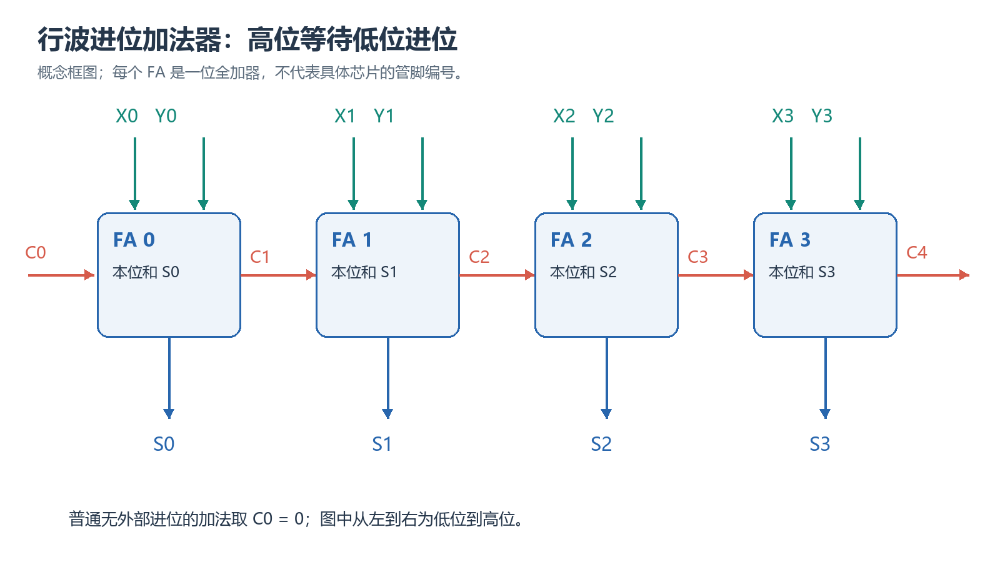

| col1 | col2 | col3 |
| ---- | ---- | ---- |
|      |      |      |
|      |      |      |

# 第4章｜布尔代数的应用、最小项与最大项展开式

## 本章要学什么

前三章从表达式出发计算或变形；现在换一个起点：先给功能要求，怎样构造正确表达式？例如三个输入中至少两个为1就输出1，或把两个一位数及一个进位相加，要如何确保所有输入都处理正确？

本章先从文字规定建立真值表，再为表的每一行建立可重复使用的表达方式。会由表得到函数后，才讨论没有规定输出的输入，以及加法、减法电路。先把每个信号代表什么说清，再从对应关系推导公式，不用第五章的圈图和第七章的特殊门型代替当前步骤。

主资料为《05_第4章 布尔代数的应用、最小项与.pdf》4.1—4.7节。前置知识是与、或、非、异或、布尔定律及基本数制运算。本文保持这条依赖顺序，新记号在首次使用处定义。未给教材题号的练习为依相应节知识自编变式，不借用已移除的专题资料作题源。

## 本章学习地图

| 阶段             | 当前要回答的问题                     | 学完可完成的事           |
| ---------------- | ------------------------------------ | ------------------------ |
| 从文字到条件     | 每个0和1分别代表什么？               | 列输入输出约定，消除歧义 |
| 从一行到整表     | 怎样只选中一行，或只排除一行？       | 写最小项、最大项和编号   |
| 从一般式到标准式 | 缺少的变量怎样合法补上？             | 完成两种标准展开并回算   |
| 有些输入未规定   | 哪些输出可以自己选择？               | 使用无关项且保持全部约束 |
| 一位到多位加法   | 本位和与进位怎样同时产生？           | 推导加法器并逐位计算     |
| 减法与进位组织   | 借位、补码减法和提前算进位怎样联系？ | 推导减法器及先行进位关系 |

## 一、先把功能规定写清楚（教材4.1—4.2）

### 本章路线

先定义每个输入、输出为1时的含义，翻译“且、或、非、至少、仅当”等词，再列出所有当前输入的结果，最后从结果选择表达式。

> 本章要解决的问题：自然语言里同一句“开关有效”，为什么可能对应不同的0和1？
>
> 本章学完应会：把要求写成能逐行核对的规则，而不是先凭印象画一个电路。

### 学习单元

#### 先规定信号含义，才有唯一函数

设装置只有在允许工作且门已打开时报警。可以定义E=1表示允许，D=1表示门打开，F=1表示报警，此时F=ED。若另一个人把D=1定义为门关闭，同一文字要求就应写F=ED'。字母本身不规定含义，输入表头旁必须有明确解释。

**有效**指某种信号取值表示它的作用被请求或条件被满足。**高有效**规定1表示有效；**低有效**规定0表示有效。低有效不等于输出永远为0，只是有效含义反过来。假设L是低有效报警输出，则报警时L=0，不报警时L=1，故L=F'。

**使能**是允许一项功能工作的控制条件。令E=1允许报警、E=0禁止，则即使D表示门开，E=0时仍不能报警，所以F=ED。使能不是每个题目里一定存在的器件或信号，只有需求明确要控制是否工作时才引入这个变量。

#### “且”“或”和“仅当”要逐句拆解

“E有效且D有效”要求二者同时成立，对应ED；“A或B成立，允许同时成立”对应A+B。若要求恰好一个成立，则使用第三章已定义的异或，不能仍用普通或。看到日常词语时先问允许哪些输入，再选运算。

“至少两个为1”包括恰好两个和三个全1；“恰好两个为1”不包括全1。这两种说法只差几个字，输出表却在111这一行不同。设计开始就应检查边界行，而不是等化简后才发现理解了另一种任务。

“仅当条件成立时输出1”通常强调输出1必须满足该条件；若要唯一确定函数，还需明确条件成立是否一定输出1。本文题目都写成“当且仅当”或明确列出其余情况下输出0，避免把必要条件误当作完整功能规定。

#### 贯穿例子：三个输入的多数判断

令A、B、C分别表示三个人是否赞成，输出F=1表示至少两人赞成。三个输入都是独立的当前条件，每种输入都可能发生。先逐行给结果，不急于写简式：

| A | B | C | 赞成人数 | F |
| - | - | - | -------- | - |
| 0 | 0 | 0 | 0        | 0 |
| 0 | 0 | 1 | 1        | 0 |
| 0 | 1 | 0 | 1        | 0 |
| 0 | 1 | 1 | 2        | 1 |
| 1 | 0 | 0 | 1        | 0 |
| 1 | 0 | 1 | 2        | 1 |
| 1 | 1 | 0 | 2        | 1 |
| 1 | 1 | 1 | 3        | 1 |

“至少两人”可由三种配对表达：A与B都1，或A与C都1，或B与C都1，所以$F=AB+AC+BC$。111时三个项都1，逻辑或仍1，不会因为多算成三而出错。这里每项可能覆盖多行，后文将专门定义只选一行的写法。

如果要求恰好两人赞成，则式子应为$AB'C+A'BC+ABC'$。这些项逐个写清第三人不赞成的条件，111时每项都0。不能先得到“至少两个”的式子，再只在表里把111改0却保持原式不变。

#### 先表后式与先式后表的作用不同

对于简单文字条件，可以直接按与或非写式，再列完整表核对；对于有优先规则或多个结果的需求，先表后式更不易漏行。两条路线都要回到同一份功能规定，不能一边按一种输入定义填表，一边按另一种定义写式。

**验证**在当前范围指把表达式对所有规定输入计算一次，检查与需求表是否逐行一致。只查几个“正常情况”可能漏掉边界。例如多数函数若只查000和111，连错误的F=A也会通过；输入011才会暴露它漏掉B、C共同赞成的情况。

本章的实现先使用已学与门、或门和反相器。把公式转换为电路时，可给每个乘积命名中间结果P=AB、Q=AC、R=BC，再令F=P+Q+R。之后的特殊门型和系统化图形化简另有章节，本章不把它们设为练习前提。

##### 小练习：输出有效含义不能偷偷切换

> 题源：依教材4.1文字描述转函数自编比较题。

**题目：** E=1表示允许、S=1表示传感器触发。当且仅当两者成立时报警。输出F高有效，另一个端口L低有效，写两函数并列四种输入的结果。

**解析：** F=ES，L=(ES)'。ES按00、01、10、11，F为0、0、0、1，L为1、1、1、0。E=0时的“不报警”在L上表现为1，不能强行把所有未使能输出都设0。函数反相的是输出含义，输入E与S的定义保持原约定。

### 本章小结

输入输出的1代表什么，先于任何公式。至少、恰好、是否允许同时成立决定真值表，不能只凭关键词套式。表达式与电路都要回到全部规定输入核对，特别要检查功能边界。

### 本章练习与检验

> 题源：依教材4.1—4.2组合设计方法自编综合题。

**题目：** 一个输入E控制是否计入投票，当E=1且A、B两人至少一人赞成时F=1，否则0。写式，比较E(A+B)与EA+B，给一组能区分的输入，再说明输出若低有效如何处理。

**解析：** 正确F=E(A+B)。EA+B在E=0、A=0、B=1时仍1，违反禁止条件，正确式此时0。低有效输出为$L=[E(A+B)]'=E'+A'B'$。使能必须限制整个赞成条件，括号决定是否让B绕过控制。

## 二、让一个表达式对应一行（教材4.3）

### 本章路线

先从一行的具体输入构造全部成立的条件，再构造只在这一行失败的条件，定义编号和记号，最后把行条件组合成整个函数。

> 本章要解决的问题：最小项和最大项为什么有相反的补号规则？
>
> 本章学完应会：由行写两种项，由项找回行，并用它们描述整个真值表。

### 学习单元

#### 最小项：恰在指定输入行为1

固定变量顺序A、B、C，考虑输入101。要让一个乘积只在这一行输出1，A必须为1、B必须为0、C必须为1，因此写AB'C。把三项条件相与，只有全部满足才输出1；其他任意一行至少有一位不同，使对应文字0。

含全部n个输入变量、每个恰出现一次、采用原变量或其补的乘积项叫**最小项**。n是变量总数。名称中的“最小”不是说它字数最少，也不是“所有等价式里最简单”；它描述细到不能再包括其他输入行的成立条件。

若三变量式AB没有C，则C=0和C=1都可以使它成立，覆盖两行，所以不是三变量最小项。若写AA'B，则本来恒0，又缺C，也不满足定义。判断最小项要同时看所有变量、每个一次和乘积形式。

#### 编号先由变量顺序决定

把A、B、C的输入值按顺序看成三位无符号二进制，101对应十进制5。这一行的最小项写$m_5$，m是minterm名称的首字母，下标5是输入行编号，不是五次方，也不是函数值。

所以$m_0=A'B'C'$，$m_3=A'BC$，$m_7=ABC$。按编号写式时输入位为1写原变量，输入位为0写补变量；这是为了让每个文字在该行都为1，乘积才1，并不是需要无理由背记的一对规则。

变量顺序如果改成C、B、A，同样位串101恰巧不变，但110则不同：ABC=110编号6，CBA=011编号3。表达式里字母可用交换律重排，编号含义却必须先固定输入次序。不能在同一题计算中中途换顺序。

#### 最大项：恰在指定输入行为0

仍看101，若要一个和项只在该行输出0，就要求每个相或的文字都0。A=1时用A'，B=0时用B，C=1时用C'，得到A'+B+C'。任一输入位改变，会使对应文字变1，整个和项随即变1。

含全部变量、每个恰出现一次的和项叫**最大项**，用大写$M_5$表示本行。最大项的“最大”不是说数字最大，定义是只在一个指定输入组合为0，其余行为1。构造规则与最小项相反，是因为目标从“每个文字为1”改成“每个文字为0”。

同一编号的二者互为补：$M_i=m_i'$，i表示任何固定行编号。比如$(AB'C)'=A'+B+C'$，由德摩根直接得到。这里叫互补，不叫普通数学的反函数；相同输入下它们恰有一个1。

#### 三变量的完整对应表

| ABC | 行编号 | 最小项 | 最大项   |
| --- | ------ | ------ | -------- |
| 000 | 0      | A'B'C' | A+B+C    |
| 001 | 1      | A'B'C  | A+B+C'   |
| 010 | 2      | A'BC'  | A+B'+C   |
| 011 | 3      | A'BC   | A+B'+C'  |
| 100 | 4      | AB'C'  | A'+B+C   |
| 101 | 5      | AB'C   | A'+B+C'  |
| 110 | 6      | ABC'   | A'+B'+C  |
| 111 | 7      | ABC    | A'+B'+C' |

不需要把表当成八个孤立答案背下。任挑一行，先使乘积每个文字1，再使和项每个文字0，就能重建。按行代入一遍可检查补号，尤其防止从最小项直接把相乘换成相加却不改变补号。

##### 小练习：从编号往返

> 题源：依教材4.3最小项、最大项定义自编变式。

**题目：** 对ABCD顺序，写编号10的最小项和最大项；分别在输入1010与1011下求值，解释它们选中或排除哪一行。

**解析：** 十进制10为1010，所以$m_{10}=AB'CD'$，$M_{10}=A'+B+C'+D$。在1010下分别1、0；1011下D'=0使最小项0，D=1使最大项1。编号对应输入行，不是把十这个数当作四变量函数的输出。

#### 最小项相或组成所有输出1的行

函数在哪些行为1，就把那些行的最小项相或。多数函数在3、5、6、7行输出1，故$F=m_3+m_5+m_6+m_7$。因为每个最小项只在自己一行为1，所列四项恰好让这四行1，其余行全部0。

缩写为$F(A,B,C)=\Sigma m(3,5,6,7)$，大写希腊字母Sigma写成$\Sigma$，表示把列出最小项作逻辑或，不是普通数值相加。括号里是十进制行编号，最左的变量顺序另外写清。

这叫**最小项展开式**，也称**标准积之和**。普通SOP可能一项包含多行，标准SOP每项恰对应一行。多数函数的简式AB+AC+BC与四最小项式等价，但两者的项数和每项角色不同。

#### 最大项相与排除所有输出0的行

多数函数在0、1、2、4行输出0，就把这些行的最大项相与：$F=M_0M_1M_2M_4$。每一最大项在自己一行0，其余行1，所以乘积恰在所列任一行变0，在未列行为1。

缩写为$F=\Pi M(0,1,2,4)$，大写Pi写成$\Pi$，表示逻辑与。称**最大项展开式**或**标准和之积**。不能把输出1的相同行编号原样放进Pi后面；那样会把本来要1的行排除成0。

当每行都规定0或1时，叫**完全给定函数**。变量顺序固定后，它的标准最小项集合与标准最大项集合都唯一：一个列全部1行，一个列全部0行；同一编号不能同时属于两边，两边合起来应包括所有$2^n$行。

### 本章小结

最小项通过让全部文字为1选中一行，最大项通过让全部文字为0排除一行。编号由变量顺序对应二进制得到。标准SOP列输出1行并相或，标准POS列输出0行并相与，不能混用编号集。

### 本章练习与检验

> 题源：依教材4.3标准展开自编综合题。

**题目：** F在三变量编号1、2、5、7行为1，其余0。写两种标准表示和F'的两种标准表示；核对编号总数。

**解析：** F为$\Sigma m(1,2,5,7)$及$\Pi M(0,3,4,6)$。F'把原0行变1，所以为$\Sigma m(0,3,4,6)$及$\Pi M(1,2,5,7)$。每边各四行，不交且合为0到7八个编号。函数取补与切换SOP、POS是两种操作，不能把一个动作的编号规则误套给另一个。

## 三、补齐变量与函数运算（教材4.3—4.4）

### 本章路线

先把一个缺少变量的项拆成全部输入情况，再扩展到整个表达式；随后从行集合解释两个函数相与、相或和取补，最后再看函数总数。

> 本章要解决的问题：普通表达式的一项可以覆盖多行，怎样不遗漏也不重复地得到标准表示？
>
> 本章学完应会：逐个补变量、去除重复编号，并用两种方法检查标准展开。

### 学习单元

#### 乘积项补变量：乘一个恒为1的条件

在三个变量A、B、C下，AB缺C。因为C+C'=1，可以写$AB=AB(C+C')=ABC+ABC'=m_7+m_6$。新增两项覆盖C=1和C=0两种情况，原来允许的输入不变，只是分开记录。

若缺两个变量，需要分别补齐。例如四变量项A'B缺C、D，乘$(C+C')(D+D')$，展开得到A'BCD、A'BCD'、A'BC'D、A'BC'D'，对应7、6、5、4。编号顺序可以排序，但不能漏掉某一种C、D组合。

补齐增加文字和项数，不是追求更短的化简，而是为了与真值表的行建立一一对应。原项AB已经是普通SOP的一项，换成标准形式不代表原式错误，也不代表增加了实际输入变量；A、B、C本来就在所讨论函数的输入表中。

#### 整个表达式展开并去重

设$F(A,B,C)=A+BC$。A允许B、C任取，对应100、101、110、111，即4、5、6、7；BC允许A任取，对应011、111，即3、7。合起来是3、4、5、6、7，编号7出现两次，用重叠律$m_7+m_7=m_7$只保留一次。

所以$F=\Sigma m(3,4,5,6,7)$。如果直接按乘1展开，A乘$(B+B')(C+C')$得到四项，BC乘A+A'得到两项，合并重复ABC后仍为同一五项。行集合方法简便，代数补齐方法显示每步等价，二者应给相同结果。

标准最大项可从剩余0行0、1、2直接得到$\Pi M(0,1,2)$。也可先将A+BC分配为$(A+B)(A+C)$，再对缺C的第一和项、缺B的第二和项分别补齐，最后去掉重复最大项。

#### 和项补变量：加一个恒为0的条件

和项P缺少X时，利用$XX'=0$与第二分配律：$P=P+XX'=(P+X)(P+X')$。这里P代表当前整个和项，补齐后两项相乘，不是把两个新增和项相加。

例如三变量A+B缺C，得到$(A+B+C)(A+B+C')=M_0M_1$。A+B为0时A=B=0，C可以0或1，所以它排除的正好是000和001两行。最小项拆成两种成立情况相或，最大项拆成两种被排除情况相与，操作方向不同。

四变量和项A'+C缺B、D，可以先补B，得到$(A'+B+C)(A'+B'+C)$，再分别补D。最终四项的编号是8、9、12、13：它们都满足A=1、C=0，B、D任意。编号可用使和项0的输入直接检查，不应照最小项补号规则读取。

##### 小练习：两条展开路线应得同一表

> 题源：依教材4.3一般式标准化自编综合变式。

**题目：** 对$F(A,B,C)=A'B+AC$，分别列出每项覆盖行并合并，再写标准POS；说明两项是否可能重复覆盖同一行。

**解析：** A'B对应010、011即2、3；AC对应101、111即5、7。两项分别要求A=0和A=1，故没有共同输入。F为$\Sigma m(2,3,5,7)$，0行为0、1、4、6，POS为$\Pi M(0,1,4,6)$。先用A互补判断无重叠，再看编号，能检查集合合并是否算错。

#### 不同最小项为什么不能同时成立

编号i与j如果不同，相应输入位至少一处不同，因此$m_i$与$m_j$中至少含一个原变量及其补。两者相与会包含XX'=0，整体为0。因此，不同编号的最小项不可能同时为1；这是从本章定义直接得到的性质。

同一个最小项乘自己仍是自己，由重叠律成立。因此两函数以最小项集合表示时，相与只保留共同编号。假设F=Sigma m(1,3,5)，G=Sigma m(3,4,5)，逐项相乘中只有3与3、5与5不为0，得到FG=Sigma m(3,5)。这里用文字Sigma书写时仍表示同一逻辑或记号。

#### 相或、相与与集合的普通含义

把一组编号称为**集合**，只表示把这些编号放在一起，每个编号重复列出不增加内容。**并集**收集至少在一边出现的编号，**交集**只收集两边都有的编号；**补集**是在本题全部行中未列入的编号。这里只介绍完成当前计算所需的含义。

对前例F、G，F+G在至少一个函数为1的行输出1，所以编号为1、3、4、5，即并集。FG要求两函数都1，所以编号为3、5，即交集。F'在F原来0的行1，即全部0到7去掉1、3、5，剩0、2、4、6。

注意这个“编号取补”相对于固定全部行。三变量全部是0到7，四变量则0到15；不能在三变量题中把8、9等也塞进补集。输入变量或顺序一旦改变，就要重新确定编号的讨论范围。

#### 从每行的函数值统一写法

令$a_i$为编号i这一行已经规定的输出值，a只表示表中某个0或1，不是新增输入。把所有行写成$F=\Sigma_i a_im_i$时，a_i为0的乘积恒0被去掉，a_i为1的行留下对应最小项，所以恰好回到前面列全部1行的做法。

对应的标准POS可统一写作$F=\Pi_i(a_i+M_i)$。若a_i=1，该因子为1不限制结果；若a_i=0，则留下M_i，排除这一行。下标i遍历本题全部输入编号，这种统一写法只是概括已有规则，不是在要求把0系数对应项也强行保留进最终简式。

#### n个输入能有多少不同函数

n个二值输入有$2^n$行，每行输出可以独立选0或1。设r表示行数，即$r=2^n$，每一行两种选择，共$2^r=2^{2^n}$种完全给定的单输出函数。指数的外层二是在为各行选择输出，内层二是在计算输入行数。

一个输入时有两行，四种函数分别为恒0、恒1、A与A'。两个输入时有四行，共十六种函数；这不是四种，也不是八种，因为每一种完整四行输出序列都定义一个新函数。函数个数与输入组合个数必须分开。

### 本章小结

乘积项乘互补和补齐变量，和项加互补积再分解。展开后的重复编号由重叠律去除。编号集合的并、交、补分别对应函数或、与、补，不同最小项不能同时为1，解释了相与为何只留下公共最小项。

### 本章练习与检验

> 题源：依教材4.3—4.4标准展开及函数关系自编综合题。

**题目：** 三变量F=Sigma m(0,2,3,5)，G=Sigma m(1,2,5,7)。求F+G、FG和F'，再求F+G的标准POS；说明取交集后能否同时删除F或G本身。

**解析：** F+G的1行为0、1、2、3、5、7；FG的1行为2、5；F'的1行为1、4、6、7。F+G的0行为4、6，所以标准POS为Pi M(4,6)。FG是新的组合函数，不等于宣称F和G原本只含共同部分；若把F改成只剩2、5，就会删去它在0、3两行应有的1。

## 四、没有规定输出的输入与编码检查（教材4.5—4.6）

### 本章路线

先区分必须1、必须0和可自行选择三类输入，再给出不依赖圈图的代数合并例子；最后比较“不会出现的输入”与“要检测出的非法输入”。

> 本章要解决的问题：非法码能否作为无关项，为什么取决于任务本身？
>
> 本章学完应会：写明输入约束，选择允许的输出，并逐行核对未被放宽的要求。

### 学习单元

#### 无关项不是未知数，也不是必须输出1

当某些输入在规定条件下不会发生，或发生时输出0、1均不影响功能，该行输出可以暂记X，称**无关项**。有这种未限定行的函数叫**非完全给定函数**。X在此仅表示设计者可以选择0或1，不是新增的第三种布尔输出。

设计者选定一个表达式后，这一行实际就有确定结果；不能在同一电路同一稳定输入下根据不同化简步骤一会儿0、一会儿1。比较多个候选式时，它们可以在无关行不同，只要在所有规定0、1行一致。

常用$d_i$标记编号i无关，d表示don't-care记号。例$F=\Sigma m(1,3,7)+\Sigma d(5)$表示1、3、7必须1，5可选；其余三变量编号0、2、4、6必须0。“加上无关项”是规格的简写，不是已经定义X能参与普通0/1运算。

#### 用代数比较两种允许的选择

若上例把5行选0，标准SOP为A'B'C+A'BC+ABC，前两项合并A'C，剩ABC，再用A'+AB=A'+B得$F_0=A'C+BC$。下标0只表示本例把无关行取0的选择，不是行编号。

若把5行选1，就加入AB'C。四项覆盖所有C=1的行，可以先合并A'B'C与AB'C得B'C，再合并A'BC与ABC得BC，最终B'C+BC=C，记作$F_1=C$。

两者在规定1行001、011、111上都1，在规定0行000、010、100、110上都0；仅在无关行101上，前者0、后者1。当前规则下C写法更简单。整个推导只用了第三章以前的代数合并，不用第五章才教的圈组。

若把原无关行101改为必须0，则F=C不再合格，因为它在那里输出1。无关选择来自规格的授权，不能为了较短表达式把一个必须输入自己改成无关。

##### 小练习：约束改变时旧简式是否保留

> 题源：依教材4.5非完全给定函数自编比较题。

**题目：** 上例已经采用F=C。后来题目补充5行必须0。说明哪些行仍正确，哪行失败，并给恢复后的表达式。

**解析：** 原来的七个规定行仍正确，新加入的101应0而C=1，失败在这一行。采用$A'C+BC$即可恢复，101时A'=0、B=0，输出0；001、011由A'C保证，111由BC保证。只指出“要重新化简”不足以解决题目，还要写出能满足新规格的函数。

#### 编码检测与使用合法码是两类任务

第一章8421 BCD只给0到9分配合法四位码字。若某装置保证输入总为合法BCD，设计一个只对十进制数字判断的功能，则10到15行可作为无关，因为课程任务已明确不会使用它们。

但若任务是设计**非法码检测器**，输出F=1专门表示输入不是合法BCD，那么10到15正是必须输出1的输入，绝不能标为无关。检测器的目的就是观察这些排列，“非法”不是“永远不必管”的通用同义词。

令ABCD为四位BCD候选，高到低权重8、4、2、1。非法码检测函数为$F=\Sigma m(10,11,12,13,14,15)$。10、11为A=1、B=0、C=1；12到15为A=B=1、C任意，因此可写$F=AC+AB=A(B+C)$。D不影响是否超过9，故在简式中消去。

逐组核对：A=0代表0到7，F=0；A=1、B=C=0代表8、9，F=0；A=1且B或C为1代表10到15，F=1。这样得到的简式在全部十六行满足检测规格，而不只是几个非法样本。

#### 多输出应分别规定，而非一个输出代替整体

若一个装置同时给“是合法BCD”与“合法数是否为偶数”两个指示，要分别定义输出。设L=1表示合法，则$L=[A(B+C)]'$。设E=1表示合法且为偶数，8421最低位D=0对应偶数，因此$E=LD'$。

如果原任务只在保证合法BCD的条件下判断偶数，则E可直接D'，而不必检测合法性；如果非法码时E必须0，就必须保留L条件。两个实现的差别来自规格是否要求非法行结果，不能从“偶数只看最低位”推出任何输入都可忽略其他位。

使用两个输出还要注意它们并不是同一个值的重复。例如合法奇数1，L=1但E=0；非法10，L=0且E=0。单看E=0无法区分奇数与非法码；当任务要求区分，就需保留两个有明确定义的输出。

### 本章小结

无关项表示在规格允许范围内可选，不是计算结果未知。选完函数后每行有具体输出。非法输入是应忽略还是应报警，由功能规定决定；检测非法码时这些行是核心要求，不能拿来随意化简。

### 本章练习与检验

> 题源：依教材4.5—4.6编码、无关项应用自编综合题。

**题目：** 输入ABCD通常为8421 BCD，输出T表示数字等于9。甲规格保证只输入合法数字；乙规格要求任何非法码T都0。说明甲可用AD的理由，以及乙为何需$AB'C'D$。

**解析：** 合法BCD里A=D=1只有1001即9，所以AD在合法行正确；但在1011、1101、1111等非法行也1。甲未约束这些行，可允许；乙规定非法行0，必须把B=C=0写明，采用完整行条件AB'C'D。二者都应说明输入约束，不能只根据表达式长短判对错。

## 五、从一位相加到多位加法器（教材4.6—4.7）

### 本章路线

先把普通算术结果分为本位与向左的进位，推导半加器；再加入上一位来的进位得到全加器，最后逐位连接并检查无符号与补码解释。

> 本章要解决的问题：1加1得到二，为什么电路的和位却是0？
>
> 本章学完应会：分别规定两个输出的位权，推导方程并列出多位运算的中间进位。

### 学习单元

#### 半加器的两个输出共同表示结果

把两个一位二进制数A、B相加，算术结果可以是0、1、2，所以需要最多两位表示。令S为本位和，K为向左一位的进位，二者都取0或1，整体算术值是$2K+S$。这里加号在“算术值”公式中是普通数值加法，后面逻辑方程里的加号仍是或，必须从语境区分。

不接收其他低位进位、只相加A和B的电路叫**半加器**。它不是结果只算一半，而是尚未加入来自右侧位的第三个输入。

| A | B | 算术总值 | K | S |
| - | - | -------- | - | - |
| 0 | 0 | 0        | 0 | 0 |
| 0 | 1 | 1        | 0 | 1 |
| 1 | 0 | 1        | 0 | 1 |
| 1 | 1 | 2        | 1 | 0 |

S恰在01、10时1，所以$S=A'B+AB'=A\oplus B$。K只在11时1，所以K=AB。S=0并不意味着总和0，因为11时K=1、S=0表示二。每个输出负责不同位权，必须合起来解读算术结果。

实现可用一个异或功能和一个与功能。每个功能在第三章和第二章都已介绍；当前只说明连接和函数，不要求尚未讲授的特殊门型实现。

#### 全加器加入右侧来的进位

多位加法中，当前列除了两数本列，还可能收到右边进来的1。令A、B为当前两输入位，C为进入本列的进位，S为本位和，K为送往左边的进位。这个有三输入、两输出的电路叫**全加器**。

| A | B | C | 算术总值 | K | S |
| - | - | - | -------- | - | - |
| 0 | 0 | 0 | 0        | 0 | 0 |
| 0 | 0 | 1 | 1        | 0 | 1 |
| 0 | 1 | 0 | 1        | 0 | 1 |
| 0 | 1 | 1 | 2        | 1 | 0 |
| 1 | 0 | 0 | 1        | 0 | 1 |
| 1 | 0 | 1 | 2        | 1 | 0 |
| 1 | 1 | 0 | 2        | 1 | 0 |
| 1 | 1 | 1 | 3        | 1 | 1 |

S在三个输入含奇数个1时为1，所以$S=A\oplus B\oplus C$。从行条件也可写$S=A'B'C+A'BC'+AB'C'+ABC$，与第三章三输入异或展开一致；不是“只有一个输入1”，因为111时和位也1。

K在至少两个输入1时为1，所以$K=AB+AC+BC$，正好是前面完整推导过的多数函数。也可因式分解成$AB+C(A+B)$。S与K各自都由同一三输入表推导，但不能用一个输出的式子代替另一个。

#### 两个半加器解释同一个全加器

先用半加器把A、B相加，得中间和P=A异或B，第一进位$K_1=AB$。再把P与C用第二个半加器相加，得S=P异或C，第二进位$K_2=PC$。最终K是两条进位条件相或：$K=AB+C(A\oplus B)$。

为什么不是把两个进位当作二位数相加？在二值输入下，AB=1时A=B=1，P=0，第二进位PC不可能同时为1；它们是两个互斥的进位来源。这里用或连接足够得到一个K，而不是额外产生更高一位。

这与$AB+C(A+B)$等价。AB=1时不论C如何K已经1，括号选择无影响；AB=0时A、B不全1，此时A+B与A异或B相同。分情况说明两种常用进位写法均正确，但中间P的定义必须保持一致。

#### 多位连接时下标代表列的位置

对四位数，令$A_3A_2A_1A_0$与$B_3B_2B_1B_0$按高到低排列，下标0为最低列。$C_i$表示进入第i列的进位，$C_{i+1}$表示该列送出的进位，$S_i$为本列和位。

每列都使用同一规则：$S_i=A_i\oplus B_i\oplus C_i$，$C_{i+1}=A_iB_i+C_i(A_i+B_i)$。普通四位加法从$C_0=0$开始。若题目明确还要加一个额外1，则把$C_0=1$，不能同时在输入数里又加一次。

以1011加0110为例，按低到高逐列：

| 列位置 | 本列A | 本列B | 进入的进位 | 和位 | 送出的进位 |
| ------ | ----- | ----- | ---------- | ---- | ---------- |
| 0      | 1     | 0     | 0          | 1    | 0          |
| 1      | 1     | 1     | 0          | 0    | 1          |
| 2      | 0     | 1     | 1          | 0    | 1          |
| 3      | 1     | 0     | 1          | 0    | 1          |

结果按高到低为$C_4S_3S_2S_1S_0=10001$，无符号解释为十一加六等于十七。表是按计算依赖从低到高写，结果位串仍按高到低写；两种书写顺序不同，不能把表中的和位顺读成结果。

这种把各位进位逐级传过去的结构叫**行波进位加法器**。所有位的输入数可以同时给出，但后面某列的结果还依赖低位传来的进位，所以“并行给输入”不等于“每一列完全独立”。

图示来源：项目原有教学示意。沿每一列检查进入和送出的进位，下标与本节从最低位0开始的规则对应。

#### 同一加法电路的两种数值解释

上一例1011和0110若看作四位补码，则输入真值为负五与正六，低四位和0001表示正一，恰好等于真和。无符号结果需保留第五位表示17；补码加法丢掉最高进位后仍得到正确的一。这与第一章编码约定不同而读数不同一致。

补码是否溢出仍要看符号与真和范围。令最高位索引3，溢出指示V为1表示发生有符号溢出。两个正数加成负数对应$A_3'B_3'S_3$，两个负数加成非负数对应$A_3B_3S_3'$，所以$V=A_3'B_3'S_3+A_3B_3S_3'$。

四位0111加0001得到1000，最高进位0而V=1，因为七加一超过正七。四位1111加0001得到1 0000，低四位为零，V=0，因为负一加一为零。最高进位和补码溢出是两个不同输出概念，不可互换。

##### 小练习：一位和不能单独代表总值

> 题源：依教材4.6半加器及4.7全加器自编比较题。

**题目：** 全加器输入A=B=C=1，求S、K和整体数值；比较半加器输入11时的结果，说明只看S能否判断总和为零。

**解析：** 全加器三个1的普通总值3，S=1、K=1，二位11表示3。半加器两个1的总值2，S=0、K=1，二位10表示2。S为0只说明总值是偶数的一种情况，不能区分0与2；必须把K的二倍权重计入。

### 本章小结

半加器相加两位，全加器再接收低位进位。和位记录奇偶，进位记录是否至少达到二。多位电路下标标列，低到高传进位，高到低写结果；无符号与补码解读及溢出检查分别遵守自己的范围规则。

### 本章练习与检验

> 题源：依教材4.7多位加法和补码溢出自编综合题。

**题目：** 用四位全加器链计算0111加0011，列每级送出进位，按无符号和补码两种规则解释低四位结果。

**解析：** 从低位起：1+1+0得S0=0、C1=1；1+1+1得S1=1、C2=1；1+0+1得S2=0、C3=1；0+0+1得S3=1、C4=0。低四位1010。无符号为10，等于七加三；补码读负六，真和10超过四位补码最大七，所以有符号溢出。相同电路结果是否正确，离不开表示范围。

## 六、借位与加补码的减法（教材4.7）

### 本章路线

先从本列减法的算术含义推出差位和借位，再将各列相连；随后回到补码说明怎样复用加法，最后比较两种方案的输入和输出定义。

> 本章要解决的问题：进入某列的借位为什么要从本列再减去1？
>
> 本章学完应会：由完整表写减法方程，并用普通数值检查最终差与借位。

### 学习单元

#### 半减器从两位相减开始

**半减器**只计算本列X减Y，不接收右边来的借位。令d为本位差，b为需要向左借的指示，b=1表示向高一列借一份。四种输入00、01、10、11的差位分别0、1、1、0，因此$d=X\oplus Y$。

只有X=0、Y=1时本列不够，需要借位，所以$b=X'Y$。借来的一份高位等于本位两个，0减1于是可写成二减一得1；不是把负一直接作为一位无符号结果保存，借位承担了高位还需偿还的信息。

可以用普通整数关系检查本列：X减Y等于d减二倍b。01时左边负一，右边一减二同为负一；10时一等于一。这里普通算术关系解释两个二值输出如何共同记录减法，并不把逻辑方程里的或改成普通加法。

#### 全减器加入低位来的借位

令B为进入本列的借位，X、Y为本列被减位和减位。当前要计算的普通值为X减Y再减B。输出d仍为本位差，K为送向左列的新借位，满足X减Y减B等于d减二倍K。

| X | Y | B | 本列普通值 | K | d |
| - | - | - | ---------- | - | - |
| 0 | 0 | 0 | 0          | 0 | 0 |
| 0 | 0 | 1 | -1         | 1 | 1 |
| 0 | 1 | 0 | -1         | 1 | 1 |
| 0 | 1 | 1 | -2         | 1 | 0 |
| 1 | 0 | 0 | 1          | 0 | 1 |
| 1 | 0 | 1 | 0          | 0 | 0 |
| 1 | 1 | 0 | 0          | 0 | 0 |
| 1 | 1 | 1 | -1         | 1 | 1 |

差位仍是三个输入的异或：$d=X\oplus Y\oplus B$。借位K在X=0且Y或B为1时产生，或Y=B=1时产生，所以$K=X'Y+X'B+YB$。后一种包含111，因为一减一再减一需要借位。

表中011时本列值为负二，借来二以后余0，因此K=1、d=0。若只凭“差位0所以没有借位”会漏掉这个输入，与半加器只看和位的错误类似：两个输出共同表达结果，单个输出不包含全部信息。

#### 两个半减器也能构成全减器

先做X减Y，中间差P=X异或Y，第一借位$K_1=X'Y$；再做P减B，差为d=P异或B，第二借位$K_2=P'B$。最后K是两种借位来源相或：$K=X'Y+(X\oplus Y)'B$。

把P'展开为XY+X'Y'，得到$K=X'Y+XYB+X'Y'B$。与前面的多数样式不同，但可用完整表比较或进一步化简为$X'Y+X'B+YB$。写出这些中间量的定义，才不会把第二个半减器误当成再从原X里减B。

#### 多位减法完整借位表

计算四位1000减0011，最低列进入借位为0，后面每列接前一列送出的借位。输入高到低X=1000、Y=0011，过程如下：

| 列位置 | X本位 | Y本位 | 进入借位 | 差位 | 送出借位 |
| ------ | ----- | ----- | -------- | ---- | -------- |
| 0      | 0     | 1     | 0        | 1    | 1        |
| 1      | 0     | 1     | 1        | 0    | 1        |
| 2      | 0     | 0     | 1        | 1    | 1        |
| 3      | 1     | 0     | 1        | 0    | 0        |

差位高到低0101，送出最高借位0，数值八减三为五。中间第1列出现零减一再减一为负二，正是表里差0但借位1的情况；借位表能解释连续借位如何跨过多列0传递。

若被减数小于减数，最左还会需要借位，在四位无符号结果里表示真实差不能用当前非负范围完整表达。例如0011减1000，低四位1011、最终借位1；位串按无符号读十一并不是真差负五，必须说明范围问题。

#### 用加法器计算A减B

第一章已经定义n位负B的补码为$2^n-B$，实际操作是把B的n位逐位取反再加1。因此在低n位运算中，A减B可改为A加B的逐位反相，再加一个1。最后这个1可以送到加法器最低位进位输入，不要又在B反相后加过一次再设进位1。

例如四位六减三：A=0110，B=0011，逐位反相B得到1100，最低进位设1。加法为0110+1100+1=1 0011，保留低四位0011为三。若漏掉最低进位1，会得到0010少一；若加两次1则变0100多一。

用补码计算带符号减法前，仍要检查输入和结果范围。四位正七减负一，实际上应得正八，超出最大七；电路给1000，补码读负八，发生溢出。不能因为换成加法器实现，就不再受补码范围约束。

#### 统一加减控制的每个信号含义

令M为操作选择，M=0做A加B，M=1做A减B。对B的每个位使用$B_i\oplus M$：M=0时保持B位，M=1时逐位取反。最低进位设$C_0=M$，正好在减法时补上那一个1。

整条加法链因此计算A加处理后的B再加M。这个结构的每项工具都已讲：异或实现保留或取反，全加器接收最低进位，多位链传递各列结果。没有必要在这里引入尚未定义的器件名称才能理解原理。

输出最高进位在加法和减法下的数值解释不同，不能统一叫“借位”。使用直接全减器链时K明确定义为借位；用A加B补码时，若要额外输出借位指示，必须根据这条实现的条件重新约定，不能只把加法C改名K。

##### 小练习：补一与最低进位不能重复

> 题源：依教材4.7用补完成减法自编错误审查。

**题目：** 计算四位五减二。学生先把二的逐位反相加1得到1110，再把它与0101相加，同时还把最低进位设1。指出多加的部分并改正。

**解析：** 负二补码1110已经包含取反后加的1；再设最低进位1会计算五减二加一，低四位0100为四。正确可直接0101+1110，或0101+1101再加最低进位1，两者都得0011为三，只能选择其中一种补一方式。

### 本章小结

差位与借位共同表达本列算术；进入借位要再从当前列减1。全减器链直接传借位，补码法则利用逐位反相加最低进位复用加法链。编码和结果范围依然需要独立检查。

### 本章练习与检验

> 题源：依教材4.7全减器与补码法自编综合题。

**题目：** 用全减器链和加补码两种方法计算四位1000减0011。分别报告结果及最高位额外信号，再说明若把1000按四位补码读，原题真值变成什么。

**解析：** 全减器表得0101、最终借位0。加法做1000+1100+1=1 0101，低四位也是0101、最高进位1；这个1不等于借位1。无符号任务为八减三等于五。若输入1000是补码负八，则真差负十一不在四位范围，保存0101不能代表正确真差，此时须报告有符号溢出，不能混用两种读数证明。

## 七、把较高位进位提前展开（教材4.7）

### 本章路线

先从已推导的单级进位解释“本级产生”和“传递低位进位”两种来源，再逐次代入得到多级方程，最后用同一输入分别计算并说明适用条件。

> 本章要解决的问题：高位进位一定要逐级等待每个低位的和位吗？
>
> 本章学完应会：解释产生量和传递量，展开四级进位，并区分代数结构与实际时间。

### 学习单元

#### 从本列输入直接知道哪些进位条件

已知$C_{i+1}=A_iB_i+C_i(A_i+B_i)$。定义$G_i=A_iB_i$，G表示**进位产生量**：只要本列A、B都1，哪怕进入进位0，也会产生送出进位1。下标i仍标同一列，不是第i次时间事件。

再定义$P_i=A_i\oplus B_i$，P表示**进位传递量**：本列恰有一个输入1时，送出进位是否1由进入的C决定；C=0时总值一不进位，C=1时总值二产生进位。所以可写$C_{i+1}=G_i+P_iC_i$。

两输入都0时G=P=0，任何低位进位都不能继续传成高位进位；两输入都1时G=1、P=0，本列自己产生进位。这三类情况解释了名称的功能，不能只给G、P两个字母定义后让读者猜“产生”“传递”的意思。

教材也允许用$P_i=A_i+B_i$写进位关系，因为两输入都1时G已经保证1，多出的传递项不改变或结果。但是若还要用$S_i=P_i\oplus C_i$计算和位，则P必须取异或定义。本文统一采用异或P，避免在同一个推导中无提示切换两种定义。

#### 两级展开不是等低级结果再重新计算

从最低进位$C_0$出发，先写$C_1=G_0+P_0C_0$。下一列$C_2=G_1+P_1C_1$，把C1的表达式整体代入，得到$C_2=G_1+P_1G_0+P_1P_0C_0$。

三个相或条件分别解释为：第1列自己产生；第0列产生且第1列传递；初始C0为1且第0、1列都传递。每一项都对应进位的一个来源和经过的必要列，不能只把公式当作更长的符号串背诵。

同理继续代入：

$$
C_3=G_2+P_2G_1+P_2P_1G_0+P_2P_1P_0C_0.
$$

$$
C_4=G_3+P_3G_2+P_3P_2G_1+P_3P_2P_1G_0+P_3P_2P_1P_0C_0.
$$

这里每个G、P都只由对应列原始A、B输入决定。所以可以先从全部输入形成这些条件，再按展开式直接求高位进位，而不是把C1、C2、C3都当成必须经过的串联中间节点。这样的组织称**先行进位**。

#### 完整数值例子：同一结果，两种计算组织

计算四位A=1011、B=0101、初始C0=0。按低到高，A各位为1、1、0、1，B为1、0、1、0，因此G0=1，其余G1、G2、G3为0；P0=0，P1=P2=P3=1。

代入展开式，C1由G0得1；C2由P1G0得1；C3由P2P1G0得1；C4由P3P2P1G0得1。四个和位由P异或进入进位得到：S0=0异或0为0，S1=1异或1为0，S2=1异或1为0，S3=1异或1为0。

最终C4和四个S组成10000，即十一加五等于十六。若按行波结构逐列算，也会得到同样的四个进位和和位。改变的是计算依赖的实现组织，逻辑函数没有改变；不能把先行进位理解成近似加法。

若C0改为1，仍是同一P、G，C1到C4继续1，但S0变1，结果10001为十七。展开式中初始进位项不是每次都单独贡献一个1；逻辑或只在条件成立时输出1，不能把多个进位来源按普通计数相加。

#### 四位作为一组继续组织

把四位内部产生高位进位的部分记为$G_{组}=G_3+P_3G_2+P_3P_2G_1+P_3P_2P_1G_0$，把所有位传递的条件记为$P_{组}=P_3P_2P_1P_0$。下标“组”表示当前整组四位，不是新的一位输入。

则$C_4=G_{组}+P_{组}C_0$，外形与单列公式相同。教材用这一关系组织更长的加法器：先在小组里求产生和传递，再在组之间用同样关系展开。每层都应说明下标是在标单个位还是一组，不能把G0既当第0位又当第0组而不提醒。

这种分组不会改变所处理的位权或输入编码，只是把进位条件分层组织。看较大框图时，先核对每组涵盖哪些列、进入进位和送出进位在哪里，比只数框的多少更能理解关系。

#### 门的输入数与延迟结论的边界

**门的输入端数**表示一个逻辑门能接几个独立输入，后面常用名称为扇入。当前公式某乘积包含五个因子，如果实际只允许二输入与门，就要再拆成多级连接，不能把纸上一项直接视作任意大的单门。

**传播延迟**是输入变化到相关输出变化所需的时间。本章只需知道串联依赖会限制速度，不用没有给出的具体门延迟做数值预测。先行展开减少了逐级进位依赖，但引入较多逻辑条件；实际需几级、各级多久，要看门的输入数量和器件条件，第7、8章会继续讲。

因此结论是：先行进位用等价展开改变进位的组织方式，并非“高位无需任何时间立即得出”，也不是“只要方程两层，任何器件都一定两级”。这类边界应在讨论速度的地方讲清，不让读者在后面再推翻本章的绝对说法。

##### 小练习：P的定义不能混用

> 题源：依教材4.7先行进位的两种P定义自编错误审查。

**题目：** 一列A=B=1、进入进位C=0。某人取P=A+B，用K=AB+PC算进位，再用S=P异或C算和。哪一步错？

**解析：** 取或定义P=1，K=1正确，因为AB已保证进位。但S=1异或0=1错误，总值二的和位应0。S公式中的P必须为A异或B，此输入下为0。两种P均能写进位方程，不等于它们在所有其他公式中可互换。

### 本章小结

G说明本列自己产生进位，P说明低位进位能否传递。逐级代入得到高位的直接条件，四位还能作为一组继续组织。逻辑等价可以在纸面证明，具体速度则需要门输入数量与传播条件，不能混成一个无条件结论。

### 本章练习与检验

> 题源：依教材4.7先行进位方程自编综合题。

**题目：** 对A=1110、B=0001、C0=0，求各P、G、C与最终结果；若只把C0改1，解释为什么所有高位进位都改变。

**解析：** 每列A、B都不同，P0至P3全1，所有G为0。C0=0时各C都0，和位全1，结果01111即15。改C0=1时，各列只传递进入的1，所以C1至C4全1，所有和位1异或1为0，结果10000即16。没有任何一列自己产生进位，最初那一个进位通过四列到达最高端。

## 学习安排与阅读资料

本地《05_第4章 布尔代数的应用、最小项与.pdf》4.1为文字描述，4.2为由表设计，4.3为两种标准展开，4.4为函数关系，4.5为非完全给定函数，4.6为设计实例，4.7为加减法器及先行进位。本篇把4.6的算例分别放到编码检查与加法起点旁，以便练习只依赖已经解释的内容。

课后核对时先用源文件确认变量顺序、补号和输出含义，再对本文完整文字题计算。下一章卡诺图会以本章“每行编号、合并相反变量和无关输入约束”为基础，本章已提供这些概念，无需先会圈图才完成当前练习。

## 本章综合习题测验

以下5题用于整章学完后的综合检验，连接本章已经讲过的方法、条件与结果核对。每题的解析与答案紧跟题目；作答时可先遮住解析，写全中间过程后再对照。

> 题源：依《逻辑设计基础》第7版本章4.1—4.7节已讲内容自编综合题，所给数据与题目组合不冒充教材原题。

### 第1题：从功能约定到标准展开

**题目：** A表示手动请求，B、C表示两个需同时成立的自动条件，1均表示有效；输出F在手动有效或两个自动条件同时有效时为1。按ABC顺序写函数、所有1行编号、标准SOP、标准POS及F'的标准SOP，并解释同编号最小项和最大项的区别。

**解析与答案：** 功能为F=A+BC，1行是3、4、5、6、7，0行是0、1、2。因此F=Σm(3,4,5,6,7)，展开为A'BC+AB'C'+AB'C+ABC'+ABC；标准POS为ΠM(0,1,2)，即(A+B+C)(A+B+C')(A+B'+C)。补函数为F'=Σm(0,1,2)。

最小项m3=A'BC只在011为1；同编号最大项M3=A+B'+C'只在011为0。编号指同一输入行，项的作用却相反，不能把F的1行编号原封不动用作F的最大项列表。

### 第2题：无关输入怎样影响可用实现

**题目：** 三变量G规定1、3、7号为1，5号无关，其余为0。证明G=C是一种合法实现，并写出它在无关行的取值。若5号改为规定0，给出一个合法SOP并找出原方案失败的输入。全过程只用输入行和代数关系。

**解析与答案：** C=1对应1、3、5、7，覆盖全部规定1，只额外把允许任选的5设为1；规定0是0、2、4、6，这些行C均0，因此G=C合法。

5改为0后，输入101时旧实现C=1就违反规格。可用A'C+BC：前项覆盖1、3，后项覆盖3、7，恰好保留1、3、7而不含5。无关项给的是设计者在该输入行的选择余地，不能在输入已被重新规定之后仍把原来的许可继续使用。

### 第3题：加减法器的位串与数值解释

**题目：** 四位加法器计算0111+0001，分别按无符号与补码解释结果，写最高进位与有符号溢出。再利用同一加法器算6−3，写出被取反的输入、最低位进位和完整结果；说明最高进位是否就是补码溢出。

**解析与答案：** 第一组低四位为1000，最高进位0。无符号真和8可表示；补码真和8超出负8到7的范围，发生溢出，低四位按补码读成负8。硬件位串相同，正确数值解释不同。

6为0110，3为0011。求减法需将3逐位取反为1100，再给最低位进位1，0110+1100+1=1 0011，低四位0011表示3。这里最高进位1而补码真差3未溢出；前一组又是最高进位0但补码溢出，足以说明二者不等同。最低位的1用于完成“取反加一”，不代表继承上一道算式的进位。

### 第4题：逐级进位与先行展开相互核验

**题目：** 两列全加器中，下标0为低列，A1A0=10、B1B0=11、C0=0。定义Gi=AiBi、Pi=Ai⊕Bi，求G0、P0、G1、P1，分别用逐级关系和展开式计算C2，再求和位。若把Pi改定义为Ai+Bi，哪些关系仍能使用，哪一条和位关系不能直接照抄？

**解析与答案：** 低列A0=0、B0=1，故G0=0、P0=1；高列A1=B1=1，故G1=1、P1=0。逐级得C1=G0+P0C0=0，C2=G1+P1C1=1。展开得C2=G1+P1G0+P1P0C0=1，两种算法一致。S0=P0⊕C0=1，S1=P1⊕C1=0，连最高进位得101，即2+3=5。

改用或定义的Pi仍可用于Ci+1=Gi+PiCi及其展开，但Si=Pi⊕Ci仅在Pi为异或时成立。高列两输入均1时，或定义P1=1，会把S1误算1，必须回到Ai⊕Bi⊕Ci求和位。

### 第5题：从真值条件重新推导全减器

**题目：** 全减器计算A−B−Bin，Bin为借入，D为差位、Bout为向高位借出。按ABBin=000到111列D与Bout；写两者的函数，再用A=0、B=1、Bin=1解释为什么差位为0却仍借出。

**解析与答案：** 八行的D依次0、1、1、0、1、0、0、1；Bout依次0、1、1、1、0、0、0、1。差位是D=A⊕B⊕Bin，借出可写Bout=A'B+A'Bin+BBin。前两项说明被减位为0时，只要有B或借入就需借；最后一项处理B=Bin=1的情形。

011这一行计算0−1−1=负2，需要从高位借来二个本位单位，故差位0、借出1。Bout描述是否借高位，不是差位的补。逐行也满足A−B−Bin=D−2Bout，可用这条数量关系检查整张表。

## 公式卡

固定变量顺序后，行i的最小项mi只在该行1，最大项Mi只在该行0，且$M_i=m_i'$。标准SOP相或全部1行，标准POS相与全部0行。不同最小项相与为0；编号集合的并、交、补对应或、与、求补。

一列全加器输入Ai、Bi、进入进位Ci，输出Si与送出进位Ci+1：

$$
S_i=A_i\oplus B_i\oplus C_i,\qquad C_{i+1}=A_iB_i+C_i(A_i+B_i).
$$

定义$G_i=A_iB_i$、$P_i=A_i\oplus B_i$，则

$$
C_{i+1}=G_i+P_iC_i,\qquad C_2=G_1+P_1G_0+P_1P_0C_0.
$$

全减器的本列输入X、Y、进入借位B，差d、送出借位K：

$$
d=X\oplus Y\oplus B,\qquad K=X'Y+X'B+YB.
$$

n位加法器计算减法时，逐位反相减数并把最低进位设1。无关项只允许放宽规格明确未限定的行；补码与无符号的范围、最高进位和有符号溢出分别检查。
