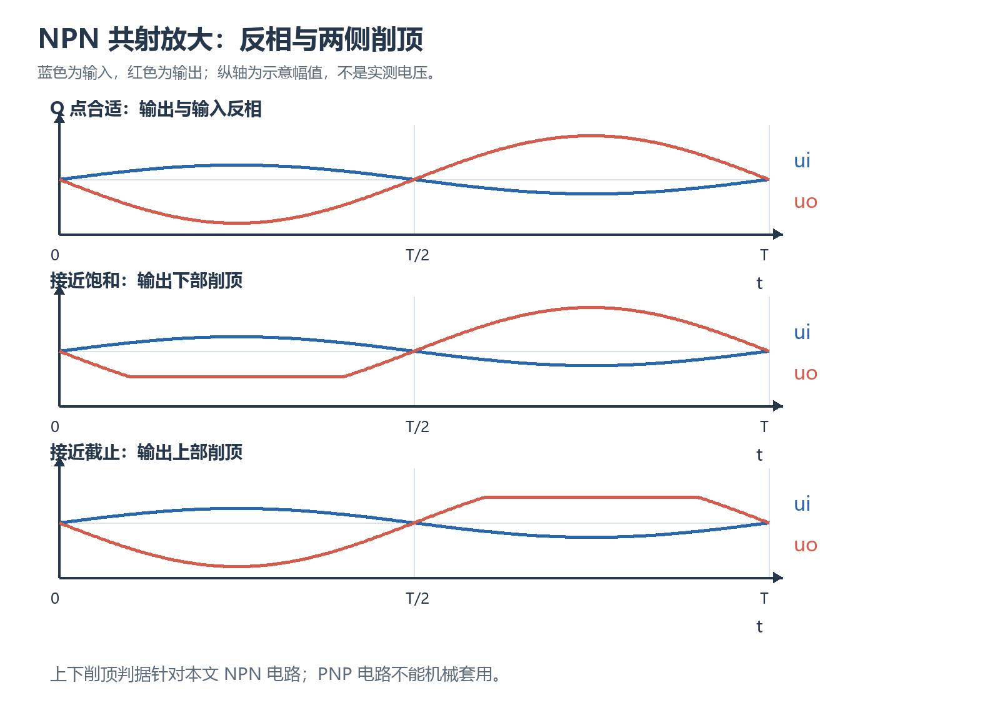

# 实验五：单管交流放大电路从零操作指南

## 一、这次要完成什么、交什么

本实验搭建一只 NPN 三极管构成的共发射极交流电压放大器，先把无交流信号时的状态调合适，再分别改变发射极旁路电容、输出负载和偏置，测量放大能力并解释削顶。下面按实验台上的执行顺序组织；课程报告仍使用教师给出的原始记录页和栏目。

先把几个操作词对应到可观察的状态：偏置是用直流电源和电阻预先设定三极管的静态电压、电流；输入变化能按比例引起输出变化时，称为在线性放大区。截止指集电极电流已很小、集电极电位接近电源一侧；饱和指集电极与发射极之间电压降已很低，继续加大驱动也难以按原比例增加电流。输出波形的某一端因此变平，叫削顶。耦合电容把交流变化传给下一级，同时隔开两边的直流；旁路电容给交流提供一条绕过发射极电阻的路径。本实验通过接入、断开和换负载来观察这些作用。

| 必做任务 | 怎样证明完成 | 对应记录 |
| --- | --- | --- |
| 调整无交流激励时的静态状态 | 有五个直流电压、实际电阻值和电流计算，能相互核对 | 表5-2 |
| 比较旁路电容接入与断开 | 两组输入、输出有效值及同一时序的波形，其他条件保持一致 | 表5-3 |
| 比较开路、10 kΩ、1 kΩ三种负载 | 三组增益和波形，注明输入与偏置没有随负载改变 | 表5-4 |
| 观察合适偏置、偏向饱和、偏向截止 | 三种直流状态、削顶方向、最大不失真输出及照片 | 表5-5 |
| 完成报告 | 接线图、计算、手绘波形、依据真实结果的分析、三道思考题 | 指导书5.9 |

课前完成教师要求的预习报告前三步，原理处画实际接线图并保留推导。课堂原始数据需由老师确认；所有波形都拍照保存。课后把计算过程写入报告，数据和波形按指导书要求手写、在坐标纸上手画；照片用于回查，不能代替规范作图。实验体会、意见和建议放在结论之后。没有完成的测量、签字和照片保留待补，不从本文示例填入。

本文中的数值分三类：指导书指定的设置、由模型计算的理论预期、明确标注的构造算例。构造算例只演示处理方法，不代表本人或本次仪器已经测到。已有原始记录和照片只读，实际填写时必须回到自己的记录取数。

## 二、先认节点、参考地和读数，再接线

### 1. NPN 管的三个电极分别做什么

9013 是本实验指定的 NPN 型三极管。B 是基极，它的电压变化能够控制C、E支路的电流变化；C 是集电极，通过集电极电阻从电源取得电流，并把电流变化转成电压变化；E 是发射极，通过发射极电阻回到电路公共参考点。这里说的是电极功能，不是实物从左到右的管脚次序。不同厂家、封装和插接模块可能不同，必须按该只器件标识、实验室说明及二极管档检查共同确认。

按常规电流方向，流入 B 的电流叫基极电流，记为 $I_B$；流入 C 的电流叫集电极电流，记为 $I_C$；从 E 流出的电流叫发射极电流，记为 $I_E$。节点电流守恒给出 $I_E=I_C+I_B$。在线性放大的工作区内，直流电流放大系数定义为 $\beta=I_C/I_B$，没有单位。它描述电流比例，不等于输入到输出的电压放大倍数；换一只9013或改变电流、温度后，它也不必保持不变。

发射极串电阻能够稳定直流状态：电流变大时，电阻上的电压升高，发射极电位随之升高，基极与发射极之间的驱动减弱，电流增长受到抑制。这种抵消原变化的作用叫负反馈。旁路电容只改变相应频率下的交流反馈，不能把发射极电阻从直流偏置电路中删除。

### 2. 所有“电压”先说相对哪里

本实验把电源负端所在的公共节点定义为参考地，记作0 V。它连接信号源的地端、示波器地端和电路地线。基极对地电位记作 $V_B$，集电极对地电位记作 $V_C$，发射极对地电位记作 $V_E$。两电极间电压按下标先后取差：基极对发射极电压 $U_{BE}=V_B-V_E$，集电极对发射极电压 $U_{CE}=V_C-V_E$。

因此，万用表测 $V_C$ 时黑线接地、红线接C；测 $U_{CE}$ 时黑线接E、红线接C。两者不能混记。示波器各通道地夹通常相连，地夹都接公共地；不能为了测 $U_{CE}$ 把普通探头的地夹改接E，这会把E通过仪器接地，改变电路。需要差分电压时，优先用万用表跨接测量，或按实验室许可使用正确的差分方法。

若一条记录只有“集电极6 V”，还不能确定集电极到发射极也是6 V。例如发射极对地为1.8 V时，两者相减才得到4.2 V。所有记录必须保存量名、参考点和单位，避免后续把两个不同的6 V代入同一公式。

### 3. 直流、交流和仪器耦合怎样区分

直流简称 DC，指不随时间交替变化的分量；交流简称 AC，指随时间变化的分量。可以把集电极瞬时电压写成 $v_C(t)=V_C+\widetilde v_C(t)$：大写 $V_C$ 是静态电位，带波浪线的一项是叠在上面的交流变化。输入瞬时交流电压用 $u_i(t)$，经输出耦合电容送到负载的瞬时交流电压用 $u_o(t)$。

本篇用 $U_i$、$U_o$ 表示交流有效值，也叫 RMS；用 $U_p$ 表示相对中心线的峰值，$U_{pp}$ 表示最高与最低之差的峰峰值。只有未失真的正弦波才满足：

$$
U_p=\sqrt{2}U_{\mathrm{RMS}},\qquad U_{pp}=2\sqrt{2}U_{\mathrm{RMS}}.
$$

指导书的输入10 mV是有效值，换成正弦峰峰值约28.3 mV，绝不能把信号源面板的10 mVpp直接当作10 mV有效值。削顶之后不能再用正弦换算式把峰峰值机械换成有效值；此时要保留波形和仪器实际采用的测量方式。

示波器 DC 耦合保留直流和交流，可观察真实的集电极电位上限；AC 耦合通过仪器内部电容去掉直流中心，适合看很小的交流变化。AC 耦合不是“电路改成交流供电”，也不会告诉你原来的直流电位是多少。万用表测偏置用直流电压档；测规定的输入、输出有效值用交流档，并核对所用表在1 kHz及毫伏量级的适用性。低于量程或带宽要求的读数不能仅凭显示稳定就认定可靠。

### 4. 静态工作点与增益的符号

停止交流激励后的一组偏置量称为静态工作点，简称 Q 点。常用集电极电流和集电极—发射极电压表示它，其他基极、发射极读数用于复核。Q 点是交流摆动的起点；不是某个旋钮刻度，也不等于输入信号的瞬时峰值。指导书用电位器把 $U_{CE}$ 调到约6 V作为初始目标，再通过输出是否失真、可用摆幅来判断是否合适。

本实验用1 kHz交流、较小输入且输出近似按比例变化的状态来测放大能力，称为近似线性的“小信号”条件；此时耦合和旁路电容的影响已较小，也未进入器件高频响应明显衰减的范围，称为“中频”近似。正常正向放大时，基极电位通常高于发射极，集电极电位高于基极；若集电极降到接近或低于基极，要连同集电极—发射极电压检查饱和，不能只看基极—发射极电压为正。在上述小信号条件下，可用带符号的电压增益 $A_u$ 描述 $u_o(t)\approx A_u u_i(t)$。本电路共发射极输出反相：输入升高使集电极电流增加，集电极电阻压降增加，集电极电位下降，所以 $A_u$ 为负，输出相对输入约反相180°。用两个有效值相除得到的是增益幅度 $|A_u|=U_o/U_i$，它非负。报告若在表中填幅度，就同时写“输出反相”；若按课程约定填带符号增益，则写负值。不能写成“负的有效值”来表示反相。

## 三、准备器件、接线图和仪器

### 1. 按原指导值准备，不混用截止实验的改件值

| 名称 | 初始电路规定值 | 连接与作用 |
| --- | --- | --- |
| 三极管 | 9013，NPN | B接输入与分压点，C接集电极支路，E接发射极支路 |
| 电源VCC | +12 V | 正端供集电极和偏置上臂，负端为公共地 |
| 集电极电阻Rc | 2.4 kΩ | +12 V到C，电流变化在此产生电压变化 |
| 发射极电阻Re | 1 kΩ | E到地，建立并稳定直流电流 |
| 偏置电阻Rb1、Rb2 | 各20 kΩ | 上臂固定电阻和下臂分压电阻 |
| 电位器Rp | 100 kΩ可调 | 与Rb1串联在电源到B的上臂；100 kΩ是标称范围 |
| 输入、输出耦合电容C1、C2 | 各10 μF | 信号源到B、C到输出端，隔离相邻部分的直流 |
| 发射极旁路电容Ce | 47 μF | 与Re并联，影响交流负反馈 |
| 输出负载RL | 1 MΩ、10 kΩ、1 kΩ或开路 | 按不同任务切换，连接在输出耦合电容之后 |

指导书表5-1的电容数量排版有缺损，接线数量以图5-3为准：两个10 μF分别作输入和输出耦合，47 μF作旁路。电容耐压按实验室器件和指导书核对，不把器件清单中的其他电容任意替代。初始的100 kΩ电位器是在一定范围内调节，后面实际参与计算的是两接入端之间的有效电阻，不是始终代入100 kΩ。

偏向截止的专门任务需要断电后把Rb1改为100 kΩ、Rp改为220 kΩ可调；这个改动只属于那一步，不能反向覆盖初始20 kΩ与100 kΩ的参数。负载10 kΩ属于测增益任务，并不是偏置支路上的Rb1。

### 2. 断电状态把每条支路接清楚

从公共地开始辨认节点，再按以下拓扑对照原图5-3逐线检查。文字连线用于核对节点，不替代需要提交的手绘电路图。

~~~text
+12 V ── Rc ── C极 ── C2 ── 输出端 ── RL ── 地
+12 V ── Rp ── Rb1 ── B极 ── Rb2 ── 地
信号源输出 ── C1 ── B极
E极 ── Re ── 地；Ce并联在E极与地之间
信号源地、直流电源负端、示波器地夹 ── 公共地
~~~

先核实电源和信号源输出均已关闭，拆接一律在断电后进行。用万用表二极管档检查器件是否存在明显短路、开路或结方向异常；NPN管在正表笔接B、负表笔分别接E和C时通常呈正向结特征，反向不应也表现为短路。二极管档可以帮助识别基极和排查坏管，但仅凭两次压降不能可靠区分C与E，也不能测出放大性能是否正常。C、E仍须以该器件引脚资料和实验室模块标识确认。

图5-3中，C1的正极朝B，C2的正极朝C，Ce的正极朝E。这个方向对应零直流偏置输入时B、C、E比信号源和地更高的直流电位。图中输入电压正参考符号与C1极性符号相邻，核对时要分别看清。若实际信号源另有直流偏置，先停止接入并确认两侧电位和电容极性，不沿用未经复核的方向。电容接反、输出短接、偏置上臂接到发射极都属于上电前要排除的问题。

指导书使用DP832A电源、Tek AFG1062或DG4062信号源、Tek MSO2012B示波器、Fluke F287C与17B+万用表。不同台设备的操作入口按现场面板为准；电源限流、输出端串接方式按实验室规程设置，本文不凭空给限流数值。测量连接优先采用指导书要求的香蕉头导线，避免不稳定的表笔尖接触。

### 3. 单独校准输入，再连入电路

信号源先设正弦、1 kHz、零直流偏置，在输出未接放大器时用交流mV档把有效值调到10 mV。发生器面板可能按50 Ω负载或高阻负载标注幅度，而实际放大器输入不是50 Ω终端；因此面板设定只是起点。记下负载模式和幅值单位，接入放大器后还要在规定输入端复测实际有效值，避免输入内阻改变造成的幅度变化。

示波器CH1探头尖端接输入耦合电容前的输入端，CH2尖端接输出耦合电容后的输出端，两个地夹接公共地。探头衰减倍率与通道设置一致，通道不启用波形反相功能。以输入触发，使屏幕同时显示几个稳定周期；交流比较时两通道采用AC耦合。1 kHz对应周期1 ms，可据此选时基，不必死记某个旋钮格数。电压量程应让波形占据可辨认的数格并保留峰值余量。

正式记录前把输出关掉重新核对接线，再上直流电源、启用小幅信号观察。若异常发热、有异响或波形明显异常，按指导书立即断电，先检查再恢复，不能靠不断扭旋钮试出一个“好看”的波形。

## 四、调静态工作点，完成表5-2

### 1. 用直流读数调到初始目标

上电确认有放大现象后，关闭信号源输出，保持直流供电。这里关闭的是交流激励，不能顺手把公共地线拆掉。用万用表跨C、E测 $U_{CE}$，缓慢调Rp，目标约6 V；另测 $V_B$、$V_E$、$V_C$ 和 $U_{BE}$。这些是在信号停止、读数稳定时取得的静态量，不从AC耦合示波图中心线反推。

按本拓扑，Rp调小使偏置上臂总电阻下降，基极电位通常升高，集电极电流增大，集电极电位下降；Rp调大则方向相反。每次只做小量调节，观察实际电压变化再决定方向，不能把“顺时针”硬编码成电流增大，因为电位器接入端和安装方向可能不同。若调到端点仍无法达到目标，先查电源、电阻数量级和C/E接反，不继续用极大输入掩盖偏置问题。

完成标志是：信号关闭时读数稳定，$U_{BE}$ 与 $V_B-V_E$ 相符，$U_{CE}$ 与 $V_C-V_E$ 相符，C对B电位关系与正向放大区相容，恢复10 mV输入后波形未见明显削顶。6 V只是初始参考，不保证三极管非线性、负载和电容均存在时上下交流余量绝对相等。要得到最大不失真摆幅，仍需后面的实际波形判断。

### 2. 测实际电阻时保护工作点

把各静态电压和当前Rp接入端记录下来后，关闭信号源及直流输出，按实验室方法确认无残余电压，再拔出电阻或使其至少一端与其他支路隔离，用电阻档测Rc、Re、Rb1、Rb2及Rp的有效接入阻值。电阻档不能在带电电路中使用。在电路内直接量到的是若干支路并联的等效值，不能拿它当单个电阻值计算。

测Rp时不改变滑动位置，记清测的是哪两端；重新装回后再通电复测静态电压。如果拆装后节点电压变了，就必须补测该组电压，不能把拆前电压与拆后阻值不加说明拼成一组。偏置表建议附记实际供电值，因为公式中的12 V应尽量用同一时刻实测电源电压替代。

### 3. 一条完整的静态测量—计算链

下面整组是自洽的构造读数，用来展示表5-2如何处理，并非原始测量：供电12.000 V，Rc=2.400 kΩ，Re=1.000 kΩ，Rb1=20.000 kΩ，Rb2=20.000 kΩ，Rp有效值46.411 kΩ；$V_B=2.470\,\mathrm V$，$V_E=1.770\,\mathrm V$，$V_C=7.800\,\mathrm V$。先检查电极间电压：

$$
U_{BE}=2.470-1.770=0.700\,\mathrm V,
\qquad U_{CE}=7.800-1.770=6.030\,\mathrm V.
$$

静态时耦合电容隔开输出负载，若可忽略探头与表的分流，Rc中电流就是集电极电流；Re中电流就是发射极电流。电阻换为欧姆后代入：

$$
I_C=\frac{12.000-7.800}{2400}\,\mathrm A
=1.750\,\mathrm{mA},
\qquad I_E=\frac{1.770}{1000}\,\mathrm A
=1.770\,\mathrm{mA}.
$$

$$
I_B=I_E-I_C=0.020\,\mathrm{mA}=20.0\,\mu\mathrm A,
\qquad \beta=\frac{1.750\,\mathrm{mA}}{0.020\,\mathrm{mA}}=87.5.
$$

另一条校核链用基极节点的电流守恒。上臂总电阻是Rp与Rb1串联；从上臂进入B节点的电流记作 $I_{\mathrm{up}}$，从下臂流向地的电流记作 $I_{\mathrm{down}}$：

$$
I_{\mathrm{up}}=\frac{12.000-2.470}{(46.411+20.000)\times10^3}\,\mathrm A
\approx143.50\,\mu\mathrm A,
\qquad I_{\mathrm{down}}=\frac{2.470}{20.000\times10^3}\,\mathrm A
=123.50\,\mu\mathrm A.
$$

上、下臂电流之差给出 $I_B\approx143.50-123.50=20.0\,\mu\mathrm A$，与发射极电流减集电极电流的方法相符。Rp的46.411 kΩ是这组构造值，精细位数只用于展示两条支路计算能闭合，不代表实验仪器真的具有这样的精度。真实数据若不闭合，先回查读数、量程与接线；保留原值和复核值，不能按期望反算一个电阻去改真实记录，也不能直接把两种相减结果平均。

这条链的判断不是“算出一个β就成功”，而是电压差、支路电流与三极管区域同时相容。β=87.5只属于这组构造状态，不是9013的规定常数，更不能用它替代其他状态的电流计算。若课程要求选择一种方法填写表5-2，注明所用方法，另一条留作校核和误差讨论。

### 4. 为什么基极电流最容易算得不稳

基极电流往往是两个毫安量相减后留下的几十微安。例如上述两个电流各有约0.01 mA的误差，差值20 μA就可能发生很大的相对变化；再用它作分母计算β，误差进一步放大。另一条上、下臂相减同样存在小差值问题，只是差值相对支路电流的比例不同。不能无条件声称某一条一定更准，要结合仪器分辨率、电阻误差与实际接法判断。

若只把 $V_C$ 错读高0.020 V，其他读数暂不变，则算出的 $I_C$ 减少 $0.020/2400=8.33\,\mu\mathrm A$，$I_B=I_E-I_C$ 反而增加8.33 μA。β会由87.5降到约61.5，远大于集电极电流本身约0.48%的变化。这个方向关系告诉你：遇到β异常先回查小差值的来源，不能立即判定三极管坏了。

如果得到负的基极电流，也不能取绝对值后交报告。先查电源实际值、V与mV的换算、参考地、电阻是否离线测量、各读数是否属于同一工作点，必要时重测。记录原始显示位数，处理中间量多留几位，最后按实际精度报告，不写出仪器无法支持的过多有效数字。

## 五、固定偏置，比较Ce接入和断开

### 1. 执行动作与现场判据

断电后接入1 MΩ输出负载，保持Rp位置不变，Ce先用47 μF。恢复供电与正弦输入，在电路输入端复核1 kHz、10 mV有效值。用交流mV档测输入、交流电压档测输出，同时用示波器AC耦合观察两通道。保存整屏波形，记录电容状态、输入与输出的实际有效值、频率及照片编号。完成标志是稳定、无明显削顶、输入输出约反相，且两通道的测量单位一致。

接着关闭两种输出，断开Ce，其他电阻和负载不动。恢复供电后先确认静态状态没有明显变化，再把实际输入保持在原值附近并重测。若拆电容时动了电位器或导线，必须先恢复并重新核实偏置，否则比较已不再只反映Ce。不能为了让两组输出一样大而重新调Rp，也不能在Ce断开后自动增大输入，再拿输出比来宣称增益变化。

把两组原始值与波形填表5-3。输入略有不同仍可分别按各自实际值计算增益，但要写清不能直接用两输出之比等同于增益之比。即使万用表读数稳定，也应看波形；已经削顶时的“输出有效值较大”不是正常小信号增益证据。

### 2. 就地解释旁路作用和计算

电容对直流稳态近似开路，所以理想情况下Ce拆接不改变直流Q点；对交流，它的阻抗随频率变化。容抗大小 $|X_C|$ 是电容对正弦电流的阻碍程度，频率记为 $f$、电容量记为 $C$，有：

$$
|X_C|=\frac{1}{2\pi fC}.
$$

在1 kHz、47 μF下，$|X_{Ce}|=1/(2\pi\times1000\times47\times10^{-6})\approx3.39\,\Omega$，远小于1 kΩ的Re，因此发射极交流摆动被明显旁路，负反馈减弱，通常增益增大。断开后，发射极电压随电流变化，抵消基极变化对基极—发射极驱动的影响，增益下降，但线性与稳定性往往改善。不能说“Ce把Re完全短路”：该说法只对一定频段的交流近似，直流仍经过Re，连接线和电容的非理想性也仍存在。

下面是用于表5-3的构造算例，频率与负载相同，输出均假定为未失真正弦。接Ce时实际输入10.0 mV、输出0.800 V；断Ce时实际输入9.8 mV、输出0.0230 V。各自换算与计算为：

$$
|A_u|_{\text{接入}}=\frac{0.800}{10.0\times10^{-3}}=80.0,
\qquad |A_u|_{\text{断开}}=\frac{0.0230}{9.8\times10^{-3}}\approx2.35.
$$

增益幅度约相差34.1倍，不能把0.800/0.0230得到的34.8倍直接当成同一结果，因为两个输入并不完全相等。两组都反相时可分别记带符号增益约−80.0、−2.35。数据只能支持“这组固定条件下旁路使增益明显增大”；不能据此断言任意频率、任意器件都会得到这些数字。

若希望用模型理解量级，发射极未旁路时的局部负反馈常使幅度接近集电极交流等效负载与Re之比，因此接近几倍是合理量级；这只是近似，不代替实测。发射极被充分旁路时，增益更多地受晶体管小信号参数限制，必须知道工作点或测量后才能给具体理论值。

## 六、恢复Ce，逐个测负载对增益的影响

### 1. 换负载时固定哪些量

断电恢复47 μF的Ce，保持原Rp。按表5-4依次测输出开路、10 kΩ、1 kΩ。每换一次都先关闭信号与直流输出，再把负载接在C2后的输出端和地之间，不能接到C与电源之间。上电后复测偏置，确认无误再恢复1 kHz、10 mV有效值输入。记录每组实际输入、输出及波形，计算后进入下一组。

“开路”在记录中写作没有外接负载，不代表示波器探头和万用表也具有无限输入电阻。仪器仍在输出端取样，应保留输入阻抗、探头倍率等已知设置。1 MΩ是上一项比较Ce时的规定负载，它与无外接负载不是完全同一个条件，表格不能偷偷互换。

### 2. 电阻并联模型与一组可复算预期

并联符号 $\parallel$ 表示两电阻两端分别相连，其等效电阻为乘积除以和。忽略晶体管输出电阻和仪器负载，且耦合电容在1 kHz近似导通时，集电极交流等效负载记作 $R'_L$，近似 $R'_L=R_C\parallel R_L$。原指导书式5-1采用小信号模型：

$$
A_u\approx-\beta\frac{R'_L}{r_{be}}.
$$

这里 $r_{be}$ 是基极—发射极的小信号输入电阻，表示在当前工作点附近小电压变化与小电流变化之比，不能把它与直流 $U_{BE}/I_B$ 混同。该式还要求Ce的旁路足够、输出没有削顶，模型参数没有显著随信号变化。

三种外接负载对应：

$$
R'_L(\text{开路})\approx2400\,\Omega,
\qquad R'_L(10\,\mathrm{k\Omega})=\frac{2400\times10000}{2400+10000}\approx1935\,\Omega,
$$

$$
R'_L(1\,\mathrm{k\Omega})=\frac{2400\times1000}{2400+1000}\approx706\,\Omega.
$$

以构造的开路测量 $U_i=0.0100\,\mathrm V$、$U_o=0.900\,\mathrm V$ 为参照，开路幅度增益为90.0。若其他小信号参数不变，10 kΩ和1 kΩ两组幅度增益可估为 $90.0\times1935/2400\approx72.6$、$90.0\times706/2400\approx26.5$；相应输出有效值约0.726 V和0.265 V。这是从构造参照得到的模型预测，不是两组实际读数，也不是指导书给定答案。

真实计算要对三组分别用实际输入与实际输出取比。若负载变小后增益反而增大，先查输入是否改变、Ce是否恢复、输出量程是否自动切换、各组是否对应同一Q点。只有排除这些混杂条件，才讨论模型不足。用电阻实测值重新算并联量，也比用标称值强行解释百分之几的差异更合理。

### 3. 耦合电容和负载为什么会一起影响读数

10 μF在1 kHz的容抗约15.9 Ω，通常远小于10 kΩ或1 kΩ负载，故上述中频近似可用来解释趋势。降低频率后容抗增大，电容与负载共同构成分压，输出幅度还可能下降、相位也可能偏离180°。所以这次保持1 kHz是控制条件，不能把某组改成低频后与原组直接比较负载效应。

若万用表和示波器给出的输出有效值不一致，先比较它们测的是交流有效值、全波形有效值还是由峰峰值换算的正弦值，再查输入阻抗、频率响应和是否削顶。对正弦的小信号比较有一致性后，才把这组读数用于增益。不同仪器的数值不应不加条件地平均。

## 七、改变偏置并找最大不失真输出

### 1. 合适工作点：先找边界，再留正确数据

断电接回1 MΩ负载，Ce保持47 μF；恢复初始偏置网络，按静态测量步骤调到 $U_{CE}$ 约6 V，再给1 kHz、10 mV有效值输入。保存这组基准波形。逐渐增大实际输入，同时观察输出上下峰；每次调节后记录输入值和输出是否仍平滑。指导书要求此阶段输入小于40 mV有效值，在这个范围内观察，不为追求两边削顶擅自超限。

“最大不失真输出”是最后一组仍未见削顶、形状与输入正弦相容的输出，不是削顶之后仪器显示的最大电压。若在指导书允许范围内没有出现边界，记录“在已测范围内未见削顶”和最高已测值，不假称已找到真正最大值。若增加输入后两端先后变平，保存第一处可辨削顶及更明显失真的状态，随后退回最后无明显失真的输入，记录该边界的估计精度。

构造示例：实际输入从20 mV增至24 mV、26 mV，输出有效值依次1.60 V、1.91 V、1.98 V；26 mV时开始出现削顶，24 mV时未见明显削顶。那么在这次2 mV步进和目视分辨率下，报告可写“最大无明显失真的已测输出1.91 V，有效值；失真阈值输入位于24至26 mV之间”。不能把1.98 V写作最大不失真输出，也不能说阈值精确为24.000 mV。

### 2. 偏向饱和：记录下部变平的证据

保持负载、频率及当前输入不变，按指导书减小Rp，使静态集电极电位降到5 V以内这一类状态。这里只能在实验室许可范围内调节电位器，不插拔导线；换电阻仍须断电。观察输出下部是否出现明显平坦区，保存有输入作时间参照的波形，再逐渐减小输入，测该偏置下最后无明显削顶的输出。

随后关闭信号，保留直流供电，测 $U_{BE}$、$U_{CE}$、$V_B$、$V_C$，必要时补测 $V_E$。结合实际Rc、Re或当前偏置支路阻值计算电流，写表5-5。此时Rp有效值已经改变，若用上臂法算基极电流，就必须重新记录该有效值，不能继续套表5-2的旧Rp。

为何是下部变平？输入正半周使集电极电流增加，集电极电位继续下降；但集电极—发射极电压不能无限减小，接近饱和后电流不再按线性关系增加，输出最低处受限。判断要同时依据本实验的NPN共射拓扑、探头没有启用反相、波形下端平坦和直流状态，不能只背“削顶就是截止”。

### 3. 偏向截止：先改规定电阻，再取证

先关闭直流和信号源，把Rb1从20 kΩ换成100 kΩ，Rp换成220 kΩ可调。检查无误后恢复供电，增大Rp，让静态集电极电位接近11 V这一类低电流状态。输入按此项指定改为1 kHz、20 mV有效值，记录上部平坦的输出；再逐渐减小输入，寻找该工作点的无明显失真输出。

若需判定上端的绝对电位，必须看C2前集电极对地的信号并采用DC耦合，地夹仍接公共地。指导书提到此处截止时集电极峰值约11.5 V，这是本实验的观测参考，不是任何9013电路固定的截止电压。C2后的AC输出已经去掉直流，不能凭其零线附近的“+几伏”直接和11.5 V比较。

关闭信号后记录静态电压，计算电流。原表5-5未单列发射极电位时，可从同一状态的 $V_E=V_C-U_{CE}$ 或 $V_E=V_B-U_{BE}$ 求得；两种推导应接近。若差异大，补测和回查，不选较“合理”的一组掩盖冲突。此时基极电流很小，电流相减法的相对误差可能更严重，β若无法可靠估计，应说明分辨率限制。

### 4. 把波形方向与直流数值连起来

构造一组偏向截止的读数：供电12.00 V、Rc=2.40 kΩ、Re=1.00 kΩ、$V_C=11.04\,\mathrm V$、$V_E=0.405\,\mathrm V$、$V_B=1.055\,\mathrm V$。于是 $U_{CE}=10.635\,\mathrm V$，$U_{BE}=0.650\,\mathrm V$，$I_C=(12.00-11.04)/2400=0.400\,\mathrm{mA}$，$I_E=0.405\,\mathrm{mA}$，相减得 $I_B=5\,\mu\mathrm A$。这些数只说明静态电流小、集电极向电源一侧的电压余量很小；上部是否真实削平仍需动态波形证据。

如果同组C2前DC波形上端约11.5 V变平，而输入负半周对应输出正峰，就支持截止削顶的判断。相反，若集电极最低处受限、$U_{CE}$ 很小，则考虑饱和。耦合电容后的输出可能被上下平移，示波器自动居中也可能改变视觉位置；这些不会改变平坦段对应哪个半周，但会让绝对电位的直觉失效。

图源：原目录已有教学绘图，依据相邻NPN共射原理说明绘制；图中纵向仅示意幅度，不是实测电压，也不是本轮产生的波形。用它辨认输入与输出半周关系，真正的削顶判定仍要回到本组现场照片和直流读数。

上述上下判据只适用于这里的NPN共发射极电路与既定电压参考。换成PNP、电源极性反转、输出取向反转或通道反相时，不能照抄“上为截止、下为饱和”，必须从电流变化与限幅端重新推理。

## 八、现场记录怎样进入计算和报告

### 1. 每组数据连同条件保存

表5-2保存五个直流电压及实际电阻，附实测电源、Rp接入端、三极管型号；计算栏写电流与β。表5-3保存Ce两状态的实际输入输出、频率及波形。表5-4保存每个负载的输入输出与增益，注明无外接负载时仍有哪些仪器连接。表5-5按三种偏置保存静态值、最大无明显失真输出、失真图及对应照片。

照片需要能看清通道名称、垂直量程、时基、耦合方式及输入输出的对应关系。若仪器截图不包含负载或电容状态，在纸质记录旁写照片编号与条件；不要只给一张“最后成功”的照片，让所有表格都引用它。DC与AC耦合图、C2前与C2后图分别标注，波形的正负参考才可追溯。

当发现误抄，保留原记录的更正痕迹，在分析副本说明原值、改正值及依据。本文不改任何原始PDF、照片或教师审核处。缺测行写待补及缺少哪个条件；没有测到的失真类型不使用教学图充作自己的结果。

### 2. 从读数到结论保留一条误差链

增益是输出除以输入，小输入分母偏低会把增益算高。例如输出0.800 V不变，输入10.0 mV算得80.0；若误读成9.5 mV，便得到84.2，偏高约5.3%。这说明输入毫伏档的量程、接触及发生器负载模式值得优先检查，不能一看到增益偏高就归因于三极管β大。

若输入和输出用同一稳定比例误差的测量链，某些共同比例误差可能在比值中部分抵消；若两者由不同仪器、不同档位测得，则通常不能假定抵消。重复测量并平均能减小随机抖动，对探头倍率填错十倍、将峰峰值当有效值、偏置逐渐漂移等系统问题没有修复作用。报告应给出误差方向和验证办法，而不是统一写“人为误差”。

负载比较最有价值的是同一偏置下的相对趋势；最大不失真输出对目视判据和调幅步长敏感；β对电流相减最敏感。三类结果应各写其主要限制，不能复制同一段误差分析。若某组因输出削顶而不适合计算小信号增益，可以保留原读数，把它移到失真分析中说明用途，再补测无失真条件。

### 3. 按教师栏目组织报告

目的写调整静态状态、比较旁路与负载、观察截止和饱和；原理画初始电路，并在变更处另注明截止任务的改件。计算至少展示一次完整的静态电流链、一次输入输出有效值的统一单位计算，以及负载并联的推导。其余组可整理成表，但每个数应能回到一条原始记录。

结果分析把“观察到什么”“由此算出什么”“在什么模型下解释”连起来。例如应依据自己的数据写：“Ce断开后两组输入仍接近规定值，输出有效值下降，静态电压复测未见超出读数精度的变化，因此变化主要与交流反馈增强相符。”没有实际复测就删除其中相应判断，不直接照抄该句作为已完成结论。

最大不失真输出写明判据、调幅步长和最高已测输入；饱和、截止分别引用波形和静态值。结论只回答已经取得证据的项目。若某项待补，明确缺的是波形、有效值还是教师确认，不能用理论计算把整项改写成“实验成功”。

## 九、三道课程思考题怎样据本实验作答

### 1. 输入合适却仍削顶，怎样调整

先确认“输入合适”指实际输入、频率及读数定义正确，而不是仅看发生器面板。偏置使静态集电极电流过大时，向饱和方向的余量不足；过小时，向截止方向的余量不足。按本电路调Rp使静态状态回到合适范围，再恢复相同输入观察。若是输入本身超过线性范围，减小输入才是必要动作；若接线或供电错误，调Rp不能替代修复。报告应引用调整前后静态电压和削顶变化，不能只写“调工作点”。

### 2. 怎样提高交流电压增益

在小信号模型适用时，充分旁路Re、增大集电极交流等效负载、避免过重外接负载，均可能提高增益幅度。改变静态电流也会改变小信号参数，但同时改变摆幅、功耗与非线性，不是无代价手段。增大Rc会改变直流压降，不能保持其他量不变地无限增大；换β较大的管子也不能保证电压增益按β同比增加，因为输入小信号电阻常随参数一起变化。作答应说明本次实际做过哪些控制变量比较，而不是提出未经实验的必然数值。

### 3. 怎样判断削顶类型，能否用于PNP

对本NPN共射电路，集电极对地的上端平坦通常对应电流接近截止，下端平坦通常对应接近饱和；再用电极间直流电压和输入半周关系复核。PNP的极性和电源参考不同，应该重新画电流和电压方向，再确定哪一端对应哪个区域。仅凭图片“看起来削了顶”无法跨拓扑判断。这里给出的是课程思考题的推理路径，不额外添加空练习或重复答案。

## 十、异常时按最小检查缩小范围，最后收尾

| 现象 | 候选原因 | 先做的区分检查 | 修正后复测判据 |
| --- | --- | --- | --- |
| 无交流输出 | 信号源未启用、输入开路、C2支路错误或偏置异常 | 异常先断电；检查输入与地，再核对各直流节点 | 恢复规定小输入，有稳定输出且未削顶 |
| 输出贴近上限 | 三极管截止、基极上臂断路、C/E接错 | 断电核对拓扑，恢复后测VB、VE、VC | 电位随Rp合理变化，工作点可调 |
| 输出下部削平 | 偏置电流过大、输入过大，也可能通道量程不当 | 核对静态UCE和实际输入，检查通道是否截屏外 | 减输入或恢复偏置后削顶消失 |
| 拆Ce后增益几乎不变 | Ce本来未接入、Re接错、旁路另有短路 | 断电检查Ce与Re两端是否确为相同节点 | 两状态直流近似不变，交流比较可复现 |
| 工频纹波或漂移 | 共地不良、接触变化、电源纹波或探头设置 | 检查地线连续性、连接稳定性与输入短时稳定度 | 固定条件下波形和读数可重复 |
| β不合理或为负 | 电流相减失准、单位或参考点错、不同状态混用 | 重算单位和两条电流链，逐项复核读数 | 支路守恒在实际精度范围内相容 |

故障表给的是候选原因，不代表本次已经发生。要动导线、电容、负载或电阻时先关闭信号和直流输出；需要通电电压检查时，先在断电状态接好测量线，再按实验室规程恢复供电。不要在带电电路中切换到电阻档排故。

离台前核对四张表是否与照片编号一一对应，最大无明显失真输出是否保存了边界条件，三种偏置的静态记录是否属于各自同一状态。请老师按现场要求确认原始数据，保存个人照片副本；然后关闭信号源及直流输出，按实验室规程处理电容、拆线、归还元件、整理台面。文档修订本身不等于这些仪器动作已经执行。

## 来源与适用边界

主要依据为原目录内`实验五 实验指导书.pdf`：PDF第1页5.1—5.3为任务、器件及预习；第2页图5-1、式5-1与初始输入要求；第3页图5-3、表5-2和表5-3；第4—5页负载、失真与注意事项；第6页5.8—5.9为思考题和报告要求。`实验五-数据记录页.pdf`第1页核对记录字段、波形拍照及审核要求。原有Markdown仅用于识别待修订结构，不替代指导书。

本指南核对了原图参数与接线关系，给出了理论推导和构造计算，没有执行仿真或硬件测量，没有更改原始读数、图片或教师记录。器件实物管脚、现场仪器量程/负载模式、实际电容极性与供电状态仍须在接线前核实；教学计算不能充作实验完成证明。
