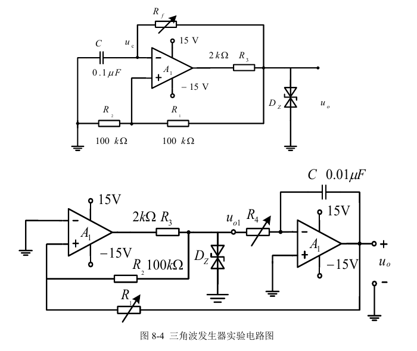
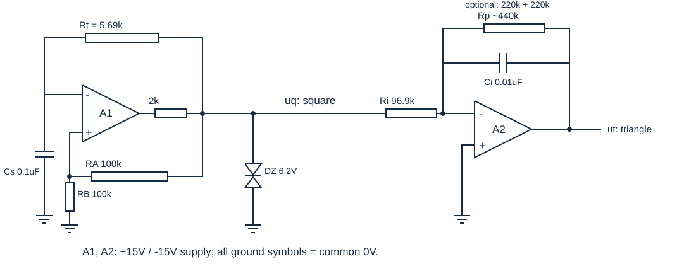

# 实验八 波形发生电路：实验完成教程

本教程依据本项目《实验八 波形发生电路实验指导书》第1—5页及《实验八 波形发生器实验数据记录》第1—2页编写。目标是让你在实验台上按顺序完成接线、调节、测量和记录，并能解释每个结果。本文的数字分为题目给定值、理论计算值和明确标注的计算示例；目前没有任何个人实测数据，也没有完成硬件验证。原始指导书和空白记录文件均保留，理论预填内容位于另建的记录副本。

## 一、先弄清这次要交什么

本实验不是用信号发生器输出一个现成方波，而是用运算放大器和反馈元件自行产生振荡。运算放大器简称运放，有同相输入端“+”、反相输入端“−”和输出端。正反馈是输出变化经反馈网络使输入差值进一步朝相同方向变化，本实验利用它迅速切换输出极性；负反馈则用于让积分器在一定输出范围内近似按输入信号积分。

需要完成三个电路。第一部分按图8-3搭建单运放方波发生器，分别将充放电电阻Rf调到10 kΩ和100 kΩ，计算周期，测量电容端电压uc的频率、占空比及输出uo的幅值、占空比，并保留10 kΩ档的双通道波形。第二部分按图8-4搭建比较器与积分器组成的三角波发生器，先回答两个运放的工作状态，再计算满足±1 V、1 ms所需的R1和R4，最后同时观察uo1和uo。第三部分独立设计一个方波振荡器，再把它转换成三角波：方波幅值±6.2 V、占空比50%、频率700 Hz至1 kHz，三角波幅值约±2 V。

完成标准和记录位置如下。表中的“计算”可以在实验前填写，“实测”必须以仪器或现场记录为依据。

| 任务 | 实验前可以完成 | 现场必须补齐 | 记录位置 |
|---|---|---|---|
| 图8-3方波电路 | 周期推导、两档理论周期 | uc频率与占空比、uo幅值与占空比、双通道照片 | 记录表第1页第1题及表8-2 |
| 图8-4三角波电路 | A1/A2工作状态、R1/R4计算 | 两路周期和幅值、同一时序波形 | 记录表第1页第2题与第2页上部 |
| 设计实验 | 设计图、原理、参数计算 | 实际阻值、方波占空比和幅值、三角波频率与幅值 | 记录表第2页第3题 |
| 完整报告 | 原理和思考题理论回答 | 真实过程、数据处理、结论、体会与建议 | 按教师报告要求整理 |

时间、地点、台号、姓名、学号、班级以及教师签字需要本人或教师填写。教程不能代替这些现场记录，也不能把“理论上应出现”写成“实际观察到”。实验前可先打印理论预填副本；原表的实测空格仍可在现场使用。

### 1.1 每张照片怎样才有用

照片至少应同时保留波形、两路通道标识、各通道电压刻度、时间刻度和用于本组数据的测量值。若屏幕上有探头衰减设置，也一并保存。拍摄后立刻把文件与电路、阻值档位对应，例如“图8-3_Rf10k_双通道”“图8-3_Rf100k_测量”“图8-4_1ms_双通道”“设计_方波三角波_双通道”。这些是建议命名，不是指导书新增的提交要求。

同一时序是两路共用同一横向时间坐标，便于看出一个波形的翻转与另一个波形的极值怎样对应。分别拍两张没有共同时间基准的截图，不足以直接证明相位或翻转关系。若教师要求手绘图，应以现场截图的实际周期、幅值、占空比为依据，不能描教材示意图充当测量。

## 二、上电前：器件、供电与公共参考点

指导书列出的仪器为DP832A线性直流稳压电源、Fluke 287C万用表、Tek MSO2012B示波器，以及Tek AFG1062或DG4062信号发生器。器件包括两只LM741或μA741、6.2 V双向稳压管2DW231、两只1N4007、电阻、电位器、0.1 μF和0.01 μF电容及接线材料。实际台面型号若不同，先核对实验室说明；本文只给测量功能，不凭空指定不同型号的菜单路径。

本实验的“±15 V供电”包含三个节点：正电源+15 V、公共参考0 V、负电源−15 V。负电源不是把某条线随意叫作地；它相对于同一个0 V应测得负电压。运放和两个观测点必须共享正确的参考点。若需要两路电源串联取得正负电源，必须按实验台的既定接法或教师检查后的接法操作，不能仅凭电源颜色和接线柱位置判断。

### 2.1 断电检查的实际顺序

先关闭电源输出，确认元件位置和图中节点，再接公共0 V、两路供电和信号网络。运放芯片本体的引脚与实验插件板的端子编号可能不是同一种编号；应以板上标识和实际芯片资料核对输入、输出及供电脚，本教程不把未看到的插件板端子号补成接线依据。

用万用表电阻档检查电位器的滑动端和所选固定端，确认所用两端间电阻随旋钮正常变化。测电阻要断电，且至少断开会形成并联支路的一端，否则测到的是整个网络的等效电阻。把理论需要的电阻设到附近后记录实际值，不能用电位器标称最大值代替工作值。电位器若允许采用滑动端与其中一固定端短接的变阻连接，应按教师确认的插件接法完成，不临时改变板内连接。

检查稳压管型号。图中的DZ是双向稳压器件，用于限制正、负两个方向的输出幅值；1N4007是普通整流二极管，不能因为器材表中也列了两只就直接替换。指导书没有要求在本次基本电路中加入那两只普通二极管，也不要求接入外部信号发生器的输出。

上电前确认输出没有被导线直接接地、正负电源未互换、稳压限流电阻未遗漏、电容没有误接成电源短路。上电后若出现异常发热、异常声音或明显错误波形，立即断电排查。更换电路和调换元件连接必须先断电；调节已确认安全接法的电位器按实验室要求进行。

### 2.2 探头怎样接才不破坏电路

示波器探头的尖端接待测节点，地夹只接本电路0 V。两个通道的地夹均接同一公共0 V，不分别夹到两个不同信号点。否则仪器内部的公共地可能把两个节点连在一起，测量动作会改变电路，甚至形成短路。也不要把地夹接到−15 V，因为−15 V在此电路中不是0 V。

探头可优先用10倍衰减，以减小对高阻节点的负载；示波器中对应通道的衰减设置必须与探头开关一致。这里“10倍”表示输入信号先被探头衰减，示波器按设定恢复显示幅值。设置不一致时，周期往往仍像是正确的，幅值却可能差十倍，不能先怀疑稳压管。

观测直流偏置和正负幅度时使用直流耦合，即仪器同时显示信号中的直流和变化部分。交流耦合会滤掉直流成分，可能掩盖积分器漂移或改变慢信号外观。先把两通道的0 V参考线显示清楚，再读正峰和负峰；上下移动屏幕波形的位置并不等于改变电路电压。

本实验的周期在毫秒量级，可从每格数百微秒或数毫秒的时间刻度起步，调整到能看到两三个完整周期。触发是让每次扫描从相似的信号状态开始；选择方波通道、固定一个上升沿和中间电平，通常更便于稳定观察。此处是测量建议，不是指导书规定的唯一设置。

## 三、任务一：图8-3方波发生器

图源：指导书第4页的两幅实验电路，按原图截取；本图用于核对线路和标称参数，属于课程示意，并非本人的接线照片。右侧积分运放在图8-4中也标成“A1”，按正文功能应理解为A2。以下所有R1、R2均以其所处电路为范围，不能把两种电路的电阻作用混用。

### 3.1 对照节点逐条接线

图8-3的R1=100 kΩ，从稳压后的输出uo接到同相输入端；R2=100 kΩ，从同相输入端接到0 V。两者构成分压器，使同相端得到输出电压的一部分。Rf从稳压后的uo接到反相输入端uc，C=0.1 μF从uc接到0 V。运放裸输出先串R3=2 kΩ，再到uo；DZ从uo接到0 V。运放按图接+15 V和−15 V。

注意uo是R3之后、稳压管所在的节点，不是运放裸输出端。把Rf和R1接在R3之前，会改变限幅节点与反馈网络的关系。测量uo也应在图示稳压节点进行；若在R3之前测得更大的幅值，不应把它直接写入表8-2的uo栏。

接好后先设Rf=10 kΩ，检查C的单位。0.1 μF等于100 nF；第二部分的0.01 μF等于10 nF。电容差十倍会使频率也差十倍，这一错误很像电位器档位错误。对电容标识拿不准时，依据元件标识和实验室测量方法确认，不凭外形判断。

### 3.2 为什么这个电路能自行翻转

令UZ表示稳压后输出电平的正幅值，理想计算中UZ=6.2 V。令β为同相端分压比例，本图有：

$$
\beta=\frac{R_2}{R_1+R_2}=\frac12.
$$

当uo=+UZ时，同相端参考电压为+βUZ；当uo=−UZ时，参考电压为−βUZ。两个不同的翻转阈值称为滞回阈值。因为输出有记忆，电容电压必须走到另一个阈值，比较器才再次翻转，所以不会只停留在0 V附近。

假设输出刚从−UZ翻到+UZ，电容电压不能瞬间跳变，仍为−βUZ。之后电容通过Rf朝+UZ充电。当uc达到+βUZ，反相输入电压追上同相参考，运放快速转向负输出。阈值随之跳到−βUZ，而电容电压仍连续，从+βUZ朝−UZ变化。到达负阈值后再次翻转，形成循环。

本图电容由固定电压通过电阻充放电，电流不是常数：电容越接近目标电压，电阻两端电压越小，电流越小。因此uc呈指数弯曲的充放电波，不是严格的直线三角波。指导书第2页把该电容波形概述为三角波，现场观察和分析时应保留这个区别；真正近似线性的三角波由下一部分的积分器产生。

### 3.3 周期推导：先求一个半周期

令τ=RfC表示电阻电容时间常数，单位为秒。它反映电容电压向目标值变化的快慢。由电容电流等于C乘电压变化率、同时等于电阻电压除以Rf，得到输出为+UZ期间的关系：

$$
\frac{du_c}{dt}=\frac{U_Z-u_c}{R_fC}.
$$

以翻转瞬间为t=0，并取初值uc(0)=−βUZ，解为：

$$
u_c(t)=U_Z-(1+\beta)U_Ze^{-t/(R_fC)}.
$$

令半周期tH结束时uc(tH)=+βUZ，移项可得：

$$
e^{-t_H/(R_fC)}=\frac{1-\beta}{1+\beta},\qquad t_H=R_fC\ln\frac{1+\beta}{1-\beta}.
$$

理想正负输出电平和阈值对称，另一个半周期与它相同。因此总周期T和频率f分别为：

$$
T=2R_fC\ln\frac{1+\beta}{1-\beta}=2R_fC\ln\left(1+\frac{2R_2}{R_1}\right),\qquad f=\frac1T.
$$

这里ln是自然对数，公式括号内必须是没有单位的电阻比。R用Ω、C用F时T得到秒；先换单位再代入，可以避免把毫秒误写成微秒。占空比D定义为一个周期中高电平持续时间与周期之比，D=tH/T，理想对称时为50%。

### 3.4 本题两档的完整计算

R1=R2=100 kΩ，所以β=1/2，ln[(1+β)/(1−β)]=ln3≈1.098612。C=0.1 μF=1.0×10⁻⁷ F。当Rf=10 kΩ=1.0×10⁴ Ω时，RfC=1.0×10⁻³ s，故：

$$
T_1=2\times10^4\times10^{-7}\times\ln3=2.1972246\times10^{-3}\ \mathrm{s}\approx2.197\ \mathrm{ms}.
$$

频率约为455.12 Hz。Rf增加到100 kΩ时，时间常数增加十倍，半周期和整周期也增加十倍：

$$
T_2=21.9722458\ \mathrm{ms},\qquad f_2\approx45.512\ \mathrm{Hz}.
$$

同一个稳态振荡过程中的uo和uc每完成一次循环的时间相同，所以两者频率相同。不能因为uc有两段斜坡就把它的频率写成方波的两倍。理想uo为±6.2 V，uc在±3.1 V之间变化；这些幅值只是理论比较基准，不填入要求现场测量的单元格。

| Rf | 表8-2可预填的计算周期 | 理论uc频率，供核对 | 理想uo幅值，供核对 |
|---|---|---|---|
| 10 kΩ | 2.197 ms | 455.12 Hz | ±6.2 V |
| 100 kΩ | 21.972 ms | 45.512 Hz | ±6.2 V |

### 3.5 实际测量的操作和成功判据

CH1尖端接uo，CH2尖端接uc，两根地夹接0 V。先观察有无稳定重复波形，再调电压刻度，使方波正负平台和uc的两个极值都能完整显示。可将方波每格约2 V、uc每格约1 V作为起始尝试，再按实际读数调整。将时基设到能显示数个周期，不要让几十个周期挤在一屏后再判断边沿。

在Rf=10 kΩ档，若触发稳定，应看到方波平台与uc指数斜坡交替出现；当uc接近正阈值，uo由正翻到负；当uc接近负阈值，uo由负翻到正。翻转前后的uc连续，而阈值随输出跳变。拍摄这一双通道对应关系，是本题要求保留的主要证据。

先用同一信号相邻两个同方向特征点读T，再算f=1/T，并与仪器自动频率读数核对。方波可用连续两个上升沿；uc可用连续两个同类峰值。读幅值时分别记录相对0 V的正平台和负平台。若两者明显不对称，原始记录写明两个值，再由它们计算峰峰值，不强行改成对称的±数值。

“幅值±6.2 V”与“峰峰值12.4 V”表示不同量。峰峰值Vpp定义为最大值减最小值。对称波形的单边幅值是Vpp的一半；若屏幕只给Vpp，应写清转换。不能把12.4 V填成“±12.4 V”。表8-2的幅值按指导书统一用±数值表示，偏置显著时另作注释。

测uc的占空比时先约定参考电平。uc不是有平坦高电平的方波，本教程采用相对于0 V的正电压持续时间占周期的比例，理想对称时也为50%。若仪器对非矩形信号自动占空比读数跳动，用0 V交点的时间间隔人工核对，并在报告说明采用的定义。教师有指定测量定义时，以教师要求为准。

完成10 kΩ档后关闭输出，按规程改为100 kΩ并复核阻值，再上电。此时应主要看到周期变长而幅值接近原来。时基也放慢约十倍，否则会误以为没有完整周期。记录第二档各个实测单元格并完成检查；理论相同的占空比仍要分别测量，不能复制前一档数值当作第二次测量。

### 3.6 第一部分的异常该怎样判断

只有一条直线时，先确认观察节点和0 V参考，再查运放供电、示波器通道启用、探头接触与时基。若输出固定在一侧且uc也停在相近电位，重点检查R1/R2的正反馈、Rf的路径和电容是否真的接到反相输入；不要一开始就换运放。

频率与理论约差十倍时，优先查0.1 μF是否拿成0.01 μF、Rf是否处于另一档，随后再考虑元件误差。输出幅值不接近6.2 V时，先核对探头衰减、测量是否在R3后及稳压管型号，再检查供电和负载。边沿有限的倾斜不等于电路失效，实际运放切换需要时间，但若平台消失或严重过冲，应进一步检查接线与设置。

## 四、任务二：图8-4三角波发生器

### 4.1 先搭比较器，再接积分反馈

本电路用两只运放。A1的反相输入端接0 V；同相输入端通过R2=100 kΩ接稳压后的uo1，通过可调R1接三角波输出uo。A1裸输出经R3=2 kΩ到uo1，DZ从uo1接0 V。A2的同相输入端接0 V，反相端通过R4接uo1，积分电容C=0.01 μF跨接A2输出uo和反相输入端。两只运放均按图用±15 V供电。

这里R1连接的是三角波输出到比较器同相端，R2连接的是方波输出到同相端。它们不像图8-3那样直接构成输出到地的分压器；把图8-3的周期公式原样用到图8-4，会得到错误参数。R4才是决定积分电流的输入电阻，不能误接到比较器反馈支路中。

积分器是把输入电压按时间累积成输出的电路。在输出未碰到供电限制、负反馈有效时，A2反相端电位接近同相端的0 V，称为虚地。虚地只表示电位近似为0 V，不能用一根导线把该节点真的短接到地，否则积分电流路径和反馈关系都被破坏。

### 4.2 原记录表①可直接使用的回答

A1不工作在线性放大范围内。它由正反馈形成滞回比较器，输出在正负方向切换，经过R3和DZ后，uo1被限制在约±6.2 V。不能对A1使用“同相电压等于反相电压”的线性放大近似，也不能把uo1的6.2 V限幅值当成运放裸输出的全部状态。

A2在正常振荡且输出未饱和时，工作于负反馈维持的近似线性范围，作为反相积分器。其反相端可近似看成虚地，输入方波转变为斜率近似恒定的三角波。若因接错、漂移或幅值要求过大而碰到输出限幅，A2就不再满足这个前提，不能继续用理想积分器公式描述削顶区。

### 4.3 幅值为什么由R1/R2决定

记Uom为三角波正峰的数值，负峰理想为−Uom；uo1的电平为±UZ。由于运放输入电流近似忽略，在A1同相输入节点可以按电导加权得到电压。用u+表示该节点电压，则：

$$
u_+=\frac{R_1u_{o1}+R_2u_o}{R_1+R_2}.
$$

比较器翻转的边界是u+=0。若uo1=−UZ，积分器使uo逐渐上升，达到正峰时有−R1UZ+R2Uom=0，因此：

$$
U_{om}=\frac{R_1}{R_2}U_Z.
$$

这说明R1/R2设定了三角波需要走到多高才翻转。若把R1增大而保持R2不变，三角波峰值变大，走完上下峰之间需要更长时间，周期也相应增加。这里的幅值关系建立在比较器阈值清晰、稳压输出近似对称、积分器正常工作的前提下。

### 4.4 周期为什么还取决于R4和C

A2输入电流近似为uo1/R4，积分关系为：

$$
\frac{du_o}{dt}=-\frac{u_{o1}}{R_4C}.
$$

当uo1=+UZ时，uo以负斜率下降；当uo1=−UZ时，uo以正斜率上升。斜率的绝对值为UZ/(R4C)，表示单位时间电压变化多少。三角波从+Uom降到−Uom共改变2Uom，耗时为2UomR4C/UZ；两个半周期相加得：

$$
T=\frac{4U_{om}R_4C}{U_Z}=4\frac{R_1}{R_2}R_4C.
$$

由此可知，同样的幅值要求下，R4或C越大，积分斜率越缓，周期越长。三角波幅值与周期的两个控制旋钮并非完全独立：调R1会同时影响幅值和周期；调R4主要影响周期。所以现场应先按幅值确定R1，再按周期调R4，随后复核两者，而不是来回无目标地转旋钮。

### 4.5 原记录表②的计算及单位核对

题给Uom=1 V、T=1 ms、UZ=6.2 V、R2=100 kΩ、C=0.01 μF=10 nF。先算幅值决定的R1：

$$
R_1=\frac{U_{om}}{U_Z}R_2=\frac{1}{6.2}\times100\ \mathrm{k\Omega}\approx16.129\ \mathrm{k\Omega}.
$$

再由周期求R4：

$$
R_4=\frac{TU_Z}{4U_{om}C}=\frac{10^{-3}\times6.2}{4\times1\times10^{-8}}\ \Omega=155000\ \Omega=155\ \mathrm{k\Omega}.
$$

这两个值分别在100 kΩ和220 kΩ电位器的可调范围内。可先断电调到R1≈16.13 kΩ、R4≈155 kΩ。理论方波和三角波周期均为1 ms，频率均为1 kHz；uo1幅值约±6.2 V、uo约±1 V。这些可以写在理论计算旁边，但第③题的实测结果应等待现场。

还可用斜率反查计算：R4C=155000×10⁻⁸=1.55 ms，斜率绝对值为6.2/1.55=4 V/ms。三角波在半周期0.5 ms内从+1 V走到−1 V，电压改变量2 V除以0.5 ms同样为4 V/ms。两个独立计算吻合，说明没有把峰值与峰峰值或半周期与周期混用。

### 4.6 双通道调试与证据获取

CH1接uo1，CH2接uo。上电后先判断是否持续振荡，再看三角波是否近似直线、上下峰是否对称。以方波上升沿触发，在同一时间坐标内应看到：uo1处于正电平时uo下降，uo1处于负电平时uo上升；uo到达负峰附近方波转正，到达正峰附近方波转负。这比仅看“有方波、有三角波”提供了更强的电路工作证据。

按峰值将R1调到使uo接近±1 V，再调整R4使周期接近1 ms。若实际限幅幅值不是6.2 V，原理论值仍应保留，另用实测方波幅值说明偏差。例如，不能看到幅值不符就把理论UZ从6.2改成一个没有注明来源的数字，然后声称原计算完全准确。

记录uo1和uo的周期、正负幅度，保存同屏波形，并让教师在指定检查位置确认。若示波器自动测量只能同时显示有限项目，可保持接线、旋钮和时基不变，补拍测量页；两张照片在记录中注明属于同一设置。不能先改动参数再拼成一个看似完整的数据组。

三角波顶部若出现明显平顶，先检查幅值设定是否让A2输出接近极限，随后查R1连接、供电和积分器的电容反馈。若波形只有一条斜线慢慢走出屏幕，需要关注积分器是否失去闭环翻转、A1是否固定某一极性或电容是否断接；把时基继续放慢通常不能解决根本原因。

## 五、任务三：使用现有器件完成设计

### 5.1 先选择满足“独立产生”的结构

采用两级结构：第一级是独立的图8-3型方波振荡器，产生约800 Hz、±6.2 V、理想50%占空比的方波；第二级是反相积分器，把这个方波变为约±2 V的三角波。三角波不再反馈到第一级比较器，这样方波的振荡机制是独立成立的，符合先独立产生方波再转换的要求。

为了避免与前两个电路的R编号混淆，设计中把两只正反馈电阻记为RA和RB，方波充放电电阻记为Rt；方波定时电容记为Cs；积分输入电阻记为Ri，积分电容记为Ci。稳压限流电阻仍为2 kΩ。所有电阻名称在下图中都有对应连接，不沿用一个编号代表两种作用。

本图是按指导书两种基本功能组合的教学设计图，不是实际接线照片。方波输出uq和三角波输出ut分别作为两个观测点；图中“0 V”均为同一个公共参考点，两只运放均用±15 V供电。积分器中的Rp是可选的直流反馈支路，下面说明其用途和影响。

### 5.2 方波参数的反算

取RA=RB=100 kΩ，所以β=1/2；取现有Cs=0.1 μF，目标频率f0=800 Hz，目标周期T0=1/f0=1.25 ms。按照第一部分已经推导的周期式：

$$
R_t=\frac{T_0}{2C_s\ln3}=\frac{1.25\times10^{-3}}{2\times10^{-7}\times1.098612}\ \Omega\approx5689\ \Omega.
$$

因此可用10 kΩ电位器调到约5.69 kΩ。RA、RB相等使理想正负阈值对称，充放电走相同路径，使高低电平时间相等；6.2 V双向稳压管决定限幅电平。设计选择800 Hz是为700 Hz至1 kHz区间保留一定调节余量，频率不必刻意卡在端点上。

若实际先设Rt=5.70 kΩ，则理论周期为2×5700×10⁻⁷×ln3≈1.2524 ms，频率约798.5 Hz，仍在要求区间内。现场要依据实际测量调到目标附近；电位器刻度只是初值，不能当成频率已经达标的证据。

### 5.3 积分电容不能再拿第一只重复使用

两级同时工作需要两个电容，因此Cs已使用0.1 μF后，Ci必须使用另一只0.01 μF。若也把Ci写成0.1 μF，纸上电路虽能算通，却超出指导书现有器件数量。取Ci=0.01 μF=10 nF，所需三角波单边幅值为Ut=2 V。

对于均值为零、50%占空比的对称方波，理想积分器在一个半周期内电压改变量为UZ/(2f0RiCi)，它等于三角波峰峰值2Ut，故：

$$
U_t=\frac{U_Z}{4f_0R_iC_i},\qquad R_i=\frac{U_Z}{4f_0C_iU_t}.
$$

代入UZ=6.2 V、f0=800 Hz、Ci=10 nF、Ut=2 V：

$$
R_i=\frac{6.2}{4\times800\times10^{-8}\times2}\ \Omega=96875\ \Omega\approx96.9\ \mathrm{k\Omega}.
$$

可用100 kΩ电位器调至约96.9 kΩ。此时斜率约为6.2/(96875×10⁻⁸)=6400 V/s=6.4 V/ms；半周期0.625 ms内改变4 V，恰好对应从+2 V到−2 V。方波翻为正电平后，三角波开始向下走；翻为负电平后向上走。

### 5.4 实际积分器的漂移及可选改进

理想积分器会把输入中很小的直流分量不断积累。实际方波的正负平台、正负持续时间及运放自身偏置不可能完全一致，三角波中心可能缓慢移动，最后碰到输出极限。不能只把输出波形在屏幕上居中就说漂移消失了，因为那只是改变显示位置。

一个可执行的改进是在Ci两端并联大电阻Rp，使直流也有负反馈通路。利用器材表中两只220 kΩ电位器，断电设至接近最大并串联，可得到约440 kΩ的Rp。先确认实际测得的两个阻值再串联，不能把两只可调器件的最大标称值直接当实测值。这一支路不需要新增第三只电容，也不侵占两只固定100 kΩ正反馈电阻。

Rp并联后，第二级成为具有缓慢泄放的积分器，严格说输出斜坡有轻微弯曲，不是理想直线。其电容时间常数RpCi约为4.4 ms，而800 Hz方波的半周期为0.625 ms，前者较大，仍能得到接近三角形的波形。采用此改进时应在实际设计图和报告中标明，不能边接了Rp边宣称完全使用理想积分电路。

为了量化影响，令x=1/(4f0RpCi)。对称稳态下的输出单边幅值为：

$$
U_t=\frac{U_ZR_p}{R_i}\tanh x,\qquad x=\frac{1}{4f_0R_pC_i}.
$$

tanh为双曲正切函数，可由正负两个半周期的指数解及周期连续条件得到。这里x≈0.0710，tanh(x)/x≈0.9983，所以按理想Ri≈96.9 kΩ设定，幅值仍约为±1.997 V。若希望把这个轻微变化也补偿，可由同式反算Ri≈96.71 kΩ；对于“±2 V左右”的题目，先按96.9 kΩ起调并实测已经合理。

这项改进只能减轻直流积累，不能保证任意偏置都不影响输出。若方波存在平均电压，反馈电阻会把它转成有限的直流输出偏移；应同时测方波上下平台、占空比和三角波中心。若偏移过大，应先修复振荡器的不对称或请教师检查，而非无限增大Rp。直接将Rp去掉虽然使理想斜坡更直，也会重新增加漂移风险。

### 5.5 现有器件的占用和搭建顺序

| 功能 | 元件方案 | 数量或设置 | 核对重点 |
|---|---|---|---|
| 方波正反馈 | 固定100 kΩ电阻 | 2只，RA与RB | 两值尽量接近 |
| 方波定时 | 10 kΩ电位器、0.1 μF电容 | Rt约5.69 kΩ、Cs一只 | 电容别拿成10 nF |
| 稳压限幅 | 2 kΩ电阻与6.2 V双向稳压管 | 各1只 | 输出取限流电阻之后 |
| 波形转换 | 100 kΩ电位器、0.01 μF电容 | Ri约96.9 kΩ、Ci一只 | A2同相端接0 V |
| 可选直流反馈 | 220 kΩ电位器串联 | 2只合成约440 kΩ | 与Ci并联 |
| 有源器件 | LM741或μA741 | 2只 | 均为±15 V供电 |

先只搭第一级，测得频率在700 Hz至1 kHz、幅值接近±6.2 V且占空比接近50%后，保存数据。关闭输出，再加入第二级和需要的Rp。重新上电后复测方波，判断积分器的负载是否使原输出发生明显变化，再调Ri使三角波接近±2 V。

接入积分器会额外从方波节点取电流，约为6.2 V/96.9 kΩ≈64 μA。方波分压支路还需要电流，稳压管是否仍能正常限幅需以接入后的波形为准。不能假定前级完全不受影响；如果幅值变小或不对称，先检查反馈与稳压支路，再按教师要求评估负载。

最后用CH1接uq、CH2接ut，在同一时序下记录方波幅值和占空比、三角波频率和幅值。若频率合格而三角波幅值偏低，先用实际f和实际UZ代入积分式，判断是否仅Ri偏大；不要为了调三角波幅值反复改Rt，使方波频率又走出要求范围。

## 六、把读数变成报告里的可复算结果

### 6.1 每组数据保留哪些条件

每组至少注明电路编号、Rf或R1/R4的实际设置、电容标称值、供电、观测节点、探头衰减和照片编号。若实际没有测元件值，应写“标称”或“设置值”，而不是“实测阻值”。用这些条件才能解释同样的理论电路为何在不同台面得到略有差异的周期。

原表没有专门设置仪器型号或异常栏时，可在该组附近的空白处补一句或在报告中加简短说明，不要覆盖教师检查处。遇到缺测，直接标记“待测”或留空并说明原因；不要由理论频率反算一个周期后填进实测栏。理论计算和实验测量需要分列，才能计算真实偏差。

### 6.2 周期、频率和占空比的示范计算

以下只演示数据处理，示例数值不是本人的测量，不能填入原始记录表。若屏幕上一个周期横跨4.50格，时间刻度为0.500 ms/格，则T=4.50×0.500=2.25 ms，f=1/(2.25×10⁻³)≈444 Hz。若同一周期内正电平持续2.20格，则D=2.20/4.50≈48.9%。

若以第一部分10 kΩ档的理论周期2.197 ms比较，定义带符号相对偏差δT=(T测−T理)/T理×100%。本例δT≈(2.25−2.197)/2.197×100%≈+2.4%。正号说明周期比理论长。若教师只要求偏差大小，可取绝对值，但报告中仍应说明采用的定义。

同一组由周期换算出的频率与仪器自动频率若差别明显，先排查是否把半周期当整周期、是否读错时基单位、自动测量是否捕获了噪声边沿。不要把不一致的两个值平均后作为最终结果，那样会掩盖读取方式错误。

### 6.3 幅值和斜率的示范核对

仍以下述独立示例说明：若三角波正峰+1.03 V、负峰−0.97 V，则峰峰值为2.00 V，中心偏置为(+1.03−0.97)/2=+0.03 V，交流部分单边幅值为1.00 V。它接近目标±1 V，但存在约30 mV的中心偏移，应分别陈述，不能把“Vpp正确”当成“正负峰完全对称”。

对图8-4，可在远离翻转边沿的一段直线斜坡选两个点，计算斜率m=(后点电压−前点电压)/(后点时间−前点时间)。若下坡在0.25 ms内由+0.5 V降到−0.5 V，则m=−4 V/ms，与设计值相符。选点不能跨过尖峰或翻转点，否则差商不再代表单段积分斜率。

记录理论斜率与实测斜率时用相同单位。把6400 V/s写成6.4 V/μs会错一千倍；正确等价是6.4 V/ms。斜率、周期和峰峰值三者可交叉检查：线性对称三角波满足斜率绝对值约等于4倍单边幅值除以周期。

### 6.4 如何解释偏差而不写成泛泛的误差清单

图8-3在电阻比不变时，周期与Rf、C成正比。若实际电容比标称大5%，其他条件近似不变，周期也约大5%；若只是UZ整体同比例变化，理想周期公式中UZ约掉，周期不会因此按同样比例变化。所以“稳压管电压偏低导致周期按比例变短”不能作为本电路的通用解释。

R1与R2的比值则会改变阈值和对数因子。比较两档周期时，T2/T1理论为10；如果这个比值接近10而两档都同方向偏离理论，更值得检查公共电容和电阻比；如果只有一档明显偏离，先检查该档Rf实际设置和读数。这样的比较能把误差来源缩小到具体环节。

图8-4的幅值正比于R1/R2与UZ，周期正比于R1/R2、R4与C。若三角波幅值偏大且周期也偏长，R1比预设大是一个候选原因；若幅值基本正常而周期偏长，更应先检查R4和C。每种解释都应联系本组数据和实际元件条件，不能仅罗列“系统误差、偶然误差、人为误差”。

设计的级联积分器与图8-4不同，三角波幅值还反比于方波频率。前级频率从800 Hz升到900 Hz，其他量不变时幅值将从2 V降到约1.78 V。现场若为了调方波频率改变Rt，必须重新检查积分幅值；这是设计电路中特别需要在过程记录中留下的联动。

## 七、指导书思考题与可填写的理论结论

### 7.1 增大方波电容C，f和占空比是否变化

题源：指导书第5页8.7第（1）题。讨论图8-3，先固定Rf、R1、R2及对称限幅条件。由T=2RfC ln(1+2R2/R1)可知，C增大会按比例增大周期，频率f=1/T按反比例下降。例如C由0.1 μF变成0.2 μF，理想频率减半。

正负半周期通过相同Rf、同一C在对称阈值之间变化，二者同时按相同比例延长，所以理想占空比仍为50%。“时间变长”不等于“占空比变大”；占空比是两段时间的比值。实物若存在正负不对称或其他非理想效应，数值可能略偏，但不能混淆理想推导与实测偏差。

### 7.2 改变R2，f和占空比是否变化

仍固定其他元件。R2增大时β增大，上下阈值的绝对值变大，电容要跨越的范围扩大，半周期变长。由对数项也可直接看出周期增大、频率下降。R2减小时相反。在理想正负对称条件下，两段仍相等，所以占空比保持50%。

例如从R2=100 kΩ改为50 kΩ、R1仍为100 kΩ，对数因子由ln3变为ln2。Rf=10 kΩ、C=0.1 μF时T变为2 ms×ln2≈1.386 ms，频率约721 Hz。该例只是思考题计算，不要求在课堂中擅自改变固定元件；若要验证，应先得到教师对附加操作的允许。

### 7.3 改用3.3 V稳压管会有什么不同

题源：指导书第5页8.7第（2）题。本题选择图8-3作答，并将“3.3 V”理解为实际所用双向限幅器件的理想正负限幅幅值。输出平台由约±6.2 V变为约±3.3 V；当β=1/2时，电容翻转阈值由约±3.1 V变为约±1.65 V。

周期公式中UZ约去，因此同样Rf、C和电阻比下，理想周期与占空比不变；主要变化是输出和电容波形的电压尺度减小。实际结果还可能受器件限幅特性、动态切换及负载影响，需测量确认。若用的是普通单向3.3 V稳压二极管，必须先核对连接方式，不能直接套用双向对称限幅的结论。

作为对比，若讨论图8-4，固定R1/R2与R4、C时，三角波幅值随UZ同比例减小，而理想周期仍由4(R1/R2)R4C决定；若还要求保持±1 V，则须重新调R1，并相应复核周期。报告只需按题目要求清楚选择一种电路作答，不必把两种情况混为一个结论。

## 八、实验结束前的记录与报告整理

先完成原始记录中所有要求的现场项目，再拆线。对照表8-2检查两档是否各有uc频率与占空比、uo幅值与占空比；10 kΩ档照片是否能看到uo和uc。对照三角波部分检查uo1和uo的周期、幅值是否齐全；设计部分检查方波占空比、幅值和三角波频率、幅值是否对应同一设置。

检查相片与笔记中的单位、探头倍率和电阻设置是否一致，特别留意毫秒与微秒、单边幅值与峰峰值。记录教师要求补测的内容和现场修改，不用事后回忆代替原始证据。教师签字和检查处由教师处理，教程和预填副本均不代签。

最后关闭电源输出，按实验室规定关闭设备和整理线缆，拆改前确认已经断电。保存原始照片及原始读数，后续处理在副本中进行，不覆盖现场证据。若某一电路没有成功，记录真实状态、已检查项及缺少的结果，报告中据实写局限，不用生成的理论波形代替失败的测量。

完整报告应包含实验内容与过程、各要求环节的数据和计算、两道思考题，以及结论后的实验体会、意见和建议。可先写“由电路模型预计……”“理论计算得到……”，等测量后再写“本组测得……，相对偏差为……”。没有数据时，结论不能提前写成“误差很小，验证成功”。

本次已经完成的内容是理论分析、元件初值、设计图、操作指导和记录表中的理论预填。仍需本人完成三部分的实物接线、测量、照片与检查。进入实验室后可按本文第三、四、五部分顺序执行，并在第六部分的方法下处理真实读数。

## 资料对应与适用范围

指导书第1页用于实验目的、预习要求和器材清单；第2—3页用于正反馈、方波周期及三角波幅值和周期关系；第4页图8-3、图8-4和表8-2用于接线、参数和测量要求；第5页用于设计指标、思考题、注意事项和报告要求。记录模板第1页对应理论推导及基本电路测量，第2页对应三角波现场结果和设计实验。

本文纠正了课程文字中把单运放RC指数波概称三角波的表述，并解释图8-4右侧运放重复标号；其余接线以原图和现场教师要求为准。仪器按键、插件板引脚和电源串联的具体端子未由本地资料提供，需对照现场标识与实验室说明核对。设计中的Rp支路是针对积分漂移的补充方案，属于有明确参数和影响说明的设计选择，不代表指导书已要求每位同学必须加入。
