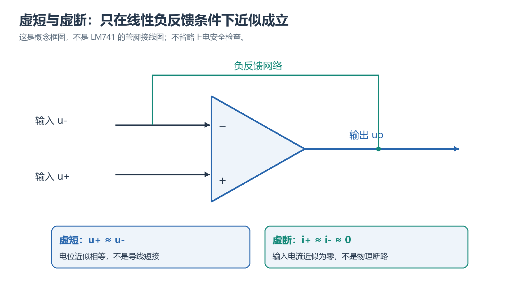
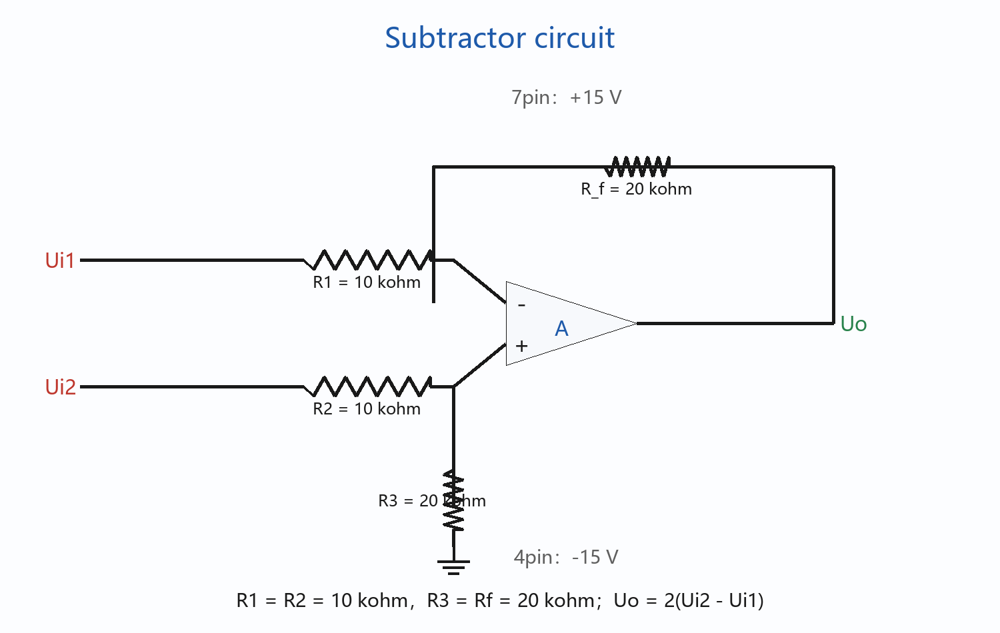
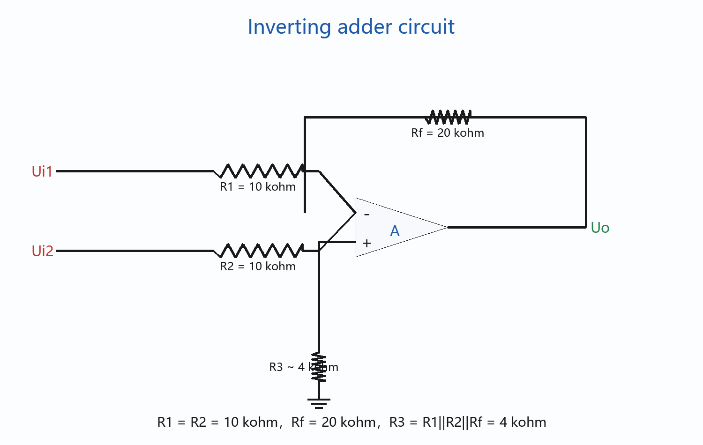
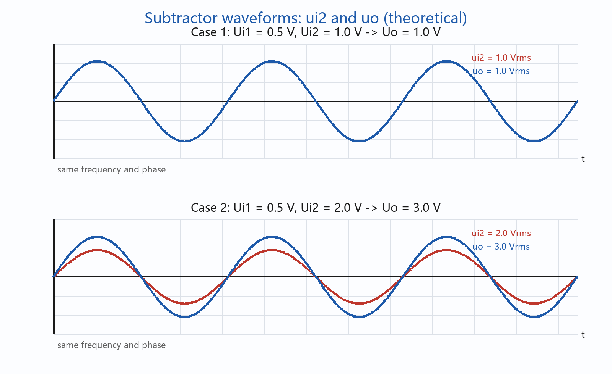
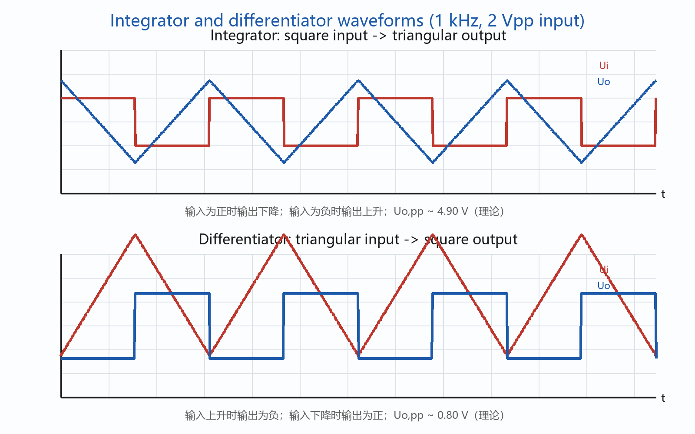
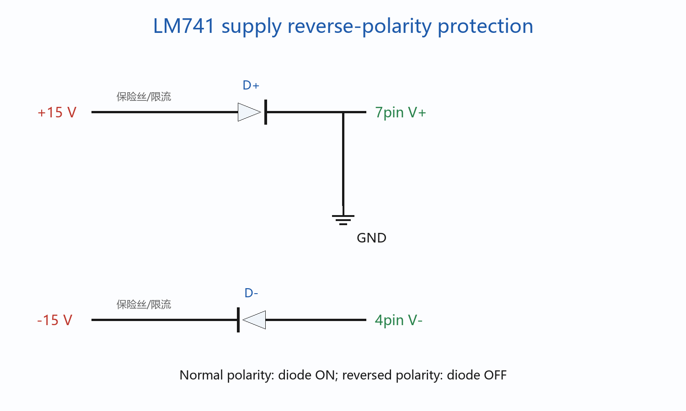
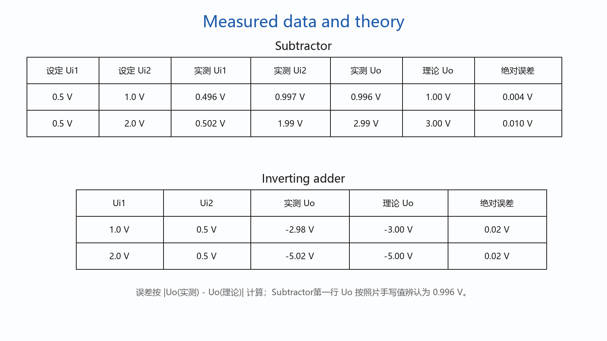
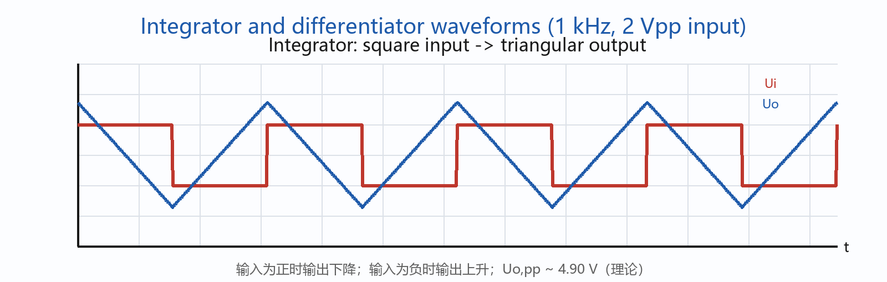
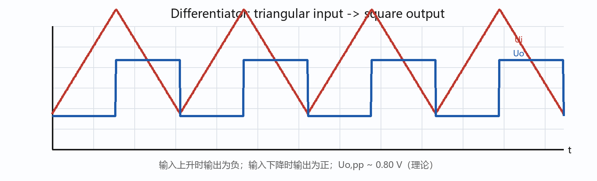

# 实验六：集成运算放大器应用实验报告指南

## 本篇要学什么

用理想运放近似和实际限制分析减法器、反相加法器、积分器和微分器，并把波形现象写成可核查的实验结论。

完成本篇后，应能：

- 说清实验对象、输入量、输出量和成立条件；
- 在上电或正式测量前完成接线、量程、方向、零点和安全状态检查；
- 用原始数据完成带单位的计算、作图、拟合或比较，并标记无法从现有材料确认的项目；
- 按“目标—原理—操作—数据—处理—误差—结论”的顺序写出可复核报告。

## 本篇学习地图

**贯穿问题：** 用理想运放近似和实际限制分析减法器、反相加法器、积分器和微分器，并把波形现象写成可核查的实验结论。

**路线：** 虚短虚断、四类电路、逐线接线、上电检查、波形/数据记录、故障排查和报告边界。

| 阶段 | 读者要完成的任务 | 输出证据 |
|---|---|---|
| 理解 | 找出模型、变量和适用条件 | 一段自己的原理解释 |
| 操作 | 复位、接线/调节、检查判据 | 接线或调节记录 |
| 测量 | 记录原始读数和实验条件 | 完整数据表 |
| 处理 | 展开公式、单位、作图或拟合 | 可复算结果 |
| 报告 | 解释现象、误差和局限 | 有边界的结论 |

## 一、实验问题、原理与准备

### 本章路线

先明确实验要回答的物理或电路问题，再把关键量、适用条件和判据连成一条测量链。用理想运放近似和实际限制分析减法器、反相加法器、积分器和微分器，并把波形现象写成可核查的实验结论。

**本章要解决的问题：** 如何把本章的实验目标、关键变量和判据连成一条可执行、可复核的测量链。

**本章学完应会：** 能说明原理和适用条件，按顺序完成操作与记录，并用数据、单位和误差机制支持报告结论。

### 学习单元

#### 一、实验信息

本实验围绕集成运算放大器的闭环应用展开。正式接线前先确认芯片型号、供电极性、公共地和反馈路径，再按“理论传递式—实测波形—误差原因”组织报告。

#### 二、实验目的

1. 掌握集成运算放大器的基本运算功能及其正确使用方法。
2. 掌握集成运算放大器常用单元电路的设计和调试方法。
3. 熟悉示波器、信号发生器和台式万用表的使用方法。

#### 三、实验设备与元器件

| 名称               | 型号或规格                      |    数量 |
| ------------------ | ------------------------------- | ------: |
| 直流稳压电源       | DP832A                          |    1 台 |
| 信号发生器         | DG4062                          |    1 台 |
| 示波器             | TEK MSO 2012B                   |    1 台 |
| 集成运算放大器     | LM741 或 μA741                 |    1 块 |
| 电阻               | 100 Ω、10 kΩ、20 kΩ、100 kΩ |    若干 |
| 电容               | 0.1 μF、0.01 μF               | 各 1 只 |
| 短接桥和连接导线   | P8-1 和 50148                   |    若干 |
| 实验用九孔插件方板 | 300 mm × 298 mm                |    1 块 |

LM741 的 2 脚为反相输入端，3 脚为同相输入端，6 脚为输出端，7 脚接 +15 V，4 脚接 -15 V，1、5 脚为调零端，8 脚为空脚。

#### 四、实验原理与电路设计

##### 4.1 理想运放的线性分析依据

运放在线性负反馈区工作时，可近似认为：

- 虚短：$u_+ \approx u_-$；
- 虚断：$i_+ \approx i_- \approx 0$；
- 同相端接地时，反相端电位近似为 0，即“虚地”。

<!-- study-note-illustration:2026-10-04:opamp-negative-feedback -->

**读图提示：**先沿反馈路径确认输出反馈到反相端，再把“虚短”理解为输入电位近似相等、“虚断”理解为输入电流近似为零。只有在线性负反馈区才可使用这些近似；这不是 LM741 管脚接线图。

来源：依据本篇笔记相邻段落自绘的教学示意；不是教材原图或实测记录。

<!-- /study-note-illustration -->

##### 4.2 减法器

指导书要求设计：

$$
\nu_o=2(u_{i2}-u_{i1}),\qquad R_f=20\text{ kΩ}
$$

图 6-4 所示减法器的一般表达式为：

$$
\nu_o=\left(1+\frac{R_f}{R_1}\right)\frac{R_3}{R_2+R_3}u_{i2}-\frac{R_f}{R_1}u_{i1}
$$

当 $R_1=R_2$ 且 $R_f=R_3$ 时：

$$
\nu_o=\frac{R_f}{R_1}(u_{i2}-u_{i1})
$$

因此选择 $R_1=R_2=10$ kΩ、$R_3=R_f=20$ kΩ，即可得到目标关系。

##### 小练习：4.2 减法器

**题目：** 反相运放增益

**解析：** $R_{in}=10\,\mathrm{k\Omega}$、$R_f=100\,\mathrm{k\Omega}$ 时，理想反相放大器 $A_v=-R_f/R_{in}=-10$；若输出达到电源轨，应优先检查饱和而不是继续套公式。

##### 4.3 反相加法器

指导书要求设计：

$$
\nu_o=-2(u_{i1}+u_{i2}),\qquad R_f=20\text{ kΩ}
$$

反相加法器的输出为：

$$
\nu_o=-\left(\frac{R_f}{R_1}u_{i1}+\frac{R_f}{R_2}u_{i2}\right)
$$

选择 $R_1=R_2=10$ kΩ、$R_f=20$ kΩ，可得到每路增益均为 -2。同相端通过偏置补偿电阻 $R_3$ 接地；若进行输入偏置电流补偿，理论推荐值为：

$$
R_3=R_1\parallel R_2\parallel R_f=4\text{ kΩ}
$$

可用两个 10 kΩ 和一个 20 kΩ 电阻并联得到 4 kΩ。若实验板接线空间有限，可按教师要求采用最接近的组合值；理想运放条件下，$R_3$ 不影响上述加法关系。

##### 小练习：4.3 反相加法器

**题目：** 反相运放增益

**解析：** $R_{in}=10\,\mathrm{k\Omega}$、$R_f=100\,\mathrm{k\Omega}$ 时，理想反相放大器 $A_v=-R_f/R_{in}=-10$；若输出达到电源轨，应优先检查饱和而不是继续套公式。

##### 4.4 实际积分器

图 6-7 中，$R_1=10$ kΩ，$R_2=10$ kΩ，$R_f=100$ kΩ，$C=0.01$ μF。反馈电容上并联 $R_f$，可限制低频增益并减轻输出饱和。

反馈阻抗和传递函数分别为：

$$
Z_f=\frac{R_f}{1+sR_fC}
$$

$$
\frac{U_o(s)}{U_i(s)}=-\frac{R_f/R_1}{1+sR_fC}
$$

对应的时域关系为：

$$
\nu_o+R_fC\frac{du_o}{dt}=-\frac{R_f}{R_1}u_i
$$

当 $2\pi fR_fC\gg1$ 时，可近似为：

$$
\nu_o(t)\approx-\frac{1}{R_1C}\int u_i(t)dt
$$

本实验中 $R_fC=1$ ms，输入频率为 1 kHz，所以 $2\pi fR_fC\approx6.28$，电路可近似完成积分。对于峰峰值 2 V、占空比 50% 的对称方波，理想积分近似给出输出峰峰值：

$$
U_{o,pp}\approx\frac{U_{i,pp}}{4fR_1C}=5.00\text{ V}
$$

考虑并联电阻后的稳态理论值为：

$$
U_{o,pp}=2\frac{R_f}{R_1}\frac{U_{i,pp}}{2}\tanh\left(\frac{1}{4fR_fC}\right)\approx4.90\text{ V}
$$

因此理论上应观察到同频率、约 4.90 V 峰峰值的近似三角波；该值是理论预测，不是实测数据。

##### 小练习：4.4 实际积分器

**题目：** 理想积分器输出

**解析：** 反相积分器满足 $u_o(t)=-[1/(RC)]\int u_i(t)\,dt$。若输入为正的恒定电压，输出应为负斜率直线，实际电路还要检查饱和和低频漂移。

##### 4.5 实际微分器

图 6-8 中，输入端串联 $R_1=100$ Ω 和 $C=0.01$ μF，$R_2=10$ kΩ，反馈电阻 $R_f=10$ kΩ。串联小电阻用于限制高频增益。

传递函数及对应时域关系为：

$$
\frac{U_o(s)}{U_i(s)}=-\frac{R_fsC}{1+sR_1C}
$$

$$
\nu_o+R_1C\frac{du_o}{dt}=-R_fC\frac{du_i}{dt}
$$

当 $2\pi fR_1C\ll1$ 时，可近似为：

$$
\nu_o(t)\approx-R_fC\frac{du_i(t)}{dt}
$$

本实验中 $2\pi fR_1C\approx0.00628$，近似条件成立。峰峰值 2 V、频率 1 kHz 的对称三角波斜率大小为：

$$
\left|\frac{du_i}{dt}\right|=2fU_{i,pp}=4000\text{ V/s}
$$

所以输出幅值约为：

$$
U_{o,p}=R_fC\left|\frac{du_i}{dt}\right|=0.40\text{ V}
$$

理论输出为同频率、峰峰值约 0.80 V 的近似方波，其极性与输入斜率相反。该值同样是理论预测。

##### 小练习：4.5 实际微分器

**题目：** 理想微分器输出

**解析：** 反相微分器满足 $u_o(t)=-RC\,du_i/dt$；输入正弦波时输出与输入相差约 $90^\circ$，幅值随频率增大。

#### 十、在线课堂第 1—12 步参考答案

> 说明：以下答案按现有《实验6 电路与电子技术实验指导书》、数据记录表和截图中的题干整理。第 2 步的题干未出现在所提供截图中，现有资料也没有足够信息可靠还原，因此暂不臆写；其余截图中出现的题目均已给出可直接整理到在线课堂的答案。第 3—5、11 步涉及电路图或波形，需按下面的连接关系和波形说明在坐标纸上绘制，不能把示波器照片当作规范作图。

##### 第 1 步：简述实验目的

1. 掌握集成运算放大器的基本工作原理、引脚识别、供电和正确接线方法。
2. 掌握减法器、反相加法器、积分器和微分器等典型运算电路的组成、计算、调试及测量方法。
3. 通过测量输入、输出电压和波形，验证运算放大器在负反馈条件下的运算关系，比较理论值与实测值并分析误差。
4. 熟悉函数信号发生器、示波器、直流稳压电源和台式万用表的基本使用方法。

##### 第 2 步：题干待补

所提供的 11 张截图中没有第 2 步的题目，当前实验资料也不能可靠确定题干。请不要根据猜测填写；补充第 2 步截图后再按题目作答。

##### 第 3 步：减法器电路、参数计算和波形

采用差动减法器，LM741 的 2 脚为反相输入端，3 脚为同相输入端，6 脚为输出端，7 脚接 +15 V，4 脚接 -15 V。

理想运放条件下：

$$
\nu_o=\left(1+\frac{R_f}{R_1}\right)\frac{R_3}{R_2+R_3}u_{i2}-\frac{R_f}{R_1}u_{i1}
$$

取 $R_1=R_2=10$ kΩ、$R_3=R_f=20$ kΩ，有：

$$
\nu_o=2(u_{i2}-u_{i1})
$$

本实验两组理论值为：

- 当 $U_{i1}=0.5$ V、$U_{i2}=1.0$ V，且两路正弦信号同频同相时，$U_o=2(1.0-0.5)=1.0$ V；$u_o$ 与 $u_{i2}$ 同相。
- 当 $U_{i1}=0.5$ V、$U_{i2}=2.0$ V，且两路正弦信号同频同相时，$U_o=2(2.0-0.5)=3.0$ V；$u_o$ 与 $u_{i2}$ 同相。

上图已将两组条件下的 $u_{i2}$ 与 $u_o$ 绘制在同一坐标系中，标出同频、同相关系及相对幅值。

##### 小练习：第 3 步：减法器电路、参数计算和波形

**题目：** 反相运放增益

**解析：** $R_{in}=10\,\mathrm{k\Omega}$、$R_f=100\,\mathrm{k\Omega}$ 时，理想反相放大器 $A_v=-R_f/R_{in}=-10$；若输出达到电源轨，应优先检查饱和而不是继续套公式。

##### 第 4 步：加法器电路和参数计算

采用反相加法器：

由虚地和节点电流定律：

$$
\frac{u_{i1}}{R_1}+\frac{u_{i2}}{R_2}+\frac{u_o}{R_f}=0
$$

所以：

$$
\nu_o=-\left(\frac{R_f}{R_1}u_{i1}+\frac{R_f}{R_2}u_{i2}\right)
$$

为实现 $u_o=-2(u_{i1}+u_{i2})$，取：

$$
R_1=R_2=10\text{ kΩ},\qquad R_f=20\text{ kΩ}
$$

同相端的偏置补偿电阻可取：

$$
R_3=R_1\parallel R_2\parallel R_f=10\parallel10\parallel20=4\text{ kΩ}
$$

代入数据记录表：

- $u_{i1}=1.0$ V、$u_{i2}=0.5$ V：$u_o=-2(1.0+0.5)=-3.0$ V。
- $u_{i1}=2.0$ V、$u_{i2}=0.5$ V：$u_o=-2(2.0+0.5)=-5.0$ V。

输出为负电压，实际测量应使用万用表直流电压档，并以公共地为参考。

##### 小练习：第 4 步：加法器电路和参数计算

**题目：** 反相运放增益

**解析：** $R_{in}=10\,\mathrm{k\Omega}$、$R_f=100\,\mathrm{k\Omega}$ 时，理想反相放大器 $A_v=-R_f/R_{in}=-10$；若输出达到电源轨，应优先检查饱和而不是继续套公式。

##### 第 5 步：积分电路和微分电路的输入、输出波形

###### 5.1 实际积分器

输入端为 1 kHz、2 V 峰峰值、占空比 50% 的对称方波；电路参数为 $R_1=10$ kΩ、$R_f=100$ kΩ、$C=0.01$ μF。传递关系近似为：

$$
\nu_o(t)\approx-\frac{1}{R_1C}\int u_i(t)\,dt
$$

理论输出是同频率的近似三角波，稳态峰峰值约为 4.90 V。输入为正电平时，输出按负斜率下降；输入为负电平时，输出按正斜率上升。可在同一坐标系中按下面的相位关系绘制：

图中应标出 $U_{i,pp}=2.00$ V、$U_{o,pp}\approx4.90$ V 和 $f=1$ kHz。输出三角波的直流中心和实际峰值以示波器实测为准。

##### 小练习：1 实际积分器（练习与解析）

###### 5.2 实际微分器

输入端为 1 kHz、2 V 峰峰值的对称三角波；输入端串联 $R_1=100$ Ω 和 $C=0.01$ μF，反馈电阻 $R_f=10$ kΩ。传递关系近似为：

$$
\nu_o(t)\approx-R_fC\frac{du_i(t)}{dt}
$$

理论输出是同频率的近似方波，峰峰值约为 0.80 V。输入三角波上升时斜率为正，输出为负电平；输入三角波下降时斜率为负，输出为正电平：

图中应标出 $U_{i,pp}=2.00$ V、$U_{o,pp}\approx0.80$ V 和 $f=1$ kHz；实际过冲、振铃和直流偏置应以示波器观察结果填写。

##### 小练习：2 实际微分器（练习与解析）

##### 小练习：第 5 步：积分电路和微分电路的输入、输出波形

**题目：** 理想积分器输出

**解析：** 反相积分器满足 $u_o(t)=-[1/(RC)]\int u_i(t)\,dt$。若输入为正的恒定电压，输出应为负斜率直线，实际电路还要检查饱和和低频漂移。

##### 第 6 步：相位关系及示波器耦合方式

减法器和加法器本质上都满足线性叠加，输入信号不必在任何情况下都同相。若输入为交流正弦波，相位差会影响矢量和或矢量差的结果；本实验减法器为便于直接验证幅值关系，要求两路输入同频同相。加法器实验中输入为直流电压，没有相位问题。

观察加法器输出时不能用 AC 耦合来测量其直流输出。因为加法器输出理论上为 -3.0 V 或 -5.0 V，AC 耦合会隔直，只能看到交流变化或纹波，无法正确显示直流电平，也不能验证输出极性和理论值。因此应使用 DC 耦合，或用万用表直流电压档测量。

##### 第 7 步：为什么采用 kΩ 级电阻

- 电阻过小：根据 $I=U/R$，电流增大，信号源和运放输出级负载加重，功耗增加，可能超出输出电流能力并引起输出幅度下降、失真或发热。
- 电阻过大：输入偏置电流和输入失调电流在电阻上产生的误差电压增大；热噪声、漏电流、杂散电容和外界干扰的影响也更明显，电路更容易出现漂移和不稳定。
- kΩ 级电阻能在负载、电流、噪声、偏置误差和功耗之间取得合理折中，适合一般运放实验。

##### 第 8 步：实际微分电路中增加小电阻和小电容的原因

1. 电容两端电压不能突变，输入信号发生快速跳变时，若没有串联电阻，电容电流理论上会很大，容易造成输入端冲击、电路阻塞、尖峰和波形失真；串联小电阻可限制瞬态电流。
2. 理想微分器的增益随频率升高而增大，会把高频噪声、尖锐边沿和寄生信号一起放大。
3. 在反馈电阻上并联小电容后，高频时反馈阻抗降低，形成高频负反馈，使高频增益下降，抑制噪声、过冲、振铃和自激振荡。
4. 这两个元件共同限制电路的有效频带，使电路只在所需频段内近似微分，同时改善稳定性；元件参数应保证不明显影响实验规定频率下的微分关系。

##### 小练习：第 8 步：实际微分电路中增加小电阻和小电容的原因

**题目：** 理想微分器输出

**解析：** 反相微分器满足 $u_o(t)=-RC\,du_i/dt$；输入正弦波时输出与输入相差约 $90^\circ$，幅值随频率增大。

##### 第 9 步：为什么不用单独的电阻、电容构成积分器

电阻和电容组成的无源 RC 网络只能在一定频率范围内近似积分，而且存在明显的信号衰减；其传递函数还会受信号源内阻、后级负载和元件误差影响，积分比例不易精确控制。加入运算放大器后，可以利用高输入电阻减小对信号源的负载，利用低输出电阻提高带负载能力，并利用负反馈使积分关系主要由 $R$、$C$ 的比值决定，便于调节、测量和级联。此外，实际积分器并联反馈电阻后还能限制低频增益，减少输出漂移和饱和。

##### 小练习：第 9 步：为什么不用单独的电阻、电容构成积分器

**题目：** 理想积分器输出

**解析：** 反相积分器满足 $u_o(t)=-[1/(RC)]\int u_i(t)\,dt$。若输入为正的恒定电压，输出应为负斜率直线，实际电路还要检查饱和和低频漂移。

##### 第 10 步：反相、同相比例放大器的输入电阻和输出电阻

- 反相比例放大器：输入信号经输入电阻接到反相端，因输入端近似虚地，信号源看到的输入电阻约为 $R_1$，通常为中等阻值；输出电阻因电压负反馈而较低。
- 同相比例放大器：信号直接加到同相端，运放输入端几乎不取电流，所以输入电阻很高；输出电阻同样因电压负反馈而降低。

以反相放大器为例，输出电压的一部分经 $R_f$ 反馈到反相端。若输出增大，反馈电压使反相端电位增大，从而减小差模输入电压，抑制输出继续增大。这种负反馈使闭环增益由外接电阻决定、提高了电路稳定性并降低了输出电阻；但反相端的输入电流仍须经过 $R_1$，所以反相输入电阻不会像同相放大器那样很高。

##### 第 11 步：防止正、负电源极性接反的保护电路

可在正、负电源线上分别串联反接保护二极管，并在上电前复核极性。二极管方向如下：正电源支路由电源流向 LM741 的 7 脚；负电源支路由 LM741 的 4 脚流向负电源。必要时在二极管前串联保险丝或限流电阻。

正常供电时两只二极管均正向导通；电源极性接反时二极管截止，切断反向电流，避免集成运放内部结被反向击穿。二极管的允许电流和正向压降应按实验室元件及电源要求确认；保护电路不能代替断电接线和上电前检查。

若实验室采用并联钳位式保护，也可在 7 脚与公共地之间接 D+（阳极接公共地、阴极接 7 脚），在 4 脚与公共地之间接 D−（阳极接 4 脚、阴极接公共地），并在电源侧配合保险丝或限流电阻；正常极性时二极管截止，反接时将错误电压钳位在约一个二极管压降范围内。

##### 第 12 步：输出电压接近电源电压的原因

可能原因包括：

1. 负反馈电阻未接、接触不良、接错节点，或误接成了正反馈，导致运放失去线性闭环工作条件。
2. 输入信号幅值或直流偏置过大，按理论增益计算后的输出超过运放允许的输出摆幅，发生饱和。
3. 正、负电源接反、电源电压不足、公共地未接通，或 4 脚、7 脚的供电不正确。
4. 输入电阻、反馈电阻或同相端电阻的阻值选错，导致实际闭环增益与理论值不符。
5. 输入端悬空、信号源输出未共地、波形/频率/偏置设置错误，或者示波器地夹接线不正确。
6. 输出端短路、负载过重，或输出同时连接了不合适的仪器端接，导致输出级限流和失真。
7. 运算放大器插反、引脚识别错误、芯片损坏，或电路存在虚焊、断线。

排查时应立即减小输入并关闭电源，按“供电和公共地—芯片引脚—负反馈回路—电阻参数—输入设置—输出负载”的顺序逐项检查，禁止带电盲目拔插导线。

### 本章小结

实验对象、模型、变量、仪器和安全边界已经能够用自己的话说明；正式操作前应先做条件检查。

### 本章练习与检验

不看原文，写出一个输入量、一个输出量和一个关键适用条件，并说明若条件不满足会出现什么现象。

## 二、实验操作、数据与处理

### 本章路线

按“复位与检查—接线/调节—正式测量—原始记录—现场复核”的顺序执行；所有现场读数、缺测和异常都保留在原始记录中，不用理论值替代。

**本章要解决的问题：** 如何把本章的实验目标、关键变量和判据连成一条可执行、可复核的测量链。

**本章学完应会：** 能说明原理和适用条件，按顺序完成操作与记录，并用数据、单位和误差机制支持报告结论。

### 学习单元

#### 五、接线、上电与检查

##### 5.1 接线前状态和通用顺序

1. 关闭直流稳压电源各通道输出和信号发生器输出，禁止带电接线、换线或换元件。
2. 以芯片半圆形缺口为基准识别 LM741 引脚，不凭插孔左右位置猜测。
3. 先搭建信号通路和负反馈回路，再接公共地，最后接电源线。
4. 信号源、示波器、万用表和实验电路使用同一公共参考地。
5. 复核 7 脚接 +15 V、4 脚接 -15 V，确认输出端无短路后再开启电源。
6. 先开启直流电源，再开启信号源输出；从较小输入幅度开始，确认输出正常后调到规定值。

##### 5.2 逐线端口映射

| 电路       | 输入端连接                                         | 反馈及同相端连接                                                       | 测量连接                                             |
| ---------- | -------------------------------------------------- | ---------------------------------------------------------------------- | ---------------------------------------------------- |
| 减法器     | ui1 经 R1=10 kΩ 接 2 脚；ui2 经 R2=10 kΩ 接 3 脚 | Rf=20 kΩ 从 6 脚回接 2 脚；R3=20 kΩ 从 3 脚接公共地                  | 台式万用表 AC 档测 ui1；示波器 CH1 测 ui2，CH2 测 uo |
| 反相加法器 | ui1、ui2 分别经 R1=10 kΩ、R2=10 kΩ 接 2 脚       | Rf=20 kΩ 从 6 脚回接 2 脚；3 脚经 R3 接公共地                         | 台式万用表 DC 档测 6 脚对地电压 uo                   |
| 积分器     | 方波 ui 经 R1=10 kΩ 接 2 脚                       | Rf=100 kΩ 与 C=0.01 μF 并联在 6 脚和 2 脚之间；3 脚经 R2=10 kΩ 接地 | 示波器两通道分别测 ui、uo，地夹均接公共地            |
| 微分器     | 三角波 ui 依次经 R1=100 Ω、C=0.01 μF 接 2 脚     | Rf=10 kΩ 从 6 脚回接 2 脚；3 脚经 R2=10 kΩ 接地                      | 示波器两通道分别测 ui、uo，地夹均接公共地            |

##### 5.3 成功判据和故障排查

- 减法器、加法器输出应接近理论值，且没有削顶或贴近电源轨。
- 积分器应把方波变为近似三角波；微分器应把三角波变为近似方波。
- 若无输出，优先检查信号源输出是否开启、公共地是否连通以及 4、7 脚供电。
- 若输出接近 ±15 V，立即断电，检查负反馈线、电阻值、输入幅度、电源极性和输出短路。
- 若波形噪声大或抖动，检查共地、导线接触、探头衰减倍率、通道耦合和示波器量程。
- 若芯片异常发热，立即断电，不得继续通电试错。

#### 六、实验步骤与数据记录

##### 6.1 减法器

1. 按 4.2 节参数搭建电路，断电复核后接通 ±15 V 电源。
2. 两路输入均设为 1 kHz 正弦波，并保持同频、同相。
3. 按表 1 设置输入有效值，分别测量实际 $U_{i1}$、$U_{i2}$ 和 $U_o$。
4. 保存 $u_{i2}$ 与 $u_o$ 波形，记录相位关系、削顶和失真情况。

图中分别给出两组输入条件下的 $u_{i2}$ 与 $u_o$ 同频、同相正弦波。

**表 1 减法器数据记录**

| 设定 Ui1 有效值 | 设定 Ui2 有效值 | 测量 Ui1 | 测量 Ui2 | Uo 测量 | Uo 理论 | Uo 绝对误差 |
| --------------: | --------------: | -------: | -------: | ------: | ------: | ----------: |
|           0.5 V |           1.0 V |  0.496 V |  0.997 V | 0.996 V |   1.0 V |     0.004 V |
|           0.5 V |           2.0 V |  0.502 V |   1.99 V |  2.99 V |   3.0 V |     0.010 V |

理论计算：

$$
U_{o1}=2(1.0-0.5)=1.0\text{ V}
$$

$$
U_{o2}=2(2.0-0.5)=3.0\text{ V}
$$

绝对误差按 $\Delta U_o=U_{o,测量}-U_{o,理论}$ 计算；如课程要求“绝对误差”为非负量，则填写 $|\Delta U_o|$。

##### 小练习：6.1 减法器

**题目：** 反相运放增益

**解析：** $R_{in}=10\,\mathrm{k\Omega}$、$R_f=100\,\mathrm{k\Omega}$ 时，理想反相放大器 $A_v=-R_f/R_{in}=-10$；若输出达到电源轨，应优先检查饱和而不是继续套公式。

##### 6.2 反相加法器

1. 按 4.3 节参数搭建电路，同相端通过 $R_3$ 接地。
2. 函数发生器选择 Arb，按表 2 设置直流输入。
3. 用台式万用表直流电压档测量输出。负号表示输出相对公共地为负电压。

**表 2 反相加法器数据记录**

|   Ui1 |   Ui2 | Uo 测量 | Uo 理论 | Uo 绝对误差 |
| ----: | ----: | ------: | ------: | ----------: |
| 1.0 V | 0.5 V | -2.98 V |  -3.0 V |      0.02 V |
| 2.0 V | 0.5 V | -5.02 V |  -5.0 V |      0.02 V |

理论计算：

$$
U_{o1}=-2(1.0+0.5)=-3.0\text{ V}
$$

$$
U_{o2}=-2(2.0+0.5)=-5.0\text{ V}
$$

##### 小练习：6.2 反相加法器

**题目：** 反相运放增益

**解析：** $R_{in}=10\,\mathrm{k\Omega}$、$R_f=100\,\mathrm{k\Omega}$ 时，理想反相放大器 $A_v=-R_f/R_{in}=-10$；若输出达到电源轨，应优先检查饱和而不是继续套公式。

##### 6.3 积分电路

1. 按图 6-7 和 4.4 节参数接线。
2. 信号发生器输出 1 kHz、2 V 峰峰值、占空比 50% 的方波。
3. 接通 ±15 V 电源，用示波器同时观察输入和输出。
4. 记录幅值、频率、波形、直流偏置和是否饱和，并保存波形照片。

**表 3 积分器波形记录**

| 项目       | 输入 ui | 输出 uo                   |
| ---------- | ------- | ------------------------- |
| 波形       | 方波    | 待实测；理论为近似三角波  |
| 频率       | 1 kHz   | 待实测；理论为 1 kHz      |
| 峰峰值     | 2.00 V  | 待实测；稳态理论约 4.90 V |
| 直流偏置   | 待实测  | 待实测                    |
| 饱和或失真 | 待观察  | 待观察                    |

##### 小练习：6.3 积分电路

**题目：** 理想积分器输出

**解析：** 反相积分器满足 $u_o(t)=-[1/(RC)]\int u_i(t)\,dt$。若输入为正的恒定电压，输出应为负斜率直线，实际电路还要检查饱和和低频漂移。

##### 6.4 微分电路

1. 按图 6-8 和 4.5 节参数接线。
2. 信号发生器输出 1 kHz、2 V 峰峰值的对称三角波。
3. 接通 ±15 V 电源，用示波器同时观察输入和输出。
4. 记录幅值、频率、波形、直流偏置、过冲和振铃，并保存波形照片。

**表 4 微分器波形记录**

| 项目       | 输入 ui | 输出 uo                |
| ---------- | ------- | ---------------------- |
| 波形       | 三角波  | 待实测；理论为近似方波 |
| 频率       | 1 kHz   | 待实测；理论为 1 kHz   |
| 峰峰值     | 2.00 V  | 待实测；理论约 0.80 V  |
| 直流偏置   | 待实测  | 待实测                 |
| 过冲或振铃 | 待观察  | 待观察                 |

##### 小练习：6.4 微分电路

**题目：** 理想微分器输出

**解析：** 反相微分器满足 $u_o(t)=-RC\,du_i/dt$；输入正弦波时输出与输入相差约 $90^\circ$，幅值随频率增大。

### 本章小结

每条数据都要同时记录条件、单位和读数位置；计算展示中间量，图表标注坐标、单位和实验条件。

### 本章练习与检验

任选一组真实或待补数据，写出从原始读数到最终结果的计算链，检查量纲、有效数字和异常值处理。

## 三、误差、报告与复习

### 本章路线

把观察、计算、理论比较和误差机制分开写，结论只回答实验目标；报告中的每个数字都应能回到原始记录、公式和单位。

**本章要解决的问题：** 如何把本章的实验目标、关键变量和判据连成一条可执行、可复核的测量链。

**本章学完应会：** 能说明原理和适用条件，按顺序完成操作与记录，并用数据、单位和误差机制支持报告结论。

### 学习单元

#### 七、当前结果与待补内容

##### 7.1 当前可确认的结果

1. 减法器实测数据为：$U_{i1}=0.496$ V、$U_{i2}=0.997$ V、$U_o=0.996$ V；理论值为 1.00 V，绝对误差为 0.004 V。
2. 减法器第二组实测数据为：$U_{i1}=0.502$ V、$U_{i2}=1.99$ V、$U_o=2.99$ V；理论值为 3.00 V，绝对误差为 0.010 V。
3. 反相加法器两组实测输出分别为 -2.98 V 和 -5.02 V；相对理论值 -3.00 V 和 -5.00 V，绝对误差均为 0.02 V。
4. 实际积分器对规定方波的理论输出为同频近似三角波，稳态峰峰值约 4.90 V；实际波形参数仍需以示波器记录为准。
5. 实际微分器对规定三角波的理论输出为同频近似方波，峰峰值约 0.80 V；实际波形参数仍需以示波器记录为准。

##### 7.2 实验后必须补充

1. 表 3、表 4 的实测幅值、频率、偏置和异常现象。
2. 积分器和微分器的示波器波形照片及教师检查结果。
3. 根据实测数据撰写积分器、微分器的结果分析、误差分析和最终实验结论。

本报告没有把积分器、微分器的理论值冒充实测结果；减法器第一行输出 0.996 V 是依据原始照片中的手写值辨认得到的，若原始仪器记录有更清晰数值，应以原始记录为准。

#### 八、思考题

##### 1. 减法器和加法器的输入是否都需要同相位？示波器能否使用相同耦合方式？

减法器本次用两个同频正弦信号验证幅值关系，必须保持同相，否则输出幅值会随相位差变化，不能直接按有效值相减。若加法器处理交流信号并按标量幅值验证加法关系，同样需要规定相位；本实验加法器输入为直流电压，不存在相位问题。

两项实验不宜一概采用相同耦合方式。减法器的纯交流正弦波可用 AC 耦合观察交流分量；加法器输出是直流电压，必须使用 DC 耦合或万用表直流档，否则 AC 耦合会滤除直流分量。

##### 小练习：1. 减法器和加法器的输入是否都需要同相位？示波器能否使用相同耦合方式？

**题目：** 反相运放增益

**解析：** $R_{in}=10\,\mathrm{k\Omega}$、$R_f=100\,\mathrm{k\Omega}$ 时，理想反相放大器 $A_v=-R_f/R_{in}=-10$；若输出达到电源轨，应优先检查饱和而不是继续套公式。

##### 2. 为什么使用 kΩ 级电阻？

电阻过小会增大输入电流和输出电流，加重信号源与运放的负载，增加功耗并可能使输出限流；电阻过大则使输入偏置电流和漏电流造成的误差增大，同时更容易受到热噪声、杂散电容和外界干扰影响。kΩ 级电阻能在负载能力、误差和噪声之间取得较合理的折中。

##### 3. 实际微分器为什么还要在反馈电阻上并联小电容？

理想微分器的增益随频率升高而增加，会显著放大高频噪声和输入边沿中的尖峰，也容易因运放相移和寄生参数产生自激。输入串联小电阻可限制最高频段的增益；反馈电阻并联小电容后，其高频阻抗下降，可进一步衰减高频分量，减小过冲和振铃，提高稳定性。设计时应保证新增极点不会破坏需要保留的微分频段。

##### 小练习：3. 实际微分器为什么还要在反馈电阻上并联小电容？

**题目：** 理想微分器输出

**解析：** 反相微分器满足 $u_o(t)=-RC\,du_i/dt$；输入正弦波时输出与输入相差约 $90^\circ$，幅值随频率增大。

##### 4. 为什么不只用电阻和电容构成积分器？

无源 RC 电路只有在特定频率范围内近似积分，并会衰减信号；其响应还会受信号源内阻和后级负载影响。运放积分器利用高输入阻抗、低输出阻抗和负反馈隔离前后级，并能通过电阻、电容比值获得较明确的比例关系，便于级联和调节。

##### 小练习：4. 为什么不只用电阻和电容构成积分器？

**题目：** 理想积分器输出

**解析：** 反相积分器满足 $u_o(t)=-[1/(RC)]\int u_i(t)\,dt$。若输入为正的恒定电压，输出应为负斜率直线，实际电路还要检查饱和和低频漂移。

##### 5. 反相与同相比例放大器的输入、输出电阻有何特点？

反相比例放大器的输入电阻主要由输入电阻决定；同相比例放大器直接从运放同相端输入，输入电阻很高。两类电路的输出电阻都因电压负反馈而降低。负反馈使输出变化反向作用于输入差模电压，从而稳定闭环增益、提高输入电阻或形成确定的输入电阻，并降低输出电阻。

##### 6. 如何防止正、负电源极性接反？

可在两条电源线上各串联一只二极管，使正确极性时二极管正向导通，接反时截止。负电源支路二极管方向应与正电源支路相反：

实际选型还需校核二极管的允许电流和正向压降，并按实验室要求连接。保护电路不能替代上电前的极性检查。

##### 7. 输出接近电源电压可能由哪些原因造成？

可能原因包括：负反馈回路开路或接错；输入幅度过大导致饱和；正、负电源或公共地接错；电阻阻值或插孔接错；输入端悬空；输出端短路或负载过重；信号源偏置、波形或端接设置错误；运放芯片损坏。应立即断电，从供电、共地、反馈回路和元件值开始逐项检查。

#### 九、安全与收尾

- LM741 使用对称 ±15 V 电源，严禁电源反接和输出端短路。
- 更换电路、导线或元件前必须断开电源，禁止带电操作。
- 手不要直接触碰芯片管脚，以减少静电损伤风险。
- 发现波形异常、异常声音或芯片发热时立即断电检查。
- 实验结束后关闭电源和信号源，拆线、整理实验台并归还器材。

#### 综合题与解析

##### 小练习：1

**题目：** 电子荷质比

**解析：** 加速电压 U=200 V、电子轨道半径 r=0.05 m、磁感应强度 B=1.0×10⁻³ T，按 e/m=2U/(r²B²) 计算。

##### 小练习：2

**题目：** 分光计

**解析：** 光栅常数 d=1/300 mm，一级衍射角 ψ=10°，用 λ=d sinψ/k 求波长。

##### 小练习：3

**题目：** 单管放大

**解析：** 输入 Ui=20 mV，输出有效值 Uo=1.0 V，求电压增益；若输出顶部削平，优先检查什么？

#### 六、练习提示与常见问题

- 先写对象、已知条件和求解目标，再选择公式、规则或操作。
- 任何结论都要检查适用条件；资料缺页、版本变化、现场读数或官方规则不明确时标记“待核实”。
- 不要把一次计算、一次波形或一个网页提示直接当作充分证据。

#### 七、隔日复习与自测

##### 换一组条件再判断（20分钟）

改变本篇核心题目的一个关键条件，重新判断方法、结果和边界，并记录哪些结论依赖模型条件。

##### 闭卷解释关键问题（20分钟）

1. 本篇的核心对象、输入和输出分别是什么？
2. 哪个条件一旦改变，原方法最先失效？
3. 如何用独立计算、图表、实验记录或官方资料检查结果？

##### 周末/阶段复盘（15分钟）

闭卷画出本篇学习地图，重做下面两道题，只看题源不看解析；最后列出一个仍需查阅的问题。

#### 八、学习安排与阅读资料

##### 阅读资料

- 实验六指导书。
- 当前项目原始 PDF、课程讲义、实验指导书或官方资料。

##### 细节查阅

争议内容优先回到题源原文核对条件、符号、版本和题图，不用记忆补齐缺失信息。

#### 九、自测参考答案

##### 题目一

比较系统误差、随机误差和操作失误的影响路径，每个原因对应可执行验证动作。

#### 深度题源检验

> 题源：实验六指导书（按项目原始资料和课程题意整理）

**题目一：** 围绕“用反馈和理想模型解释运放电路并审查饱和边界”设计完整核验任务：写出输入条件、控制变量、步骤、成功判据和异常分支。

**解析：** 从原理或反馈模型确定变量，再把操作连接到读数或波形；无现场数据时标记待测。

**题目二：** undefined

**解析：** undefined

<!-- study-notes-v2-rebuilt:2026-10-07 -->

### 本章小结

结论区分观察、测量结果、理论比较与误差机制；缺少原始证据的地方写“待补/待确认”，不填猜测。

### 本章练习与检验

给出一个具体异常现象，按“现象—优先检查项—修正动作—重新判据”写出排查记录，并说明它是否足以改变结论。

## 四、练习提示与常见问题

- 先回答“测什么、凭什么、怎么判定成功”，再填写公式和步骤。
- 原始数据、处理数据和理论参考值分栏保存；不要把处理结果覆盖原始记录。
- 报告中的“误差”要写出影响路径，例如读数偏大如何传递到最终量，而不是只列“人为误差、仪器误差”。
- 涉及高压、大电流、强光、加热或极性风险时，按实验室规程执行并在教师检查后启动。

## 五、隔日复习与自测

### 换一组条件再判断（20 分钟）

改变一个控制量，预测曲线、波形、峰谷或读数如何变化，并写出预测依据。

### 闭卷解释关键问题（20 分钟）

不用看稿，依次说明实验目标、核心公式、成功判据、一个异常和一个误差传递路径。

### 周末复盘（15 分钟）

对照原始数据检查：是否有单位、条件、有效数字、缺测说明、图表标题、结论证据和待确认项。

## 六、学习安排与阅读资料

1. 先读“实验问题、原理与准备”，能口头解释后再看操作。
2. 实验台上只依据经核对的指导书和教师规程设置危险参数。
3. 细节查阅优先回到本实验的指导书、原始数据页和仪器面板；本指南不代填现场读数。

## 七、自测参考答案

- 实验主线的答案必须包含对象、变量、条件和判据，不能只写结论。
- 数据题的答案必须能由原始读数、公式、单位和有效数字复算。
- 异常题的答案必须说明现象与修正动作之间的因果关系；若缺少现场证据，应保留为待确认。

## 八、报告提交前核对

- [ ] 实验目的与结论一一对应。
- [ ] 原理公式的符号、单位和适用条件已解释。
- [ ] 接线、量程、方向、零点或调节状态已记录。
- [ ] 原始数据未被覆盖，图表有标题、坐标、单位和条件。
- [ ] 计算展示关键中间量，结果使用合理有效数字。
- [ ] 误差写出具体机制和影响路径，未把猜测写成实测事实。
- [ ] 缺测、异常和待教师确认项目已明确标注。

